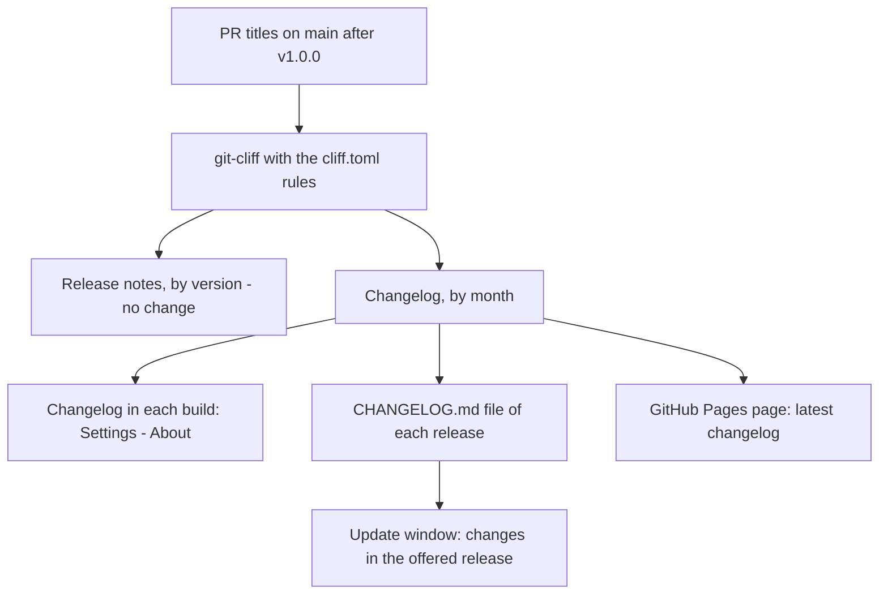

# Monthly Changelog - Plan

## Goal Capsule

- **Objective:** Users and readers of the repository can see what changed in Longhand, month by month, in the app and on the web, and nobody must do a step to keep that record correct.
- **Product authority:** This Product Contract. The release flow in `docs/releases.md` and the git-cliff rules in `cliff.toml` stay the authority for which commits make a release and how a commit shows as a line.
- **Open blockers:** None.

---

## Product Contract

### Summary

Each release generates a changelog from the PR titles on `main` after the v1.0.0 tag, grouped by calendar month, with git-cliff and the same rules that write the release notes. Nothing is committed. Each build contains the changelog: Settings > About shows the recent months, and the update window shows what the offered release adds. The full changelog is on a GitHub Pages page and is a file of each release.

### Problem Frame

Longhand makes a release for each merged PR, so the version numbers change often and tell users little. The only record of changes today is the GitHub Releases page, which has one entry for each version. "What's new" in Settings > About opens that page in the browser. A user who wants to know what changed this month, or what an update gives, must read many release entries.

A changelog file that the PR author or a CI job commits causes other problems. Each merge makes open PRs out of date, two PRs can overwrite each other's lines, a PR cannot know the month in which it will merge, and a CI commit adds one commit for each release.

### Key Decisions

- **Generate from git history; commit nothing.** The squash-merged PR titles on `main` already are the changelog, and the release flow already reads them with git-cliff. This removes the merge-order and end-of-month problems. Governs R1. (session-settled: user-approved — chosen over a CI bot commit after each release and over a script that the PR author runs with a CI check: both add commits or PR steps, and the author script conflicts between PRs)
- **Use git-cliff and the rules in `cliff.toml`.** The changelog and the release notes must agree exactly, not by chance: the same commit filter, the same preprocessing, the same groups and the same line text. Governs R2, R4, R5. (session-settled: user-directed — chosen over a separate generator that copies the rules: a copy can drift from `cliff.toml`)
- **Start after the v1.0.0 tag.** The commits before 1.0.0 are the preview build-out. Many have no PR, and some refer to PRs of another repository. Governs R1. (session-settled: user-directed — chosen over the full history and over an added hand-written entry for the time before 1.0.0)
- **Group by the month of the commit on `main`, in UTC.** The date of a squash commit is the merge date, so it is known only after the merge and never changes. Governs R3. (session-settled: user-approved — chosen over local time: UTC agrees with CI)
- **Show months, not versions.** The changelog is a record over time. Governs R6.
- **Show the changelog in Settings > About and in the update window.** Governs R10, R13. (session-settled: user-approved — chosen over About only, and over a one-time notice after an update relaunches, which CLAUDE.md does not allow for normal behaviour)
- **Publish the full changelog on GitHub Pages and as a file of each release.** The Pages page always shows the latest changelog at one address. The release file keeps the changelog as it was at that release. Governs R7, R8. (session-settled: user-directed — chosen over only one of the two and over in-app only)

### Requirements

**Generation**

- R1. Each release generates the changelog from the commits on `main` after the v1.0.0 tag. No person and no CI job commits a generated changelog, and a PR needs no changelog step.
- R2. git-cliff generates the changelog with the commit rules in `cliff.toml`. A change to those rules changes the release notes and the changelog together.
- R3. The changelog has one section for each calendar month that has changes, newest month first, with a heading such as "October 2026". The month of a change is the month of its commit date on `main`, in UTC.
- R4. In a month, the changes show under the headings of the release notes, in the same order: New features and improvements, Fixes, Other changes. A heading with no changes does not show. The commit types that show, and the text of each line, are the same as in the release notes.
- R5. The release notes of each release do not change: they stay grouped by version.
- R6. The changelog shows no version numbers.

**Links**

- R7. A line whose PR title ends in a PR reference such as `(#72)` links to that PR in `twistymaze/longhand`. In the app, the link opens in the default browser. A line with no PR reference has no link.

**Publication**

- R8. Each release has a `CHANGELOG.md` file that holds the full changelog as of that release.
- R9. A GitHub Pages page shows the full changelog of the latest release at a fixed address. `README.md` and a short `CHANGELOG.md` on `main` link to it. That `CHANGELOG.md` contains no generated changes.

**In the app**

- R10. "What's new" in Settings > About opens a Recent changes view in the app, not the GitHub Releases page.
- R11. Recent changes shows the current month and the 5 months before it, and a link to the full changelog page.
- R12. Each build contains its changelog, so Recent changes needs no network. A local build generates the changelog from its local history. A build that cannot read the history shows only the link to the full changelog.

**Update window**

- R13. When the update window offers a new version, it also lists the changes in the offered release that are not in the running build, grouped as in R3 and R4.
- R14. When the app cannot get that list, the window shows a link to the full changelog in place of the list. Install and Relaunch and Remind Me Later work as before.
- R15. The update window keeps its current text, which names the offered version and the installed version.

### Success Criteria

- A later change to the commit rules in `cliff.toml` (a new type, a new heading, a new preprocessor) changes the release notes and the changelog together, with no change to the changelog generation.
- No PR in a month needs a changelog step or a rebase because of the changelog.

### Key Flows

- F1. A user reads recent changes
  - **Trigger:** The user clicks "What's new" in Settings > About.
  - **Steps:** Recent changes opens and shows the last 6 months from the changelog in the build. The user clicks a line, and the PR opens in the browser. The user clicks the link to the full changelog, and the Pages page opens in the browser.
  - **Covered by:** R7, R10, R11, R12
- F2. A user sees what an update gives
  - **Trigger:** The app offers a new version, automatically or after "Check for Updates…".
  - **Steps:** The update window shows the versions as today, and the changes after the running build, by month. The user installs or chooses Remind Me Later.
  - **Covered by:** R13, R14, R15

### Acceptance Examples

- AE1. **Covers R3.** A PR merges at 23:30 UTC on 31 October 2026, and it shows under October 2026. A PR that merges at 00:10 UTC on 1 November 2026 (31 October in the evening, US time) shows under November 2026.
- AE2. **Covers R2, R4.** A `docs:` or `chore:` commit does not show. A `feat(capture)+:` commit shows like a `feat(capture):` commit under New features and improvements, with the same text as in its release notes.
- AE3. **Covers R1.** A `fix:` PR merges near the end of a month and was not up to date with `main`. No person or check changes a changelog file, and the next release puts the PR in the month of its merge.
- AE4. **Covers R13.** The running build is 1.0.20, and the app offers 1.0.25. The update window lists the changes of 1.0.21 to 1.0.25, and none of the changes that 1.0.20 already contains.
- AE5. **Covers R14.** The app offers a version but cannot get its changes. The window shows the link to the full changelog, and Install and Relaunch works.
- AE6. **Covers R7.** A release-type commit has no `(#NN)` reference. Its line shows with no link.
- AE7. **Covers R12.** A local build made from a checkout with full history shows Recent changes. A build made from a source copy with no git history shows only the link.

### Scope Boundaries

- No changes before the v1.0.0 tag, and no hand-written entry for the preview time.
- No hand-written or edited changelog lines. The PR title is the text of the line.
- No notice after an update relaunches.
- No change to the release notes, to the version rules or to the release types.
- No update window on Windows. Windows has no in-app updates yet (`docs/ideas/someday/windows-preview-builds-and-updates.md`). Recent changes in Settings > About works on Windows too.

### Dependencies / Assumptions

- GitHub Pages must be turned on once in the repository settings. The user does this step.
- The publish job needs permission to deploy to Pages. Today, `release-publish` is the only job that can write to the repository (`docs/releases.md`).
- The release build reads the full history and the tags, as git-cliff already does for the release notes.
- A PR title that someone edits in the merge dialog shows as edited (`docs/releases.md`, PR titles).

### Outstanding Questions

**Deferred to Planning**

- How git-cliff makes month groups. For example, a second template on the same rules, or git-cliff's context output that a script groups by month.
- How the update window gets the changes of the offered release. For example, it can read the `CHANGELOG.md` file of the release, or a field in `latest.json`. It must also know which changes the running build contains, for example from its commit or its changelog.
- The layout of Recent changes, and how the update window shows a long list without a window that is too tall. Use the `apple-design` skill.
- How the release deploys the Pages page, and the page's address.

### Sources / Research

- `docs/releases.md`: the release flow, the release notes headings and the PR title rules.
- `cliff.toml` and `scripts/release-version.ts`: the git-cliff rules and how the release notes are generated today.
- `src/settings/About.tsx`: the "What's new" link (`longhandAddresses.releases`).
- `src/update/UpdateWindow.tsx`: the "offered" state of the update window.
- `docs/ideas/someday/scheduled-release-batches.md`: a related idea that makes releases less frequent; the monthly changelog does not depend on it.
