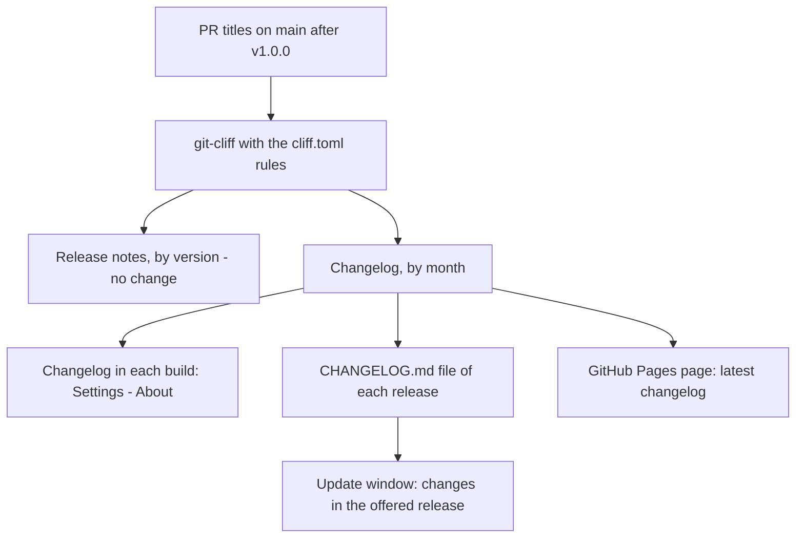
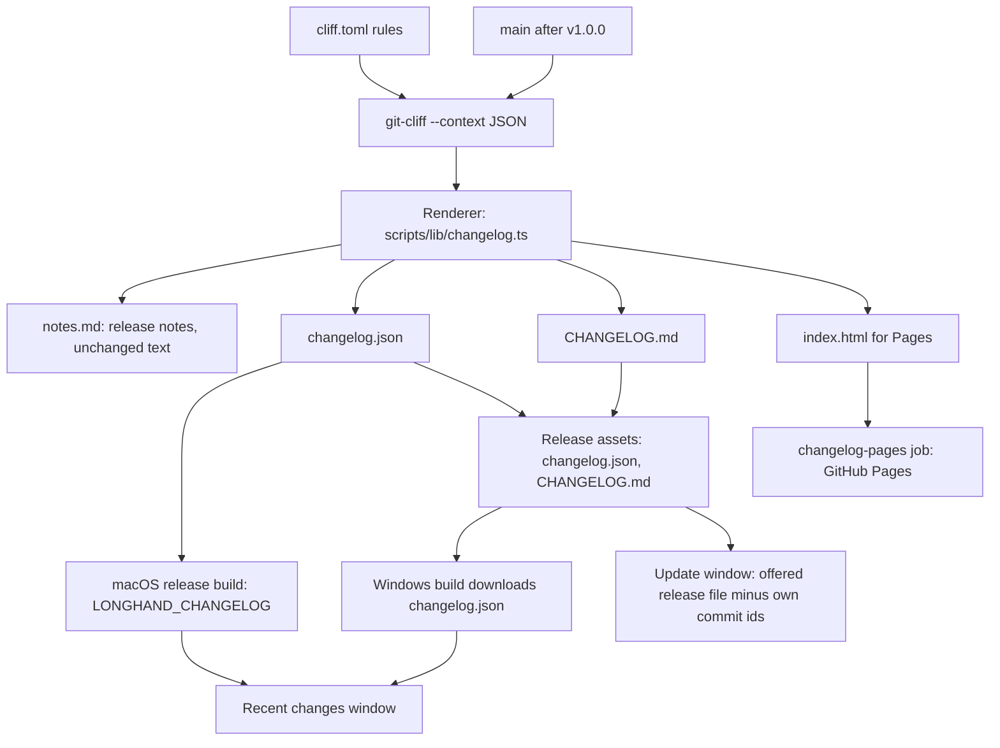

# Monthly Changelog - Plan

## Goal Capsule

- **Objective:** Users and readers of the repository can see what changed in Longhand, month by month, in the app and on the web, and nobody must do a step to keep that record correct.
- **Means:** git-cliff applies the rules in `cliff.toml`, and one Longhand renderer writes the release notes and every changelog output from git-cliff's JSON context (KTD1).
- **Product authority:** This Product Contract. The release flow in `docs/releases.md` and the git-cliff rules in `cliff.toml` stay the authority for which commits make a release and how a commit shows as a line. The Product Contract wins on behaviour; the Planning Contract wins on mechanism.
- **Execution profile:** One feature in one PR on one branch, with a commit per unit. The PR title is `feat: …`; ask the user "patch or minor?" before the PR opens.
- **Stop conditions:** Stop and ask when the release notes cannot stay byte-identical (U1), or when the Pages deploy needs a repository setting that the user has not turned on.
- **Open blockers:** None. The user turns on GitHub Pages (source "GitHub Actions") before the first release of this feature.

---

## Product Contract

### Summary

Each release generates a changelog from the PR titles on `main` after the v1.0.0 tag, grouped by calendar month, with git-cliff and the same rules that write the release notes. Nothing is committed. Each build contains the changelog: Settings > About shows the recent months, and the update window shows what the offered release adds. The full changelog is on a GitHub Pages page and is a file of each release.

### Problem Frame

Longhand makes a release for each merged PR, so the version numbers change often and tell users little. The only record of changes today is the GitHub Releases page, which has one entry for each version. "What's new" in Settings > About opens that page in the browser. A user who wants to know what changed this month, or what an update gives, must read many release entries.

A changelog file that the PR author or a CI job commits causes other problems. Each merge makes open PRs out of date, two PRs can overwrite each other's lines, a PR cannot know the month in which it will merge, and a CI commit adds one commit for each release.

### Key Decisions

- **Generate from git history; commit nothing.** The squash-merged PR titles on `main` already are the changelog, and the release flow already reads them with git-cliff. This removes the merge-order and end-of-month problems. Governs R1. (session-settled: user-approved — chosen over a CI bot commit after each release and over a script that the PR author runs with a CI check: both add commits or PR steps, and the author script conflicts between PRs)
- **Use git-cliff and the rules in `cliff.toml`.** The changelog and the release notes must agree exactly, not by chance: the same commit filter, the same preprocessing, the same groups and the same line text. Governs R2, R4, R5. (session-settled: user-directed — chosen over a separate generator that copies the rules: a copy can drift from `cliff.toml`)
- **Start after the v1.0.0 tag.** The commits before 1.0.0 are the preview build-out. Many have no PR, and some refer to PRs of another repository. Governs R1. (session-settled: user-directed — chosen over the full history and over an added hand-written entry for the time before 1.0.0)
- **Group by the month of the commit on `main`, in UTC.** The date of a squash commit is the merge date, so it is known only after the merge and never changes. Governs R3. (session-settled: user-approved — chosen over local time: UTC agrees with CI)
- **Show months, not versions.** The changelog is a record over time. Governs R6.
- **Show the changelog in Settings > About and in the update window.** Governs R10, R13. (session-settled: user-approved — chosen over About only, and over a one-time notice after an update relaunches, which CLAUDE.md does not allow for normal behaviour)
- **Publish the full changelog on GitHub Pages and as a file of each release.** The Pages page always shows the latest changelog at one address. The release file keeps the changelog as it was at that release. Governs R7, R8. (session-settled: user-directed — chosen over only one of the two and over in-app only)

### Requirements

**Generation**

- R1. Each release generates the changelog from the commits on `main` after the v1.0.0 tag. No person and no CI job commits a generated changelog, and a PR needs no changelog step.
- R2. git-cliff generates the changelog with the commit rules in `cliff.toml`. A change to those rules changes the release notes and the changelog together.
- R3. The changelog has one section for each calendar month that has changes, newest month first, with a heading such as "October 2026". The month of a change is the month of its commit date on `main`, in UTC.
- R4. In a month, the changes show under the headings of the release notes, in the same order. Today these are New features and improvements, Fixes, and Other changes. A heading with no changes does not show. The commit types that show, and the text of each line, are the same as in the release notes.
- R5. The release notes of each release do not change: they stay grouped by version.
- R6. The changelog shows no version numbers.

**Links**

- R7. A line whose PR title ends in a PR reference such as `(#72)` links to that PR in `twistymaze/longhand`. In the app, the link opens in the default browser. A line with no PR reference has no link.

**Publication**

- R8. Each release has a `CHANGELOG.md` file that holds the full changelog as of that release.
- R9. A GitHub Pages page shows the full changelog of the latest release at a fixed address. `README.md` and a short `CHANGELOG.md` on `main` link to it. That `CHANGELOG.md` contains no generated changes.

**In the app**

- R10. "What's new" in Settings > About opens a Recent changes view in the app, not the GitHub Releases page.
- R11. Recent changes shows the newest month in the build's changelog and the 5 months before it, and a link to the full changelog page.
- R12. Each build contains its changelog, so Recent changes needs no network. All builds of one release, the macOS build and the Windows installer, contain the same changelog. A release build that cannot make the changelog fails. A local build generates the changelog from its local history. A local build whose history does not contain the v1.0.0 tag cannot read the history, and shows only the link to the full changelog.

**Update window**

- R13. When the update window offers a new version, it also lists the changes in the offered release that are not in the running build, grouped as in R3 and R4. These are the changes after the commit of the running build, in the order of `main`. The window does not compare line text. The data behind the list keeps the commit of each change; R6 applies only to the text that the user sees.
- R14. When the app cannot get that list, the window shows a link to the full changelog in place of the list. Install and Relaunch and Remind Me Later work as before.
- R15. The update window keeps its current text, which names the offered version and the installed version.
- R16. A long list scrolls inside the update window. The window buttons stay visible, and each PR link can be reached with the keyboard.

### Success Criteria

- A later change to the commit rules in `cliff.toml` (a new type, a new heading, a new preprocessor) changes the release notes and the changelog together, with no change to the changelog generation.
- No PR in a month needs a changelog step or a rebase because of the changelog.

### Key Flows

- F1. A user reads recent changes
  - **Trigger:** The user clicks "What's new" in Settings > About.
  - **Steps:** Recent changes opens and shows the last 6 months from the changelog in the build. The user clicks a line, and the PR opens in the browser. The user clicks the link to the full changelog, and the Pages page opens in the browser.
  - **Covered by:** R7, R10, R11, R12
- F2. A user sees what an update gives
  - **Trigger:** The app offers a new version, automatically or after "Check for Updates…".
  - **Steps:** The update window shows the versions as today, and the changes after the running build, by month. The user installs or chooses Remind Me Later.
  - **Covered by:** R13, R14, R15, R16

### Acceptance Examples

- AE1. **Covers R3.** A PR merges at 23:30 UTC on 31 October 2026, and it shows under October 2026. A PR that merges at 00:10 UTC on 1 November 2026 (31 October in the evening, US time) shows under November 2026.
- AE2. **Covers R2, R4.** A `docs:` or `chore:` commit does not show. A `feat(capture)+:` commit shows like a `feat(capture):` commit under New features and improvements, with the same text as in its release notes.
- AE3. **Covers R1.** A `fix:` PR merges near the end of a month and was not up to date with `main`. No person or check changes a changelog file, and the next release puts the PR in the month of its merge.
- AE4. **Covers R13.** The running build is 1.0.20, and the app offers 1.0.25. The update window lists the changes of 1.0.21 to 1.0.25, and none of the changes that 1.0.20 already contains.
- AE5. **Covers R14.** The app offers a version but cannot get its changes. The window shows the link to the full changelog, and Install and Relaunch works.
- AE6. **Covers R7.** A release-type commit has no `(#NN)` reference. Its line shows with no link.
- AE7. **Covers R12.** A local build made from a checkout with full history shows Recent changes. A local build made from a source copy with no git history, or from a shallow clone with no v1.0.0 tag, shows only the link. The Windows installer of a release shows the same changes as the macOS build of that release.
- AE8. **Covers R11.** A build whose newest change is from January 2027 is opened in August 2027. Recent changes shows August 2026 to January 2027, not an empty view.
- AE9. **Covers R13.** A change to `cliff.toml` changes the text of old lines. The update window still lists only the changes after the running build's commit.

### Scope Boundaries

- No changes before the v1.0.0 tag, and no hand-written entry for the preview time.
- No hand-written or edited changelog lines. The PR title is the text of the line.
- No notice after an update relaunches.
- No summary of a month written by a model, and no "since the last minor version" view. These stay open in `docs/ideas/done/in-app-change-log.md`.
- No change to the release notes, to the version rules or to the release types.
- No update window on Windows. Windows has no in-app updates yet (`docs/ideas/done/windows-preview-builds-and-updates.md`). Recent changes in Settings > About works on Windows too.

### Dependencies / Assumptions

- GitHub Pages must be turned on once in the repository settings. The user does this step.
- The publish job needs permission to deploy to Pages. Today, `release-publish` in `.github/workflows/ci.yml` and `attach` in `.github/workflows/release-windows.yml` are the only jobs that can write to the repository.
- The macOS release build reads the full history and the tags, as git-cliff already does for the release notes. The Windows installer build in `.github/workflows/release-windows.yml` checks out one commit with no history and has no git-cliff, so R12 needs another source for its changelog.
- A PR title that someone edits in the merge dialog shows as edited (`docs/releases.md`, PR titles).

### Outstanding Questions

**Deferred to Implementation**

- The exact layout of the Recent changes window and of the list in the update window. Use the `apple-design` skill (U5, U6).

### Sources / Research

- `docs/releases.md`: the release flow, the release notes headings and the PR title rules.
- `cliff.toml` and `scripts/release-version.ts`: the git-cliff rules and how the release notes are generated today.
- `src/settings/About.tsx`: the "What's new" link (`longhandAddresses.releases`).
- `src/update/UpdateWindow.tsx`: the "offered" state of the update window.
- `docs/ideas/someday/scheduled-release-batches.md`: a related idea that makes releases less frequent; the monthly changelog does not depend on it.

**Product Contract preservation:** Product Contract unchanged. The planning questions that it deferred are answered by KTD1, KTD5, KTD6 and KTD7; the layout question stays deferred to implementation.

---

## Planning Contract

### Key Technical Decisions

- KTD1. **git-cliff applies the rules; one Longhand renderer writes every text.** `git-cliff --context` gives the commits after the `cliff.toml` rules (filter, `+` preprocessor, groups) as JSON. One renderer module turns that JSON into the release notes, the monthly `CHANGELOG.md`, `changelog.json` and the Pages page. The `cliff.toml` body template is removed, so no second copy of the line format exists. Governs R2, R4, R5. (session-settled: user-directed — chosen over keeping the git-cliff template for the release notes and a second render path that a test holds equal: two text paths can drift)
- KTD2. **`changelog.json` is the one data format.** It has a format number and a list of entries in the order of `main`. Each entry has the full commit id, the commit time, the month key (`YYYY-MM`, UTC), the group heading and its order, the line text and the PR number when the line has one. The file also records the commit that it was made from (the build's head commit) and that commit's time. The app, the update window and the Windows build read only this file. A reader that gets an unknown format number treats the changelog as not available. The file is a shared interface between releases, so the format number is in it from the start.
- KTD3. **Line text and order are the release-notes line text and order.** The line is `scope: Message (#NN)` exactly as the release notes write it today, and the PR link comes from the trailing `(#NN)`. In a month, groups follow the group order of `cliff.toml`, and lines are oldest first, as in the release notes. Months are newest first. Governs R3, R4, R7.
- KTD4. **The build gets its changelog from a file at build time.** `LONGHAND_CHANGELOG` names a `changelog.json` file, and `src-tauri/build.rs` puts it into the binary, as `licences.rs` does with the licence list. When the variable is not set, a local build reads the file that `beforeBuildCommand` generated, or the build gets an empty "not available" changelog. A build with `LONGHAND_RELEASE=1` and no changelog fails. Governs R12.
- KTD5. **The update window downloads the offered release's `changelog.json` once per offer.** The asset address is fixed by the version (`releases/download/v<version>/changelog.json`). The app lists the offered entries whose commit time is later than its own head commit time and whose commit id is not in its own changelog, in the order of the offered file. The time cut keeps out old commits that a later `cliff.toml` rule includes for the first time; the id check keeps out commits that the build already has. The squash commits on `main` have increasing commit times (checked for the 45 commits since v1.0.0). `latest.json` stays small, because every update check reads it. Governs R13, R14.
- KTD6. **Pages deploys from a separate job with the official Pages actions.** A `changelog-pages` job runs after `release-publish` only when that job published a release. It has `pages: write` and `id-token: write`, and the environment `github-pages`. The page is one static HTML file with light and dark styles, no script and no Jekyll. Its address is `https://twistymaze.github.io/longhand/`. The job has `continue-on-error: true`: `release-windows.yml` starts only after a successful CI run, so a failed deploy must not stop the Windows installer. The next release deploys the page again. The CI concurrency group (`ci-${{ github.ref }}`, no cancel on push) runs the main runs one at a time, so an older deploy cannot replace a newer page. Governs R9.
- KTD7. **The Windows build downloads `changelog.json` from its release.** `release-windows.yml` already finds the release of the built commit. The build job downloads the asset and sets `LONGHAND_CHANGELOG`. A missing asset fails the job. Governs R12.
- KTD8. **Recent changes opens in its own window**, as the full licence list does from Settings > About. Governs R10, R11. (session-settled: user-approved — chosen over a view that replaces the About pane: the licence list sets the pattern for a long list from About)

### High-Level Technical Design

Release CI order: `release-build` (version, renderer, build with `LONGHAND_CHANGELOG`) → `release-publish` (assets, sets `published`) → `changelog-pages` (deploy). `release-windows.yml` runs after CI as today and reads the published asset.

### Assumptions

- `git-cliff --context` in version 2.14.2 gives each commit's id, committer time, group, scope and message after the rules. This was checked on the repository: 45 commits since v1.0.0.
- `reqwest` 0.13 is already in the workspace (`crates/summarize`, `crates/models`), so the `longhand` crate can use it with no new crate in `Cargo.lock`.
- The repository is public and Pages is not turned on yet (checked 2026-10-28).

---

## Implementation Units

### U1. Renderer from the git-cliff context

**Goal:** One module makes the release notes and all changelog outputs from git-cliff's JSON context, and the release notes stay byte-identical.

**Requirements:** R1, R2, R3, R4, R5, R6, R7, R8; KTD1, KTD2, KTD3; AE1, AE2.

**Dependencies:** None.

**Files:**
- Create `scripts/lib/changelog.ts`, `scripts/lib/changelog.test.ts`
- Create `scripts/changelog.ts` (command line: write `changelog.json`, `CHANGELOG.md` and `index.html` into a folder; `local` mode for builds)
- Create `scripts/changelog.test.ts`
- Modify `scripts/release-version.ts`, `scripts/release-version.test.ts`
- Modify `cliff.toml` (remove the body template, keep the rules, update the comments)
- Modify `package.json` only if `test:scripts` needs the new test files named

**Approach:**
1. Add characterization tests first: for the fixture repositories that `scripts/release-version.test.ts` already builds, record the release notes that the current template writes.
2. Read the context with `git-cliff --context` over `v1.0.0..HEAD` for the changelog and with `--unreleased` for the release notes. Reuse the `Tools` seam in `release-version.ts`.
3. The renderer gives entries (KTD2), the release notes text, the monthly Markdown and the HTML page. The HTML escapes all commit text.
4. `release-version.ts` writes the notes with the renderer and, when a release is due, the changelog files into the release files folder.
5. `scripts/changelog.ts local <out>` makes `changelog.json` for a local build. With no git-cliff, or with no `v1.0.0` tag in the history, it writes the "not available" file and ends without an error.

**Execution note:** Write the characterization tests for the current release notes before you change `release-version.ts` or `cliff.toml`.

**Patterns to follow:** `scripts/release-version.ts` (`Tools`, `systemTools`, `run`); `scripts/lib/version.ts` for a small pure module with its test; `scripts/publish-release.ts` for Node built-ins only.

**Test scenarios:**
- The release notes for each fixture release are byte-identical to the characterization text.
- Covers AE2. A `feat(capture)+:` commit renders as `capture: …` under "New features and improvements"; `docs:` and `chore:` commits do not appear.
- Covers AE1. A commit at 23:30 UTC on 31 October 2026 has the month key `2026-10`; a commit at 00:10 UTC on 1 November 2026 has `2026-11`.
- A month with only fixes has no "New features and improvements" heading.
- Months are newest first; in a month, lines are oldest first and groups follow the `cliff.toml` order.
- A message that ends in `(#72)` gives PR 72; a message with no reference gives no PR, and its line text is unchanged.
- A commit message with `<script>` and `&` is escaped in `index.html` and unchanged in `CHANGELOG.md` and `changelog.json`.
- `changelog.json` has the format number and entries with full commit ids in the order of `main`.
- `local` mode with no `v1.0.0` tag writes the "not available" file.
- `local` mode with no git-cliff on the path writes the "not available" file.
- Integration with the real git-cliff on a fixture repository: the changelog entries and the release notes come from the same commits.

**Verification:** The script tests pass with the real git-cliff, and the release notes of the fixture releases did not change.

### U2. Release pipeline: build input, assets and Pages

**Goal:** Each release builds with its changelog, attaches `changelog.json` and `CHANGELOG.md`, and deploys the Pages page.

**Requirements:** R1, R8, R9, R12; KTD4, KTD6.

**Dependencies:** U1.

**Files:**
- Modify `.github/workflows/ci.yml` (release-build: pass the changelog files and `LONGHAND_CHANGELOG` to the Tauri build; script tests: add the changelog tests; new `changelog-pages` job)
- Modify `scripts/publish-release.ts`, `scripts/publish-release.test.ts`

**Approach:**
1. `release-build` writes the changelog files with the version step and sets `LONGHAND_CHANGELOG` for the Tauri build step. The release files artifact carries the new files.
2. `publish-release.ts publish` uploads `changelog.json` and `CHANGELOG.md` before it publishes the draft, and writes `published=true` to its output only when it published.
3. `changelog-pages` downloads the artifact, uploads the page with `actions/upload-pages-artifact` and deploys with `actions/deploy-pages`, with `continue-on-error: true` (KTD6). Pin both actions by full commit SHA.

**Patterns to follow:** The existing `release-publish` job (Node only, no npm, no build code); the SHA-pinned `uses:` lines in `ci.yml`.

**Test scenarios:**
- `publish` uploads the DMG, the archive, the signature, `latest.json`, `changelog.json` and `CHANGELOG.md`, then publishes.
- `publish` that skips because a newer CI run waits uploads nothing and reports that it did not publish.
- `publish` that skips because the version is not newer reports that it did not publish.

**Verification:** The script tests pass. The workflow passes `actionlint` if it is available, and the first release after merge shows both assets and the Pages page.

### U3. Windows installer build reads the release changelog

**Goal:** The Windows installer contains the same changelog as the macOS build of its release.

**Requirements:** R12; KTD7; AE7.

**Dependencies:** U2.

**Files:**
- Modify `.github/workflows/release-windows.yml`

**Approach:** Before the Tauri build, download `changelog.json` from the release that the `find` job named, into the runner temp folder, and set `LONGHAND_CHANGELOG`. Fail the step when the asset is missing. A manual run for an older release with no asset fails the same way; that is expected.

**Execution note:** Workflow only; verify on the first release after merge, not with unit tests.

**Test expectation:** none -- workflow configuration; the first release after merge proves it.

**Verification:** The Windows installer of the first release after merge shows the same Recent changes as the macOS build.

### U4. Changelog in the binary

**Goal:** Each build contains its changelog, and the app can read it.

**Requirements:** R12; KTD2, KTD4; AE7.

**Dependencies:** U1.

**Files:**
- Modify `src-tauri/build.rs`
- Create `src-tauri/src/commands/changelog.rs` (command that returns the bundled changelog; parse and "not available" handling)
- Modify `src-tauri/src/commands/mod.rs`, `src-tauri/src/lib.rs` (register the command)
- Modify `src-tauri/tauri.conf.json` (`beforeBuildCommand` runs `node scripts/changelog.ts local …` first)
- Create `src-tauri/changelog/.gitignore`
- Modify `src/bindings.ts` (regenerated)

**Approach:**
1. `beforeBuildCommand` writes the local file into `src-tauri/changelog/`, a tracked folder whose `.gitignore` ignores the generated file. `build.rs` copies the file that `LONGHAND_CHANGELOG` names, or the local file, into `OUT_DIR`. It watches the folder, watches the `LONGHAND_CHANGELOG` file only when it exists, and watches the `LONGHAND_CHANGELOG` and `LONGHAND_RELEASE` variables, so a missing file does not rebuild the crate on each cargo command.
2. With `LONGHAND_RELEASE=1` and no file, the build fails with a message that names `LONGHAND_CHANGELOG`.
3. With no file in a local build, the binary contains the "not available" changelog.
4. The command parses the embedded file once and returns entries or "not available". It also gives the set of commit ids for U6.

**Patterns to follow:** `src-tauri/src/commands/licences.rs` (`include_str!` of a generated file); `src-tauri/src/commands/build_info.rs` (`option_env!`, `parse_release`).

**Test scenarios:**
- A valid file gives its entries in file order.
- A file with an unknown format number gives "not available".
- An empty or broken file gives "not available".
- The id set contains every entry's full commit id.

**Verification:** `cargo test -p longhand` passes; a local `tauri build` from this checkout shows Recent changes; a build with `LONGHAND_RELEASE=1` and no changelog fails.

### U5. Recent changes window

**Goal:** "What's new" in Settings > About opens a Recent changes window with the newest 6 months of the build's changelog.

**Requirements:** R6, R7, R10, R11, R12; KTD3, KTD8; F1; AE7, AE8.

**Dependencies:** U4.

**Files:**
- Create `src/changelog/RecentChangesWindow.tsx`, `src/changelog/RecentChangesWindow.test.tsx`
- Create `src/changelog/months.ts`, `src/changelog/months.test.ts` (the 6-month selection and the month names)
- Modify `src/App.tsx`, `src/App.test.tsx` (`?window=changelog`)
- Modify `src/settings/About.tsx`, `src/settings/About.test.tsx` ("What's new" opens the window; remove `longhandAddresses.releases` if nothing else uses it)
- Modify `src-tauri/src/window.rs`, `src-tauri/src/commands/window.rs` (open or focus the window, as `open_licences`)
- Create `src-tauri/capabilities/changelog.json` (`core:default` and `opener:allow-open-url` limited to `https://github.com/twistymaze/longhand/pull/*` and `https://twistymaze.github.io/longhand/*`; see `docs/solutions/tooling-decisions/opener-url-scope-glob-matching.md`)

**Approach:** The window reads the bundled changelog through U4's command. It shows the newest month in the changelog and the 5 calendar months before it (AE8); a calendar month with no changes has no heading. It shows month headings ("October 2026"), group headings and lines. Each line with a PR opens the PR in the default browser through the opener plugin. A link at the end opens the Pages page. With "not available", the window shows only that link. Invoke `apple-design` before the layout; keep the window plain and quiet, as the licence window is.

**Patterns to follow:** `src/licences/LicencesWindow.tsx` and its test; `WebLink` in `src/settings/About.tsx`; `open_licences_window` in `src-tauri/src/window.rs`.

**Test scenarios:**
- Covers AE8. Entries from August 2026 to January 2027 show 6 months, January 2027 first, when the newest entry is in January 2027, whatever today's date is.
- Entries that span 8 calendar months show only the newest 6 calendar months and the full-changelog link.
- Entries in January 2027 and October 2026 only show both months; November and December 2026 have no heading.
- A PR address is built from the integer PR number, never from text in the changelog.
- A month with fixes only shows the Fixes heading and no other heading.
- A click on a line with PR 72 opens `https://github.com/twistymaze/longhand/pull/72` once.
- A line with no PR is plain text and has no link role.
- Covers AE7. "Not available" shows only the full-changelog link.
- "What's new" in About calls the open command once and opens no browser page.
- The window shows no version number anywhere.
- `?window=changelog` shows the window and not the main window.

**Verification:** `npm test` and `npm run typecheck` pass; a signed local build shows the window from Settings > About.

### U6. Update window lists the offered changes

**Goal:** The update window shows the changes that the offered release adds, or the full-changelog link when it cannot get them.

**Requirements:** R13, R14, R15, R16; KTD2, KTD5; F2; AE4, AE5, AE9.

**Dependencies:** U4.

**Files:**
- Modify `src-tauri/Cargo.toml` (add `reqwest` with the workspace's features)
- Modify `src-tauri/src/managers/updates.rs` (fetch and cache the offered changes for a version)
- Modify `src-tauri/src/commands/updates.rs` (command that returns the offered changes)
- Modify `src/update/UpdateWindow.tsx`, `src/update/UpdateWindow.test.tsx`
- Modify `src-tauri/capabilities/update.json` (add `opener:allow-open-url` with the same scope as `changelog.json`)
- Modify `src/bindings.ts` (regenerated)
- Modify `licences/generated/*` only if `scripts/check-licences.sh` changes them

**Approach:**
1. The command takes the offered version, downloads `changelog.json` from that release with a timeout and a size limit, and keeps the result for that version.
2. A pure function returns the offered entries that KTD5 selects (later than the bundled head commit time, and not in the bundled id set), in the offered file's order. It never compares line text.
3. Any download, size, parse or format failure gives "not available".
4. In the "offered" state, the window shows the current title and text (R15) at once, with a reserved area below. The area shows the list grouped by month and heading, or the full-changelog link.
5. The list scrolls in the area with a maximum height; the buttons stay below it and visible. The rule that an automatic notice takes no focus (see the header comment of `UpdateWindow.tsx`) applies to the links too.

**Patterns to follow:** `check` in `src-tauri/src/managers/updates.rs` for timeouts; `crates/summarize` for `reqwest` client use; `viewOf` and `useWindowFitsContent` in `src/update/UpdateWindow.tsx`.

**Test scenarios:**
- Covers AE4. Offered entries A–F and bundled ids A–B give C–F in offered order.
- Covers AE9. Offered entries whose line text differs from the bundled text, with the same ids, are not listed.
- An offered entry of a newly included type whose commit time is before the bundled head commit time is not listed.
- An offered entry list with nothing new gives an empty list, and the window shows the full-changelog link and no error.
- Covers AE5. A failed download gives "not available"; the window shows the link, and Install and Relaunch still sends `install`.
- A response larger than the size limit gives "not available".
- While the request runs, the window shows the title, the text and both buttons.
- A list of 60 lines scrolls in its area, and both buttons stay in the window.
- An automatic offer gives no focus to a link or a button.
- The command called twice for the same version downloads once.

**Verification:** `cargo test -p longhand`, `npm test` and `npm run typecheck` pass; `scripts/check-licences.sh` passes.

### U7. Documentation and repository links

**Goal:** The docs describe the changelog and the one-time Pages step, and the repository links to the Pages page.

**Requirements:** R9; Dependencies / Assumptions (Pages setup).

**Dependencies:** U1, U2.

**Files:**
- Modify `docs/releases.md` (changelog section, Pages setup step, release assets list)
- Modify `CONCEPTS.md` (Updates: add "Changelog")
- Modify `README.md` (link to the Pages page)
- Create `CHANGELOG.md` (a short file with only the link)
- Modify `docs/ideas/done/in-app-change-log.md` only if the shipped scope differs from its "Scope of the plan" section

**Approach:** Follow ASD-STE100 for the docs. The one-time step: Settings → Pages → Build and deployment → Source: GitHub Actions.

**Test expectation:** none -- documentation only.

**Verification:** `scripts/check-provenance.sh` and `node scripts/ideas.ts check` pass, and the links resolve after the first release.

---

## Verification Contract

| Check | When |
|---|---|
| `npm run test:scripts` (needs git-cliff 2.14.2 on the path) | U1, U2 |
| `npm test` and `npm run typecheck` | U5, U6 |
| `cargo test -p longhand` | U4, U6 |
| `cargo fmt --all --check` and `cargo clippy --workspace --all-targets` | Before each push |
| `scripts/check-licences.sh` | After U6 adds `reqwest` to the `longhand` crate |
| `scripts/check-windows.sh` | Before the PR, for the Rust changes |
| Manual test: signed local build (`docs/development-workflow.md#manual-tests`) opens Recent changes from Settings > About | After U5 |
| After merge: the first release has `changelog.json` and `CHANGELOG.md`, the Pages page shows, the Windows installer shows the same months | After the first release |

The update window list against a real release can only be tested after two releases with this feature exist; until then, U6's tests are the proof.

---

## Definition of Done

- All units are done and their tests pass, with the checks in the Verification Contract.
- The release notes of the fixture releases are byte-identical to the characterization text (U1).
- No code from abandoned attempts is in the diff.
- The PR title is a `feat` Conventional Commit, and the user chose patch or minor.
- `docs/releases.md` tells the user to turn on Pages before the first release of this feature.
