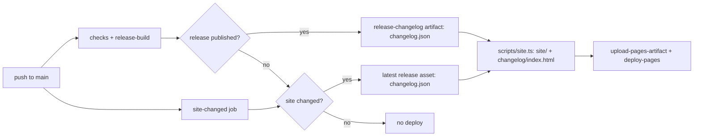
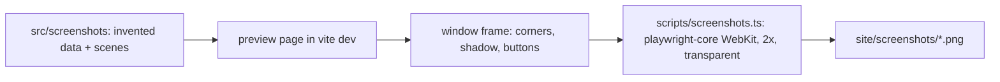

# Landing page at longhand.md - Plan

## Goal Capsule

- **Objective:** A newcomer who opens https://longhand.md understands in about a minute what Longhand is, why it is different, and how a meeting goes with it, and can download it. The page does not look like a generic AI-made product page, and the app and the plugin send people to the site.
- **Means:** a static page in `site/`, screenshots that a script renders from the real React screens in WebKit, and the existing Pages job, which also deploys when the page changes (KTD1-KTD4).
- **Product authority:** the user (maintainer). The user approves the screenshots (R21) and the finished page (R22) before the PR opens.
- **Stop conditions:** stop and ask when a review stop (R21, R22) is reached, or when the deploy design in KTD2 cannot keep the latest release's changelog on the site.
- **Execution:** `ce-work` in a new worktree from `origin/main`, one PR with a patch release. The PR title names the landing page, the website links and the changelog-list fix.
- **Open blockers:** none.

---

## Product Contract

**Product Contract preservation:** changed: R15 (no window title text, because the real window has none), and R23-R26 added (links to the site, at the user's request after the brainstorm).

### Summary

A single landing page at the root of `longhand.md`, ordered what → why → how, with three screenshots that a repeatable script renders from the real app screens with invented meeting content, each framed as a real macOS window. The site also deploys when the page changes on `main`. The app's About pane, the macOS About panel, the agent plugin and the README link to the site. The same work fixes two rendering faults in the changelog lists.

### Problem Frame

The site at `longhand.md` holds only the changelog; its root sends the visitor to `/changelog/`. A newcomer who hears about Longhand lands on the GitHub README, which is written for developers and shows no screenshot of the app. There is no page that shows the app and explains the idea in plain words, and nothing in the app or the plugin points to one.

Pages made with AI help often share the same look: purple or indigo gradients, Inter for all text, a centered hero with a vague tagline, rows of rounded cards with emoji, glass effects. Readers now recognize that look and read it as low effort. The page must not have it.

In the changelog lists (Recent changes, the update window and the changelog page), the group headings are gray and look washed out, and the bullet of a wrapped line sits at its last line instead of its first.

### Key Decisions

- **Audience: curious newcomers.** People who heard of Longhand and want to know what it is; the page ends at Download. Governs R1-R7. (session-settled: user-directed — chosen over a personal page for friends and over a page for developers and agent users)
- **Information order: what → why → how.** The idea and privacy come before the screenshots. Governs R1-R4. (session-settled: user-directed — chosen over a layout that follows the meeting first, over one large screenshot first, and over a page styled as a Markdown note)
- **Look: a well-typeset page, between the Mac app's look and almost no design.** Use the Mac app's look only where it helps; no writing-paper skeuomorphism. Governs R8-R10. (session-settled: user-directed — chosen over "looks like the Mac app", "Longhand as writing" and "almost no design")
- **Screenshots: a repeatable script with invented content, framed as macOS windows.** Governs R12-R16. (session-settled: user-directed — chosen over a one-time capture; the window frame was the user's addition)
- **Windows: "coming soon", with no download link.** Governs R5. (session-settled: user-directed — chosen over a preview link to the unsigned installer)
- **Deploy also when the page changes.** Governs R17-R18. (session-settled: user-approved — chosen over deploys only at releases)
- **Changelog group headings in the normal text color.** Governs R19. (session-settled: user-approved — chosen over keeping the gray and over a darker gray)
- **New website links use `https://longhand.md` directly.** Governs R23-R25. (session-settled: user-directed — chosen over a github.io address that GitHub forwards: simpler, and old builds keeping an old address is acceptable)
- **Download goes to the latest release page.** The DMG file name changes with each version, so a stable link points at the release page. Governs R4.
- **One PR.** The changelog-list fix and the website links change the app, so the PR makes a patch release whose title names all three changes. That release also deploys the new page.

### Requirements

**Page content and order**

- R1. The page opens with **what**: the name Longhand, one plain sentence that says what it is, and the download action.
- R2. Next comes **why**: the idea (take part in the meeting; type a few words; the transcript holds the details; afterwards Longhand writes a summary from your notes and the transcript) and the privacy points (audio and transcription stay on the computer; you choose the AI service; no account, no Longhand cloud, no usage data; notes are plain files you own).
- R3. Then comes **how**, a meeting in order, each step with its screenshot: during the meeting (a note while recording), after it (the finished note with its summary), and over time (the notes library).
- R4. A footer links to the changelog (`/changelog/`), the GitHub repository and the latest release page. The download action also goes to the latest release page.
- R5. The page names Windows as a platform that is coming soon, with no Windows download link, and does not read as Mac-only.
- R6. The page copy is short, specific plain language taken from what Longhand does (the README is the source of facts). No generic marketing phrases.
- R7. The page works and reads well at phone width as well as desktop width.

**Look**

- R8. The page avoids the known AI-design tells: no purple or indigo gradients or gradient text, no Inter-by-default, no centered-hero-plus-card-grid, no emoji or generic icon grids, no glass effects, no stock illustrations.
- R9. The page follows the visitor's light or dark setting.
- R10. The typography is chosen deliberately, and the page borrows the Mac app's look (colors, controls) only where it helps. No writing-paper or handwriting imitation.

**Privacy of the page itself**

- R11. The page loads nothing from other sites: no analytics, no trackers, no web fonts or scripts from a CDN.

**Screenshots**

- R12. Three screenshots: a note while recording, the finished note with its summary, and the notes library.
- R13. A script renders the screenshots from the real app UI, so a change to the app's look is one command away from new screenshots.
- R14. All content in the screenshots is invented: people, meeting topics, notes, transcript text and summaries. No real names, and nothing from private paths (`fixtures/`, `manual-tests/`, `sample.*`). The invented content is checked into the repo and reviewed in the PR.
- R15. Each screenshot looks like a full macOS window capture of the real main window: the window buttons in the app's own top strip, rounded corners and the window shadow, at the real window size. It shows no title text, because the real window has none. It is not a borderless render of the page.
- R16. The screenshots are light mode.

**Deploy**

- R17. The site deploys when a release is published (as now) and also when a push to `main` changes the landing page or its screenshots.
- R18. A deploy that is not from a release keeps the changelog page of the latest release.

**Changelog lists**

- R19. In Recent changes, the update window and the changelog page, the group headings use the normal text color and stay smaller than the month heading.
- R20. A list item that wraps to more than one line has its bullet at the first line.

**Links to the site**

- R23. The About pane in Settings has a Website link to `https://longhand.md` beside the Source code link.
- R24. The macOS About panel (app menu > About Longhand) shows `longhand.md` in place of `github.com/twistymaze/longhand`.
- R25. The agent plugin manifests and the marketplace entry give `https://longhand.md` as the homepage or website. The `repository` fields stay on GitHub.
- R26. The README links to `https://longhand.md` near its top.

**Review stops**

- R21. Before the page is built out, the user reviews sample screenshots, and the work continues only after the user approves them.
- R22. Before the PR opens, the user reviews the finished page served locally, and the PR opens only after the user approves it.

### Acceptance Examples

- AE1. **Covers R17, R18.** **Given** the latest release is v1.2.10, **when** a push to `main` changes only the landing page text, **then** `longhand.md` shows the new text and `longhand.md/changelog/` still shows the v1.2.10 changelog.
- AE2. **Covers R20.** **Given** a changelog line too long for one line, **when** it wraps, **then** its bullet aligns with the first line of the text, in the app and on the page.
- AE3. **Covers R11.** **Given** the page is open, **when** the browser's network log is read, **then** every request goes to `longhand.md` (or the GitHub Pages host behind it).
- AE4. **Covers R17.** **Given** a push to `main` changes only `src/` files, **when** CI runs and no release is due, **then** the site does not deploy.

### Scope Boundaries

- A Windows download on the page (it waits for a signed installer).
- More pages (blog, docs, FAQ), more screenshots, other languages, dark-mode screenshots.
- Changes to the README's Windows text: the README keeps its link to the unsigned installer.
- `PAGES_URL` (the changelog address that the app opens) stays the `github.io` address, which GitHub forwards to the custom domain.
- Links that stay on GitHub: update and download addresses, PR links in the changelog, the licence link, `SECURITY.md`, and the agent install steps in `src-tauri/src/managers/agent_block.rs`.
- The "Website" field of the GitHub repository is a repository setting, not a file. The user sets it, or asks for it after the merge.
- Rendering the screenshots in CI: they render on a Mac and are committed (KTD3).
- Considered and not built: an automated check for real names in the screenshot content. The R21 review and the PR review of the checked-in content (R14) catch them; a leak found later would change this.
- Considered and not built: a deploy of a site change whose CI run GitHub cancels while it waits in the `main` concurrency group. The change then deploys with the next site change or release. Comparing against the last release tag would deploy on every later push, against AE4. Repeated lost deploys would change this.

### Dependencies / Assumptions

- The custom domain `longhand.md` is set in the Pages settings and HTTPS is on; `docs/releases.md` setup step 5 records the setup.
- The changelog page and its styles come from `scripts/lib/changelog.ts` (`html()`), and the site is assembled by the `changelog-pages` job in `.github/workflows/ci.yml`.
- Each release since PR #74 has `changelog.json` as a release asset (`scripts/publish-release.ts`), so a page-only deploy can make the changelog page from the latest release.

### Sources / Research

- Common tells of AI-made pages: [Why Your AI Keeps Building the Same Purple Gradient Website](https://prg.sh/ramblings/Why-Your-AI-Keeps-Building-the-Same-Purple-Gradient-Website), [Scoring 500 Show HN pages for AI design patterns](https://adriankrebs.ch/blog/design-slop/), [The visible tells of AI design](https://impeccable.style/slop).
- `README.md` for the product facts and the privacy points.
- `docs/plans/2026-10-28-0833-feat-monthly-changelog-plan.md` for the changelog page and the Pages deploy.

---

## Planning Contract

### Key Technical Decisions

- KTD1. **The site source lives in a new top-level `site/` folder of plain HTML and CSS.** CI skips pushes that change only `docs/**` or `**.md` (`.github/workflows/ci.yml`, push `paths-ignore`), so a page there would never deploy. A new folder triggers CI. Plain files need no build step and no framework, and the page has no JavaScript.
- KTD2. **One deploy job, `changelog-pages`, runs for a published release or a changed site.** A small job in `ci.yml` sets `changed=true` when the push changed `site/**` or `scripts/site.ts`, with the same base rules as `scripts/licence-inputs-changed.sh`. `changelog-pages` runs when a release was published, or when the site changed and `release-build` succeeded. A release deploy takes `changelog.json` from the `release-changelog` artifact; a page-only deploy downloads `changelog.json` from the latest release. Both run one script that writes the site (KTD4). A separate `pages.yml` was rejected: it could run beside the release run and put the previous release's changelog on the site. The cost: a page-only push waits for the normal CI checks before it deploys.
- KTD3. **The screenshots render from the real components in WebKit through `playwright-core`, on a Mac, and the PNGs are committed.** WebKit is the engine of the app's WKWebView, and the app font is `system-ui`, so a Mac gives the real look. A preview page under `src/screenshots/` renders `SessionPage` and `Home` with `mockTauri` from `src/test/tauri.ts` and invented data, in the same way as the existing component tests. `vite build` takes only the root `index.html`, so the preview page is never in the app bundle. `playwright-core` is a devDependency at a version that is more than 7 days old; it downloads no browser, and the script names the install command when the WebKit build is missing.
- KTD4. **The window frame is drawn in the preview page with our own CSS.** A frame component holds the scene at 960x680 (the main window size in `src-tauri/src/window.rs`) with rounded corners, the shadow and the three window buttons at x 20 and y 23 (the macOS 26 inset), as `window.rs` sets them. Inside the frame, the scene uses the same shell as `MainWindow` in `src/App.tsx`: a full-height flex column with `bg-window`, the `title-strip` div, then a `min-h-0 flex-1` container for `SessionPage` or `Home`. The page sets the `mac` class on `html`, as `src/main.tsx` does on a Mac, so that strip is 44 px high. The preview page makes `html` and `body` transparent (as `html.widget-window` does in `src/index.css`), and the capture uses a transparent background at 2x scale, so the shadow keeps its alpha. Our own CSS needs no `PROVENANCE.md` record.
- KTD5. **`scripts/site.ts` writes the whole site from `site/` and a `changelog.json` path.** It copies `site/` and writes `changelog/index.html` with `html()` from `scripts/lib/changelog.ts`. It uses Node built-ins only, so the deploy job needs setup-node but no `npm ci`. The same script serves the local review (R22).
- KTD6. **The page uses system font stacks and no web font.** Headings use a serif stack (`ui-serif`, which is New York on a Mac, then Georgia); body text uses the system sans-serif stack. This avoids the Inter tell (R8), loads nothing (R11) and needs no font licence. `apple-design` may change the stacks during U4 within R8, R10 and R11.
- KTD7. **The list bullet fix makes each PR line's button a block.** A button is laid out as inline-block, whose baseline is its last line, so the `::marker` aligns with the last line (`src/changelog/ChangelogMonths.tsx`). A block button with left-aligned text puts the marker at the first line. The Pages `html()` list uses a plain `<li>` with an inline `<a>` and does not have this fault; R20 there needs only a check.

### High-Level Technical Design





### Output Structure

```text
site/
  index.html
  style.css
  icon.png                  (from src-tauri/icons, a size the page needs)
  screenshots/
    recording.png
    summary.png
    library.png
src/screenshots/
  index.html                (preview page, dev server only)
  main.tsx                  (picks the scene from the query)
  scenes.tsx                (invented notes, transcript, summary; mocks)
  WindowFrame.tsx
  scenes.test.tsx
scripts/
  screenshots.ts
  site.ts
  site.test.ts
  site-changed.sh
```

### Assumptions

- The WebKit build that `playwright-core` expects is in the local Playwright cache, or `npx playwright-core install webkit` gets it.
- The macOS 26 window-button inset (23 px) is the one to draw, because the screenshots show the current macOS.

### Sequencing

U1 and U2 first (small app changes). U3 next, then review stop R21. U4 and U5 after the user approves the screenshots, then review stop R22, then the PR.

---

## Implementation Units

### U1. Changelog list fixes

**Goal:** Group headings in the normal text color, and bullets at the first line of wrapped items.

**Requirements:** R19, R20 (AE2); KTD7.

**Dependencies:** none.

**Files:**
- `src/changelog/ChangelogMonths.tsx`
- `scripts/lib/changelog.ts`
- `src/changelog/RecentChangesWindow.test.tsx`
- `scripts/lib/changelog.test.ts`

**Approach:**
1. In `ChangelogMonths.tsx`, give the group `<h3>` the normal label color and keep its smaller size.
2. Make the PR-line button a block with left-aligned text. Keep its focus outline and hover underline.
3. In `html()`, give `h3` the normal text color and keep its size below `h2`.
4. Render a long line in WebKit with the U3 preview tooling or the U5 local site, and check the bullet position in both places.

**Patterns to follow:** the label tokens in `src/index.css`; `apple-design` for the heading weight and size.

**Test scenarios:**
- A group heading in Recent changes does not use the secondary label color.
- A PR line is still a button that opens its PR address on click.
- The Pages page CSS gives `h3` the text color, not the muted color.

**Verification:** both lists show dark group headings, and a wrapped line has its bullet at the first line in WebKit.

### U2. Links to the site

**Goal:** The app, the plugin and the README point to `https://longhand.md`.

**Requirements:** R23, R24, R25, R26.

**Dependencies:** none.

**Files:**
- `src/settings/About.tsx`
- `src/settings/About.test.tsx`
- `src-tauri/src/menu.rs` (and its tests in the same file)
- `plugins/longhand/.claude-plugin/plugin.json`
- `plugins/longhand/.codex-plugin/plugin.json`
- `.claude-plugin/marketplace.json`
- `README.md`

**Approach:**
1. Add a `website` address to `longhandAddresses` and a "Website" `WebLink` before "Source code". The settings capability already allows `https://*`.
2. Change the About panel credits text to `longhand.md`, and update the comment above `about_metadata`.
3. Set `homepage` (and `websiteURL` in the Codex manifest) to `https://longhand.md`. Keep `repository`.
4. Add one sentence with the site link near the top of the README.

**Test scenarios:**
- A click on Website in the About pane opens `https://longhand.md`.
- A click on Source code still opens the repository.
- The About panel credits text contains `longhand.md` and not `github.com`.

**Verification:** the About pane shows Website and Source code, and the plugin manifests still parse as JSON.

### U3. Screenshot script

**Goal:** One command renders the three framed screenshots into `site/screenshots/`.

**Requirements:** R12-R16, R14; KTD3, KTD4.

**Dependencies:** none.

**Files:**
- `src/screenshots/index.html`
- `src/screenshots/main.tsx`
- `src/screenshots/scenes.tsx`
- `src/screenshots/WindowFrame.tsx`
- `src/screenshots/scenes.test.tsx`
- `scripts/screenshots.ts`
- `package.json`, `package-lock.json` (devDependency `playwright-core`, script `screenshots`)
- `licences/generated/*` (only if `scripts/check-licences.sh` changes them)
- `site/screenshots/recording.png`, `site/screenshots/summary.png`, `site/screenshots/library.png`

**Approach:**
1. Write the invented content in `scenes.tsx`: four to six notes with plausible meeting titles, tags, dates fixed through `Home`'s `now` prop, one note's Markdown notes, transcript lines and a summary. Use clearly invented names.
2. Build each scene from the fixture builders in `src/session/SessionPage.test.tsx` and `src/home/Home.test.tsx`: the recording scene renders `SessionPage` with a static recording capture; the summary scene renders the saved phase on the Summary tab; the library scene renders `Home` with one note selected for the preview panel.
3. `main.tsx` reads the scene name from the query, calls `mockTauri` with the scene's handlers, sets the `mac` class, and renders the scene inside `WindowFrame` (with the `MainWindow` shell, KTD4), wrapped in `ScopeTonesProvider`.
4. `scripts/screenshots.ts` starts the vite dev server on a free port, opens each scene in `playwright-core` WebKit at 2x with a transparent background, waits for a selector that marks the scene as drawn, captures the frame element, and stops the server.
5. Run it, then show the three PNGs to the user (review stop R21) before U4.

**Execution note:** draw one scene end to end first and show it, then the other two.

**Patterns to follow:** `mockTauri` in `src/test/tauri.ts`; the `renderPage()` and `renderHome()` helpers in the tests named above; `apple-design` for the frame shadow and corner radius.

**Test scenarios:**
- Each scene renders under `mockTauri` with no "no mock for command" error.
- The recording scene shows the recording bar and the invented notes.
- The summary scene shows the invented summary heading.
- The library scene lists every invented note title.

**Verification:** `npm run screenshots` writes three PNGs at 2x the window size plus the shadow margin, and the user approves them (R21).

### U4. Landing page

**Goal:** The page in `site/` that tells what, why and how, with the three screenshots.

**Requirements:** R1-R11; KTD1, KTD6.

**Dependencies:** U3 (approved screenshots).

**Files:**
- `site/index.html`
- `site/style.css`
- `site/icon.png`

**Approach:**
1. Invoke `apple-design` and `emil-design-eng` before the layout.
2. Write the copy from the README facts, through `ce-noslop`: the name, one sentence and Download for Mac with "Windows: coming soon" (R1, R5); the idea and the privacy points (R2); the three steps with their screenshots (R3); the footer (R4).
3. Use color tokens on `:root` with a dark set under `prefers-color-scheme: dark` (R9), and system font stacks (KTD6).
4. Give each screenshot `width`, `height` and `alt` text. At phone width a full window is too small to read, so each screenshot links to its full-size PNG and the text beside it carries the meaning (R7). Use `srcset` only if the 2x PNG is too heavy at phone width.
5. Check the page against the R8 tells one by one.

**Test expectation:** none -- a static page with no logic; R22 and the U5 build test check it.

**Verification:** the page reads well at 375 px and at desktop width in light and dark, and loads only files from the site.

### U5. Site build and deploy

**Goal:** One script writes the site, and CI deploys it for a release or a changed page.

**Requirements:** R17, R18 (AE1, AE4), R11 (AE3); KTD2, KTD5.

**Dependencies:** U4.

**Files:**
- `scripts/site.ts`
- `scripts/site.test.ts`
- `scripts/site-changed.sh`
- `scripts/lib/changelog.ts`, `scripts/lib/changelog.test.ts` (the link back to `/`)
- `.github/workflows/ci.yml`
- `docs/releases.md`

**Approach:**
1. `scripts/site.ts build <out> <changelog.json>` copies `site/` to `<out>` and writes `<out>/changelog/index.html` with `html()`. No root meta refresh any more.
2. `scripts/site-changed.sh` prints `changed=true|false` for `site/**` and `scripts/site.ts`, with the base rules of `scripts/licence-inputs-changed.sh`.
3. In `html()` (`scripts/lib/changelog.ts`), add a link back to the landing page (`/`) at the top of the changelog page, so a visitor can reach Download from there.
4. In `ci.yml`, add a small `site-changed` job for pushes to `main`. Change `changelog-pages`: add `site-changed` to `needs`, run on `!cancelled()` when a release was published, or when the site changed and `release-build` succeeded. Add `actions/checkout` and `actions/setup-node` (SHA-pinned), and `contents: read`. Take `changelog.json` from the artifact for a release, or with `gh release download --pattern changelog.json` from the latest release otherwise. Run `scripts/site.ts`, then the existing upload and deploy steps. Set `shell: bash` on steps with pipes. Save no caches.
5. Add `scripts/site.test.ts` to the "Release script tests" step.
6. Update `docs/releases.md`: the Pages job now also deploys a page change, and the site root is the landing page.
7. Build the site locally into `.context/site` and serve it for the user (review stop R22).

**Patterns to follow:** `scripts/changelog.ts` (`import.meta.main`, Node built-ins); `scripts/licence-inputs-changed.sh`; the current `changelog-pages` steps. Run `actionlint` on the workflow.

**Test scenarios:**
- Covers AE1. `build` with a sample `changelog.json` writes `index.html` from `site/` and `changelog/index.html` with the sample month.
- `build` copies the screenshots and the stylesheet.
- The written `changelog/index.html` has a link to `/`.
- `build` with a missing `changelog.json` path fails with a message that names the path.
- Covers AE3. Every `src` and `href` in the written `index.html` that is not a link to GitHub or the changelog is a relative path in the site.
- Covers AE4. `site-changed.sh` prints `changed=false` for a change only under `src/`, and `changed=true` for a change under `site/`.

**Verification:** the local site shows the landing page at `/` and the changelog at `/changelog/`, `actionlint` passes, and the user approves the page (R22).

---

## Verification Contract

Follow [Checks and CI](docs/development-workflow.md#checks-and-ci). For this plan:

- `npm run typecheck` (covers `src/screenshots/` and the new scripts).
- `npm test` for the U1, U2 and U3 tests.
- `npm run test:scripts` for `scripts/site.test.ts` and `scripts/lib/changelog.test.ts`.
- `cargo test` for the `menu.rs` tests, `cargo fmt --all --check`, and clippy on the app crate.
- `actionlint` on `.github/workflows/ci.yml`.
- `scripts/check-licences.sh` (sandbox off) after the `playwright-core` change, and `node scripts/check-dependency-age.ts` passes for the new lock entries.
- `npm run screenshots` runs on a clean checkout with the WebKit build present.
- Manual: the R21 and R22 review stops, and a WebKit check of the wrapped-line bullet (AE2).

## Definition of Done

- Every R in the Product Contract is met, and the user approved the screenshots (R21) and the local page (R22).
- All checks in the Verification Contract pass locally, and CI is green on the PR, CodeQL included.
- `site/screenshots/` holds only the three approved PNGs, and no file in the diff holds real names or content from private paths.
- No preview page, scratch file or abandoned attempt is left in the diff outside the files listed in the units.
- The PR title is a Conventional Commit that names the landing page, the website links and the changelog-list fix; the user chose patch or minor before it opened.
