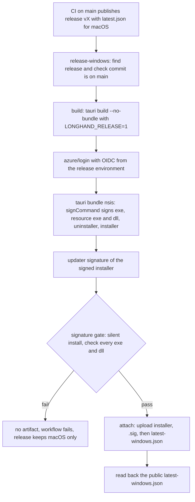

# Signed Windows Releases and In-App Updates - Plan

## Goal Capsule

- **Objective:** A Windows user installs Longhand once from a signed installer that shows the publisher's name. After that, each new release comes to the Windows app as an in-app update, with the same rules as on macOS.
- **Product authority:** This plan. It covers the x64 Windows build of each release only. The Windows download button on longhand.md is a separate step after a real release proves this path (R16).
- **Means:** The Windows release workflow signs inside the Tauri bundle step and gates publication on a signature check (KTD3, KTD5). The Windows app reads its own update manifest (KTD1).
- **Open blockers:** The Azure Artifact Signing setup in Appendix A must be complete before a release can sign. Individual identity validation needs an Azure billing account of type Individual in the United States or Canada (A3). The implementation can start before the setup is complete, but no signed release can publish until it is.
- **Stop conditions:** Stop and ask when a change would alter the macOS release or update path beyond R11, or when the signature check cannot pass without an unsigned file.
- **Execution profile:** One PR with a `feat` title (ask the user "patch or minor?" before opening it). The workflow cannot sign from a PR branch, so the first end-to-end proof is the first release after the merge (R16).
- **Product Contract preservation:** Restructured, no scope change: the Deferred to Planning questions are answered in the Planning Contract.

---

## Product Contract

### Summary

Each release's Windows installer is signed through Azure Artifact Signing with the validated name of the maintainer. The Windows app of a release checks for updates and installs them with the macOS rules. The release order does not change: the release publishes after the macOS build, and the Windows workflow then attaches the signed installer and adds Windows to the update manifest.

### Problem Frame

Several colleagues of the maintainer now use Longhand on Windows at work. The Windows installer of each release is not signed. When a browser downloads it, SmartScreen shows an "unknown publisher" warning, and a managed work PC with a policy that blocks unsigned apps can refuse it. The installed Windows app never checks for updates, because the Windows build does not set the release flag. Each new release therefore needs a manual download and install on each Windows PC, and colleagues fall behind the macOS users.

`STRATEGY.md` says that installers and update paths come "only when a real person wants one". Real people now want one. The strategy text is out of date and gets a separate update (Scope Boundaries).

### Key Decisions

- **Sign with Azure Artifact Signing, as an individual.** Microsoft validates the maintainer's identity, and the publisher name is the validated legal name. No key file to keep, and about USD 10 a month for the Basic tier. (session-settled: user-directed — chosen over an OV certificate from a CA, SignPath Foundation and no signing: a CA certificate costs more and needs a cloud HSM; SignPath shows "SignPath Foundation" as publisher; no signing leaves managed PCs blocked.) Governs R1, R2, R13.
- **macOS first, Windows later.** The release publishes after the macOS build, as now. The Windows workflow adds Windows to the release after its build. (session-settled: user-directed — chosen over a release that waits for both builds: a Windows build failure must not block macOS users.) Governs R6, R7, R11.
- **x64 only.** (session-settled: user-directed — chosen over x64 and ARM64: no known ARM64 user, and a second Windows build adds CI time.) ARM64 PCs run the x64 build through emulation.
- **The website download waits for a real release.** (session-settled: user-directed — chosen over enabling the button in this change: the path must work on a real release first.) Governs R16.
- **Never ship an unsigned Windows build after signing starts.** An unsigned file would bring back the warning and the policy block that this work removes. Governs R3.
- **Per-user install.** A work PC user often has no admin rights, and an update must install without a UAC prompt. Governs R9.
- **No long-lived signing secret in GitHub.** GitHub Actions signs in to Azure through a federated credential that trusts the `release` environment of `twistymaze/longhand`, so no client secret expires or leaks. Governs R13.

### Requirements

**Signing**

- R1. Each Windows installer that a release offers is Authenticode-signed with the Artifact Signing certificate profile and timestamped, and so is each executable and DLL that it installs: the Longhand executable, the transcription libraries and the NeMo helper with its libraries.
- R2. Windows shows the validated name as the publisher in the install prompt and in the file properties of the installer and the installed executable.
- R3. When signing fails, that release gets no Windows installer and no Windows update entry; the Windows workflow fails visibly.

**Updates**

- R4. The Windows app of a release checks for updates and shows the update window with the same schedule, the same What's new content and the same rule as macOS: it never offers or installs an update while a note records or processes.
- R5. When the user chooses to install, the Windows app closes and installs the update with no admin prompt. It opens again after the Install click and after a launch install, and stays closed after an install at quit.
- R6. The update manifest of a release names the Windows update only after the signed installer of that release is attached. Until then, the Windows app finds no update and shows no error, in an automatic check and in a manual check, which shows that the app is up to date. The updater plugin reports a missing manifest file and a missing platform entry as errors, so the Windows app must treat those errors as "no update".
- R7. When the Windows build of a release fails or GitHub replaces its waiting run, Windows apps stay on their version until a later release has a Windows update.
- R8. The Windows app accepts only an update signed with the same updater key as macOS.

**Install**

- R9. The installer installs Longhand for the current user and needs no admin rights.
- R10. An install of the first signed release over an existing unsigned install keeps the notes, the settings, the saved API keys and the storage folder choice, with no uninstall.
- R11. The Windows build never delays or blocks the publication of a release or its macOS update. At no moment does the latest release lack a valid macOS update manifest.

**Setup and documentation**

- R12. `docs/releases.md` gets a step-by-step one-time setup for Artifact Signing and GitHub, at the same level of detail as its Apple steps. Each step says where to click or what command to run, and how to check the result. Appendix A is the draft.
- R13. The Windows release workflow signs with a federated Azure login from the `release` environment only. The `release` environment must continue to allow deployments only from `main`, so pull request runs and other branches cannot sign.
- R14. The Expiry dates table in `docs/releases.md` lists the Artifact Signing credentials and how to renew each.
- R15. `docs/releases.md`, the Release entry in `CONCEPTS.md` and the Windows idea file describe the signed Windows installer and Windows updates in place of the unsigned installer.

**Validation**

- R16. After the PR merges, the first real release is checked on a managed work PC whose policy blocks unsigned apps, before the website download is turned on: a browser download of the installer shows the publisher name, the install works without admin rights over an older install, and the next release comes as an in-app update.

### Key Flows

- F1. First signed install
  - **Trigger:** A colleague downloads the signed installer of a release from its GitHub release page.
  - **Steps:** Windows shows the publisher name (SmartScreen can still warn until reputation builds). The installer runs for the current user and replaces the older unsigned install. Longhand opens with the existing notes and settings.
  - **Covered by:** R1, R2, R9, R10
- F2. Release with a Windows update
  - **Trigger:** A push to `main` makes a release.
  - **Steps:** The macOS build publishes the release. The Windows workflow builds and signs the installer, attaches it, and adds Windows to the update manifest. A Windows app finds the update on its next check and offers it when no note records or processes. The user installs; the app closes, installs and opens again.
  - **Covered by:** R4, R5, R6, R11
- F3. Windows build fails
  - **Trigger:** Signing or the Windows build of a release fails.
  - **Steps:** The release keeps its macOS files and update. It has no Windows installer and no Windows entry. Windows apps stay on their version. The next release with a successful Windows build brings them up to date.
  - **Covered by:** R3, R7

### Acceptance Examples

- AE1. **Covers R6.** Given release 1.9.0 publishes and its Windows build still runs, when a Windows app on 1.8.0 checks for updates, then it finds no update and shows nothing. When the user selects Check for Updates in that time, the app shows that it is up to date, not an error. When the Windows build attaches the signed installer, the next check offers 1.9.0.
- AE2. **Covers R4.** Given a Windows app records a note and an update is available, when the check runs, then the app holds the offer and shows it after the note stops and processing ends.
- AE3. **Covers R3, R7.** Given signing of release 1.9.0 fails, then 1.9.0 has no Windows installer, and a Windows app on 1.8.0 stays on 1.8.0. When release 1.9.1 builds and signs, the app is offered 1.9.1.
- AE4. **Covers R10.** Given a colleague runs an unsigned 1.8.0 install with notes, a storage folder and a saved API key, when they run the signed 1.9.0 installer, then Longhand opens on the same notes and folder, and the summary still works with the saved key.

### Success Criteria

- A colleague installs the signed release once, and each later release with a Windows build reaches them as an update offer with no manual download.
- The install prompt and the file properties name the maintainer as publisher. A SmartScreen warning on early downloads does not fail this criterion: reputation builds with downloads.
- No macOS release is later or blocked because of the Windows path.

### Scope Boundaries

- The Windows download button on longhand.md. It is a separate change after R16.
- A native ARM64 Windows build.
- Microsoft Store, winget and MSI distribution.
- A change to the release order (a release that waits for both builds) or immutable releases.
- Signing for local or manual test builds of Windows.
- The update of the out-of-date line in `STRATEGY.md`. It is a separate docs change on `main`.

### Dependencies / Assumptions

- A1. Signing works only after the maintainer completes Appendix A. Billing for the Artifact Signing account starts when the account is created.
- A2. Identity validation for an individual can take minutes or, when Microsoft asks for documents, up to 20 business days. Plan the setup before the implementation is ready to merge.
- A3. Individual validation needs an Azure billing account of type Individual whose legal name and sold-to address match the government ID. If the existing subscription bills to an organization account, the maintainer needs an Individual billing account first. If individual onboarding is not available, this plan returns to brainstorming to choose a CA certificate.
- A4. In-app updates download without the Mark of the Web, so SmartScreen does not check them. Signing matters for the first install and for policy checks such as Smart App Control.
- A5. App data lives in the per-user Tauri app data folder for the identifier `net.ewal.longhand`, and saved keys are in the Windows credential store under that identifier. A per-user reinstall keeps both. The storage folder choice is in `settings.json` in `%APPDATA%\net.ewal.longhand` (the local store in `src-tauri/src/managers/local_store.rs`), and saved keys are in Windows Credential Manager under the service `net.ewal.longhand.secure-store` (`crates/secrets`). None of these is in the install folder.

### Outstanding Questions

**Resolve Before Planning**

None.

**Deferred to Planning**

Each one is answered in the Planning Contract:

- How the build signs each binary before the updater signature: KTD3, KTD4.
- How the Windows app gets its update entry without a change to the macOS manifest, and a newer release during an older Windows build: KTD1, KTD8.
- Which steps can reach the Azure login and the updater key: KTD6.
- The Windows install moments: KTD7.
- The runner: KTD9.
- macOS-only wording: the update window text is neutral; the Settings switch is macOS-only today (U3).
- GitHub variable names and the federated credential subject: KTD10, Appendix A.

### Sources / Research

- Existing idea: `docs/ideas/next/windows-preview-builds-and-updates.md`.
- Current flow: `docs/releases.md`, `.github/workflows/release-windows.yml`, `scripts/publish-release.ts` (writes only `darwin-aarch64`), `src-tauri/src/commands/build_info.rs` (the `LONGHAND_RELEASE` flag), `src-tauri/src/managers/updates.rs` and `src-tauri/src/managers/updates/flow.rs` (the busy rule and the install moments).
- Earlier plans that deferred Windows updates: `docs/plans/2026-09-28-1240-feat-preview-builds-and-updates-plan.md`, `docs/plans/2026-10-11-1323-ci-releases-in-source-repository-plan.md`.
- Microsoft: [Artifact Signing quickstart](https://learn.microsoft.com/en-us/azure/artifact-signing/quickstart), [FAQ](https://learn.microsoft.com/en-us/azure/artifact-signing/faq), [signing integrations](https://learn.microsoft.com/en-us/azure/artifact-signing/how-to-signing-integrations), [GitHub action](https://github.com/azure/artifact-signing-action).
- Tauri: [Windows code signing](https://v2.tauri.app/distribute/sign/windows/).

---

## Planning Contract

### Key Technical Decisions

- KTD1. **The Windows app reads its own manifest, `latest-windows.json`.** The app chooses the manifest URL by target OS: macOS keeps `releases/latest/download/latest.json`, and Windows reads `releases/latest/download/latest-windows.json`. Only the Windows workflow writes the Windows file, so the macOS file never changes after publication (R11). The manifest platform key is `windows-x86_64`. Governs R6, R11.
- KTD2. **On Windows, three updater errors mean "no update".** `ReleaseNotFound` (the manifest file is missing: GitHub answers 404), `TargetsNotFound` and `TargetNotFound` (the manifest has no entry for this platform) become `Ok(None)` in a Windows build. macOS keeps today's error handling, because its manifest always exists when its release does. The match happens on the typed error, before `check()` turns it into text. Accepted cost on Windows: a GitHub 5xx also gives `ReleaseNotFound`, so a check during a GitHub outage reads as "up to date" and the next scheduled check tries again. Network errors keep their own variant and still show the error. Governs R6, R7.
- KTD3. **Sign inside the Tauri bundle step.** The workflow compiles with `tauri build --no-bundle`, then logs in to Azure, then runs `tauri bundle --bundles nsis` with `bundle.windows.signCommand`. Both steps take the same release config file, because the app version is compiled into the binary: a compile without it reports version 0.1.0, and every Windows app would then see each release as newer than itself. The bundler signs the main executable, the resource `.exe` and `.dll` files, the uninstaller and the installer before it writes the updater signature. The sign command comes only from the CI config overlay, so local builds stay unsigned. Signing before `tauri build` does not work: `beforeBuildCommand` runs `prepare-nemo.ts` again and `build.rs` makes `transcribe-libs/` again, so signed files are replaced. If the signature gate (KTD5) shows unsigned resource files, the workflow signs the staged resource folders with the same command between the two steps. Governs R1.
- KTD4. **SignTool with the Artifact Signing dlib, authenticated through the Azure CLI login.** A wrapper script receives each file from `signCommand` and runs SignTool with the dlib, a generated `metadata.json`, SHA-256 and the Microsoft timestamp server. The dlib authenticates through `DefaultAzureCredential`, which uses the `azure/login` OIDC session, so no client secret exists. Chosen over `artifact-signing-cli`, whose documented authentication is a client secret, and over `azure/artifact-signing-action`, which can only sign files that exist and cannot run inside the bundler. SignTool and the dlib come from NuGet packages with pinned versions, because the runner image's SDK can be older than the minimum version. Governs R1, R13.
- KTD5. **A signature gate before upload.** After bundling, the workflow installs the installer silently into a temporary folder and checks every `.exe` and `.dll` there, plus the installer. Each file must have a valid, timestamped Authenticode signature. The vendor exception is a fixed list of file names with their expected publishers: the VC runtime DLLs (`msvcp140*.dll`, `vcruntime140*.dll`, `vcomp140*.dll`) with Microsoft Corporation, and the Vulkan loader `vulkan-1.dll` with its vendor publisher as observed in the first gate run. A listed file that carries the `WINDOWS_PUBLISHER` signature also passes. Every other `.exe` and `.dll` must have the `WINDOWS_PUBLISHER` subject. The gate fails when it finds no files. A failure leaves no artifact, so nothing is attached. Governs R1, R2, R3.
- KTD6. **The Windows build job can sign, and only for commits on `main`.** The build job runs in the `release` environment with `id-token: write`, only after the `find` job confirms the commit is on `main` (`docs/solutions/security-issues/dispatched-release-build-could-write-main-caches.md`). `TAURI_SIGNING_PRIVATE_KEY` is set on the bundle step only. `id-token: write` applies to the whole job, so every step, the compile and the package installs included, can request the OIDC token that Azure accepts for signing; the Azure login after the compile only shortens the Azure CLI session. This is accepted: the macOS release job already compiles while it holds the Apple certificate and the updater key, and the compiled code goes into the signed installer anyway. (session-settled: user-directed — chosen over a compile job without signing access, a separate sign job and a credential-free check job: same trust as the macOS release, less workflow and about 10 minutes less per release.) The `attach` job stays the only job that can write to the repository, and it runs no build code. Governs R13.
- KTD7. **Windows install moments.** On Windows the updater runs the NSIS installer and ends the process. The Install click and the launch install let NSIS open the app again. The install at quit sets `restart_after_install(false)`, so the app does not open again after the user quit. The click and a plain quit both reach the install through the app's exit handler, so the manager records that an exit is a restart before it requests the restart for the click, and the exit handler relaunches only when that record exists. The app records the install attempt before it starts the installer, because the process ends before the result is known. Governs R5.
- KTD8. **`attach` uploads the installer, its signature, then the Windows manifest, and reads the manifest back.** The manifest goes last, so a Windows app never finds a manifest that points at a missing installer. On a re-run, `attach` first deletes the existing `latest-windows.json`, because GitHub replaces an asset only by delete and upload, and an old manifest would point at an installer being replaced; Windows apps read "no update" (KTD2) until the new manifest is up. After the upload, `attach` reads the public `releases/download/<tag>/latest-windows.json` and fails when the content differs. When a newer release publishes during an older Windows build, the older release gets its installer and manifest, and Windows apps wait for the newer release's Windows build (R7).
- KTD9. **The Windows release build stays on `windows-latest`.** The macOS-first order means that the Windows build time does not delay macOS users, and the warm build takes about 24 minutes there. The 8-core runner is a later option if Windows updates arrive too late.
- KTD10. **The Azure federated credential uses the exact subject `repo:twistymaze@328897520/longhand@1414511015:environment:release`.** The repository emits GitHub's immutable subject format (`use_immutable_subject: true`, read from the OIDC customization API on 2026-10-28), so the Azure portal's GitHub preset, which writes `repo:twistymaze/longhand:...`, does not match. Appendix A step G uses "Other issuer" with this subject. Governs R13.
- KTD11. **The per-user install mode is pinned.** `tauri.windows.conf.json` sets the NSIS `installMode` to `currentUser`, which is also the Tauri default, so a later config change cannot move installs to a per-machine path that needs admin rights. Governs R9.

### High-Level Technical Design

The release flow for one release:



What a Windows app does with the manifest:

| Situation | Check result | Manual check shows |
|---|---|---|
| Latest release has `latest-windows.json` with a newer version | Update | The update window |
| Latest release has no `latest-windows.json` yet (404) | No update (KTD2) | Up to date |
| Manifest has no `windows-x86_64` entry | No update (KTD2) | Up to date |
| Network error | Error | The error |

Install moments on Windows (KTD7):

| Moment | Installer run | App afterwards |
|---|---|---|
| Install and Relaunch click | NSIS passive, `/UPDATE` | Opens again |
| Later, then quit | NSIS passive, `/UPDATE`, no relaunch | Stays closed |
| Next launch with a saved update | NSIS passive, `/UPDATE` | Opens again |

### Assumptions

- The Tauri 2.12 NSIS bundler signs resource `.exe` and `.dll` files through `signCommand` (read from the bundler source, not from documentation). KTD3's fallback and KTD5's gate cover the case where it does not.
- The Artifact Signing dlib accepts the Azure CLI credential from `azure/login` OIDC. If it does not, the wrapper passes the federated token through `AzureCliCredential` explicitly; a client secret stays out of scope (R13).

### Risks

| Risk | Effect | Mitigation |
|---|---|---|
| The first signed build runs only after the merge | A fault shows on a real release | macOS ships regardless (R11). A fix that changes only `release-windows.yml` takes effect on a rebuild with `gh workflow run release-windows.yml -f tag=v<version>`. A rebuild builds the tag's commit, so a fix to `scripts/`, the Tauri config or app code needs a new release: merge it with a `fix:` title. |
| Appendix A is not complete at merge time | The Windows build of each release fails at the Azure login | R3 holds: no Windows installer. Complete the setup, then rebuild the latest tag. |
| The Azure token expires during a long step | Signing fails | The login is after the compile (KTD3), and the bundle step takes minutes. |
| Smart App Control also weighs reputation | A signed build can still be blocked on a new publisher | R16 tests on a managed PC; Microsoft's file submission is the fallback. |

---

## Implementation Units

### U1. Windows update manifest and "no update" errors

**Goal:** The Windows app of a release reads `latest-windows.json`, and a missing manifest or platform entry reads as "no update".

**Requirements:** R4, R6, R7, R8; KTD1, KTD2.

**Dependencies:** None.

**Files:**
- `src-tauri/src/managers/updates.rs` (manifest URL by target OS, error classification before the error becomes text, tests)
- `src-tauri/src/commands/build_info.rs` (doc comment: the release flag is set for the macOS and Windows release builds)

**Approach:**
1. Replace the single `MANIFEST_URL` with one URL per target OS.
2. Add a pure helper that says whether an updater error means "no update" for a target OS (the three variants in KTD2, Windows only), and use it in `check()` before `map_err`.
3. Keep the flow (`updates/flow.rs`) unchanged: it already shows "up to date" for `Ok(None)` and schedules no retry.

**Patterns to follow:** The pure helpers `installs_at_launch` and `launch_skips_install` in `updates.rs`; the manifest URL pin test.

**Test scenarios:**
- Covers AE1. `ReleaseNotFound` is classified as no update.
- `TargetsNotFound` and `TargetNotFound` are classified as no update.
- A network error and a signature error are not classified as no update.
- The manifest URL is `.../latest-windows.json` for a Windows target and `.../latest.json` for macOS (pin test per target).
- For a macOS target, `ReleaseNotFound` stays an error.

**Verification:** A Windows release build with no Windows manifest shows "up to date" for a manual check; macOS behaviour is unchanged.

### U2. Windows install moments

**Goal:** An update installs on Windows at the click, at quit and at the next launch with the macOS rules, and the app opens again only after the click or the launch install.

**Requirements:** R4, R5; KTD7; AE2.

**Dependencies:** None.

**Files:**
- `src-tauri/src/managers/updates.rs` (install at exit and at launch)
- `src-tauri/src/managers/updates/archive.rs` (only if the saved-file names need a Windows change)

**Approach:**
1. Record that an exit is a restart before `request_restart` for the Install click; in the exit handler, set `restart_after_install(false)` on Windows when that record does not exist.
2. Write the install-attempt record before `install()` on every path, because the Windows process ends inside `install()`.
3. Keep the saved archive names: on Windows the bytes are the NSIS installer, and the plugin accepts them.

**Execution note:** Put the relaunch choice in a pure helper (moment in, relaunch yes/no out), so that it has a test on macOS CI.

**Test scenarios:**
- The relaunch helper returns yes for the click and the launch install, and no for the quit install.
- A confirmed held update that installs at a manual quit (no restart record) does not relaunch.
- The install-attempt record exists before the installer starts (the failure-record test pattern in `updates.rs`).
- Covers AE2. The busy rule still holds an offer while a note records (existing flow tests stay green).

**Verification:** On Windows, "Later" then quit installs and leaves the app closed; the next launch shows the new version.

### U3. Update settings on Windows

**Goal:** The "Check for updates automatically" switch shows on Windows as on macOS.

**Requirements:** R4.

**Dependencies:** None.

**Files:**
- `src/settings/Status.tsx`
- `src/settings/Status.test.tsx`
- `src/update/UpdateWindow.tsx` (comments that name only macOS)

**Approach:** Remove the macOS-only condition from the Updates group and its read-only computation. The update window text stays as it is.

**Test scenarios:**
- On a Windows platform, the Updates group and its switch render.
- On macOS, the group renders as before.

**Verification:** Settings on Windows shows the switch, and turning it off stops automatic checks.

### U4. Windows manifest and attach in the publish script

**Goal:** `attach` publishes the signed installer, its updater signature and `latest-windows.json` in that order, then reads the manifest back.

**Requirements:** R6, R7, R11; KTD1, KTD8.

**Dependencies:** None.

**Files:**
- `scripts/publish-release.ts`
- `scripts/publish-release.test.ts`

**Approach:**
1. Change `attach` to take the tag, the installer and its `.sig`.
2. Add a Windows manifest builder: version from the tag, the release notes, the `windows-x86_64` entry with the signature text and the installer's asset URL.
3. When the release already has `latest-windows.json`, delete it first. Then upload the installer, then the `.sig`, then the manifest last, with the existing replace path.
4. Read `releases/download/<tag>/latest-windows.json` back and fail when it differs.
5. Never touch `latest.json`.

**Patterns to follow:** `buildManifest`, the `ReleasesApi` seam and the fake repository in the tests; the script uses only Node built-ins.

**Test scenarios:**
- The Windows manifest has the version, the `windows-x86_64` key, the trimmed signature and the installer URL.
- `attach` uploads the manifest after the installer and the signature.
- `attach` never uploads or deletes `latest.json`.
- A re-run deletes the old manifest before it replaces the installer and the `.sig`, and uploads the new manifest last.
- A missing tag fails without uploads.
- A read-back that differs fails the command.
- The CLI rejects the old two-argument form with the usage text.

**Verification:** `node --test scripts/publish-release.test.ts` passes.

### U5. Signing wrapper, signature gate and install mode

**Goal:** One script signs a file for `signCommand` and checks a whole install tree for KTD5.

**Requirements:** R1, R2, R3, R9; KTD3, KTD4, KTD5, KTD11.

**Dependencies:** None.

**Files:**
- `scripts/windows-signing.ts` (subcommands `sign <file>` and `verify <folder> <installer>`)
- `scripts/windows-signing.test.ts`
- `src-tauri/tauri.windows.conf.json` (NSIS `installMode`)
- `.github/workflows/ci.yml` (add the new test file to the release-script test list)

**Approach:**
1. `sign` reads the SignTool path, the dlib path and the `metadata.json` path from environment variables and runs SignTool with SHA-256 digests and the Microsoft timestamp server. It fails on a non-zero exit.
2. `verify` lists every `.exe` and `.dll` under the folder plus the installer, fails on an empty list, and checks each file with PowerShell `Get-AuthenticodeSignature`: valid status, a timestamp, and the publisher rule of KTD5 (the fixed vendor list, else `WINDOWS_PUBLISHER`).
3. Keep the file selection and the publisher rule in pure functions.

**Patterns to follow:** `scripts/windows-redist.ts` and its test for Windows-only script logic tested on any OS.

**Test scenarios:**
- File selection finds `.exe` and `.dll` files in nested folders and ignores other types.
- An empty folder fails.
- A file with status other than valid fails, and so does a valid file with no timestamp.
- Longhand's own file with another publisher fails.
- A Microsoft-signed VC runtime DLL passes with its own publisher.
- `vulkan-1.dll` passes with its vendor publisher or with `WINDOWS_PUBLISHER`.
- A file not on the vendor list that is signed by another publisher fails.
- The `sign` command line has the digest, timestamp, dlib and metadata arguments, with the file as its own argument.

**Verification:** `node --test scripts/windows-signing.test.ts` passes; the workflow gate (U6) reports each checked file.

### U6. Signed Windows release workflow

**Goal:** `release-windows.yml` builds a release build of the app, signs it, gates it and attaches it with the Windows manifest.

**Requirements:** R1, R3, R6, R8, R11, R13; KTD3, KTD4, KTD5, KTD6, KTD8, KTD9.

**Dependencies:** U4, U5.

**Files:**
- `.github/workflows/release-windows.yml`

**Approach:**
1. Build job: `environment: release`, job permissions `contents: read` and `id-token: write`.
2. Extend the release config overlay with `createUpdaterArtifacts: true` and the `signCommand` that runs `node scripts/windows-signing.ts sign %1`.
3. Install SignTool and the dlib from pinned NuGet versions, and write `metadata.json` from the environment variables.
4. Run `tauri build --no-bundle` with the same release config file as step 5, `LONGHAND_RELEASE=1`, `LONGHAND_CHANGELOG` and the build commit. Then check that the file version of the built `longhand.exe` is the tag version.
5. Run `azure/login` (pinned by SHA), then `tauri bundle --bundles nsis` with the release config and `TAURI_SIGNING_PRIVATE_KEY` on that step only.
6. Check that the `.sig` names the release version, as the macOS job does.
7. Run the signature gate on a silent install into a temporary folder and on the installer.
8. Upload the installer and the `.sig` as the artifact.
9. Attach job: `node scripts/publish-release.ts attach` with the tag, the installer and the `.sig`.
10. Update the header and step comments that say the build is unsigned and gets no updates.

**Execution note:** This is CI configuration; prove it with `actionlint` locally and the first real release (R16). A dispatch rebuild of a tag is the retry path for a workflow fault only; it builds the tag's commit (Risks).

**Patterns to follow:** The macOS `release-build` job in `.github/workflows/ci.yml` (environment, per-step secrets, signature version check, cleanup with `if: always()`); `docs/solutions/build-errors/windows-rust-selects-git-linker-after-msvc-setup.md` (Rust steps in `pwsh`).

**Test scenarios:** Test expectation: none -- workflow configuration; the signature gate and `attach` read-back check every run, and U4 and U5 carry the unit tests.

**Verification:** `actionlint` reports no errors; on the first release after the merge, the run attaches three files and the gate log lists every file as signed.

### U7. Documentation

**Goal:** The docs describe signed Windows releases and Windows updates, with the one-time setup step by step.

**Requirements:** R12, R14, R15.

**Dependencies:** U1 to U6.

**Files:**
- `docs/releases.md` (release flow, one-time setup with Appendix A as the Artifact Signing steps, the Expiry dates table, installing the first Windows build, the Windows bullet in "When a release does not publish")
- `CONCEPTS.md` (Release entry)
- `docs/ideas/next/windows-preview-builds-and-updates.md` (Notes)

**Approach:** Move Appendix A into `docs/releases.md` with the final variable names, and state the `main`-only rule of the `release` environment as a condition of signing.

**Test scenarios:** Test expectation: none -- documentation.

**Verification:** A reader can do the setup from `docs/releases.md` alone; `node scripts/ideas.ts check` passes.

---

## Verification Contract

| Gate | Command or check | Applies to |
|---|---|---|
| Rust format | `cargo fmt --all --check` | U1, U2 |
| Rust lint | `cargo clippy --workspace --all-targets` | U1, U2 |
| Rust tests | `cargo test -p longhand --lib updates` during units; one full workspace run at the end | U1, U2 |
| Frontend | `npm run typecheck` and `npm test` | U3, U4, U5 |
| Script tests | `node --test scripts/publish-release.test.ts scripts/windows-signing.test.ts` | U4, U5 |
| Workflow lint | `actionlint .github/workflows/release-windows.yml .github/workflows/ci.yml` | U5, U6 |
| Ideas | `node scripts/ideas.ts check` | U7 |
| CI | All required checks green on the PR, including the Windows checks that compile the `cfg(windows)` code | All |
| Post-merge | R16 on a managed work PC | Release |

---

## Definition of Done

- U1 to U7 are complete and every gate in the Verification Contract passes.
- No code path, workflow step or config uploads, deletes or rewrites `latest.json` from the Windows workflow.
- Local and PR builds stay unsigned and get no updates; only the release workflow signs.
- The PR title is a `feat` Conventional Commit, with patch or minor chosen by the user.
- No abandoned-attempt code, temporary debug steps or unused config remain in the diff.
- After the merge: Appendix A is complete, the first release attaches a signed installer, `.sig` and `latest-windows.json`, and R16 passes before the website download is turned on.

---

## Appendix

### Appendix A. Draft setup guide: Artifact Signing and GitHub

This draft is from the Microsoft documentation of October 2026. The implementation checks it against the current portal and moves the final version into `docs/releases.md` (R12). Do the steps in this order. The names in `code` are suggestions; write down the names that you use.

**A. Check the billing account (5 minutes)**

1. Sign in to the [Azure portal](https://portal.azure.com/) with the account that owns your subscription.
2. Search for **Cost Management + Billing** and open it. Select **Billing scopes**, then your billing account, then **Properties**.
3. Check that **Account type** is **Individual**. If it is **Organization** or the page shows a company, stop and tell the agent: the plan needs another billing account (A3).
4. Check that the legal name and the sold-to address are exactly as on your driver's license or passport. Edit them there if they are not. The certificate shows your name, city, state and country.

**B. Register the resource provider (2 minutes)**

1. Search for **Subscriptions** and select your subscription.
2. Under **Settings**, select **Resource providers**.
3. Find **Microsoft.CodeSigning**, select it, and select **Register**. Wait until the status is **Registered**.

**C. Create the signing account (5 minutes; billing starts here)**

1. Search for **Artifact Signing Accounts** and select **Create**.
2. **Subscription:** your subscription. **Resource group:** **Create new**, `longhand-signing`.
3. **Account name:** for example `longhandsigning` (3 to 24 letters and digits, unique in Azure, starts with a letter).
4. **Region:** for example **East US**. Write down the endpoint of that region: East US is `https://eus.codesigning.azure.net`.
5. **Pricing:** **Basic**. Select **Review + Create**, then **Create**, then **Go to resource**.

**D. Give yourself the verifier role (2 minutes)**

1. In the signing account, select **Access control (IAM)** > **Add** > **Add role assignment**.
2. Select the role **Artifact Signing Identity Verifier**, select **Next**, add your own user, and select **Review + assign**.

**E. Validate your identity (15 minutes; you need your phone and your ID)**

1. Install **Microsoft Authenticator** on your phone if it is not installed.
2. In the signing account, under **Objects**, select **Identity validations**.
3. Change **Organization** to **Individual**, select **New identity**, then **Public**.
4. Select the billing account. The form fills in from it. Check the **Certificate subject preview**, then select **Create**. The status becomes **In Progress**.
5. When the status is **Action Required**, select your name, and open the link under "Please complete your verification here". Sign in with the same email address as in the request.
6. Select **Get verified here through our trusted ID-verifiers** and follow the AU10TIX steps: email PIN, phone number, then scan the QR code with your phone. Photograph your ID on a flat surface with no flash, and do the face check in even light.
7. On the phone, select **Open Authenticator** and add the Verified ID. Scan the next QR code in the browser, select the credential, and select **Share**.
8. The browser shows **Verification Successful**. After a few minutes the portal status is **Completed**. If Microsoft asks for documents (for example a utility bill), the email says which, and the wait can be up to 20 business days.

**F. Create the certificate profile (2 minutes)**

1. In the signing account, under **Objects**, select **Certificate profiles** > **Create** > **Public Trust**.
2. **Certificate Profile Name:** for example `longhand`. Keep **Program Type** at **None**.
3. **Verified CN and O:** select your completed validation. Leave **Include street address** and **Include postal code** clear. Select **Create**.

**G. Let GitHub sign with no secret (10 minutes)**

1. Search for **Microsoft Entra ID** > **App registrations** > **New registration**. Name it `longhand-release-signing`, keep the defaults, and select **Register**. Write down the **Application (client) ID** and the **Directory (tenant) ID**.
2. In the app, select **Certificates & secrets** > **Federated credentials** > **Add credential**. Choose the scenario **Other issuer**, not the GitHub preset: this repository uses GitHub's newer subject format, which the preset does not write (KTD10). Enter exactly:
   - **Issuer:** `https://token.actions.githubusercontent.com`
   - **Type:** **Explicit subject identifier**
   - **Value:** `repo:twistymaze@328897520/longhand@1414511015:environment:release`
   - **Name:** `longhand-release`
   - **Audience:** keep `api://AzureADTokenExchange`

   Select **Add**.
3. Go back to the signing account > **Access control (IAM)** > **Add role assignment**. Select the role **Artifact Signing Certificate Profile Signer**, then **Next** > **Select members**, search for `longhand-release-signing`, and select **Review + assign**.
4. Write down your **Subscription ID** (Subscriptions page).
5. Check the GitHub side of the trust. In `twistymaze/longhand`, open Settings > Environments > `release`. Under "Deployment branches and tags", the only rule must be `main` (setup step 3 in `docs/releases.md`). Do not loosen this rule: any branch that can use the `release` environment can sign files with your name.

**H. Put the values in GitHub (5 minutes)**

These values are not secret, so they go in as environment variables of the `release` environment. Run each command and paste the value when it asks. The final names come from the implementation.

```bash
gh variable set AZURE_CLIENT_ID --env release -R twistymaze/longhand
```

```bash
gh variable set AZURE_TENANT_ID --env release -R twistymaze/longhand
```

```bash
gh variable set AZURE_SUBSCRIPTION_ID --env release -R twistymaze/longhand
```

```bash
gh variable set ARTIFACT_SIGNING_ENDPOINT --env release -R twistymaze/longhand
```

```bash
gh variable set ARTIFACT_SIGNING_ACCOUNT --env release -R twistymaze/longhand
```

```bash
gh variable set ARTIFACT_SIGNING_PROFILE --env release -R twistymaze/longhand
```

The publisher name for the signature gate (KTD5) is the common name in the **Certificate subject preview** of step F, for example `Ervin Walter`:

```bash
gh variable set WINDOWS_PUBLISHER --env release -R twistymaze/longhand
```

Check that this command lists the 7 names:

```bash
gh variable list --env release -R twistymaze/longhand
```

**I. Renewal**

- The signing certificates last 3 days, and Azure renews them by itself. The timestamp keeps old signatures valid.
- Microsoft sends reminders from 60 days before the identity validation expires. Renew it then, or signing stops.
- The federated credential does not expire.
- Delete the signing account to stop billing; signed files stay valid.
