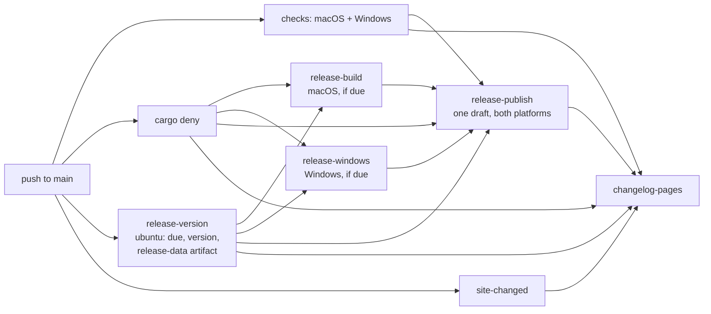

# Unified Release and Direct Downloads - Plan

## Goal Capsule

- **Objective:** A visitor to longhand.md gets the newest Longhand installer for their computer with one click, on macOS and on Windows. Each release has the installers for both platforms from the moment it is published.
- **Means:** One CI run on `main` builds both platforms in parallel and publishes one release with fixed installer names; the landing page links directly to those names (KTD1, KTD4, KTD8).
- **Product authority:** The Product Contract below wins on behaviour. The Planning Contract wins on mechanism within it. The user chose the release shape, the file names, the button behaviour and the `build` PR title on 2026-10-29.
- **Execution profile:** One PR on one branch, in a worktree made from `origin/main`. Commit per unit. Run the local checks of [Checks and CI](../development-workflow.md#checks-and-ci) before the push.
- **Stop conditions:** Stop and ask when a step needs a change to the Azure federated credential, the `release` environment rules, the `main` ruleset or a repository variable. Stop when the existing release build steps cannot move without a change to their behaviour.
- **Who finishes:** `ce-work` implements and opens the PR with a `build:` title, then `ce-babysit-pr` runs until the PR is ready. The maintainer merges. The merge run is the first real run of the new release jobs (KTD9).
- **Open blockers:** None.

---

## Product Contract

Product Contract preservation: changed R14 (clarification: the Windows floor is Windows 10, 64-bit) and Dependencies (the PR title is `build`, KTD9); the Outstanding Questions are resolved in the Planning Contract. No scope change.

### Summary

Each release builds the macOS and Windows installers in parallel, at the same time as the checks on `main`. The release publishes once, with both platforms, or it does not publish. The installers get fixed file names, so a link to the latest release always gives a file. The landing page shows one direct download button for the visitor's operating system and a link to the other installer.

### Problem Frame

The landing page sends visitors to the GitHub releases page. That page lists nine files for each release, and a person who is not technical must find the correct one. The Windows button shows "Coming soon", although signed Windows releases exist since v1.2.14.

A direct link is not possible today, for three reasons:

- The file names contain the version (`Longhand_1.2.14_aarch64.dmg`, `Longhand_1.2.14_x64-setup.exe`).
- The Windows installer comes in a separate workflow after the release is published. For v1.2.14, the macOS files were published at 14:37 and the Windows installer at 14:53.
- Some releases never get a Windows installer. GitHub replaces a waiting Windows run, or the Windows build or signing fails, and the release keeps only its macOS files (`docs/releases.md`, "The Windows installer is missing").

The cause is that Windows is a second-class platform in the release process. The user wants macOS and Windows to be almost equally important.

Measured times today, from the push to `main`: the checks take about 11–13 min. The macOS release build and publication take about 4 min, so macOS is available after about 17 min. The Windows build takes 9–18 min and starts only after the CI run ends, so Windows is available after about 27–35 min.

### Key Decisions

- **One release for both platforms.** A failure of the Windows build fails the release, the same as a failure of the macOS build. A failed Windows build is a defect in CI, and the fix goes in a `fix:` PR. Governs R1, R3, R4, R5. (session-settled: user-directed — chosen over a separate Windows workflow that attaches its installer after publication: Windows and macOS must be almost equally important, and a release with no Windows installer is a defect to fix.)
- **Release builds start alongside the checks.** The builds wait only for the `cargo deny` job (licences, sources, bans; about 1–2 min), not for the checks. Publication waits for the checks and both builds. The deny gate stays before any job that holds a signing credential, because the ruleset of `main` lets an admin push without a PR. A failed check still publishes nothing. Governs R1, R2. (session-settled: user-approved — chosen over release builds that start after the checks pass: both platforms come out about 15–20 min after the push, compared with 25–30 min.)
- **Fixed installer names.** When both platforms publish together, `releases/latest/download/<name>` always gives a file, so the site needs no step that finds file addresses. Governs R6, R9. (session-settled: user-approved — chosen over versioned names with a site build that finds the newest release that has each file: no blocker remains after the release is unified.)
- **One button for the detected operating system, and a link to the other installer.** Governs R9–R13. (session-settled: user-directed — chosen over two equal buttons: most visitors see one clear action, and the other platform stays one click away.)

### Requirements

**Release**

- R1. When a push to `main` makes a release due, the macOS and Windows release builds start in parallel with the checks of that CI run, after the `cargo deny` job passes.
- R2. The release publishes only after every check and both release builds pass. All files go up to a draft first, and the draft becomes the latest release only after the last file is uploaded.
- R3. When a check, the macOS build or the Windows build fails, nothing publishes and no tag is made. The next run that makes the release due publishes it with both platforms.
- R4. When GitHub replaces a waiting CI run on `main`, the commits of that run go out in the next release, with both platforms.
- R5. The separate Windows release workflow (`.github/workflows/release-windows.yml`) and its rebuild of the installer for one tag are removed.

**Release files**

- R6. The installers have fixed names that contain the platform and the architecture but no version: `Longhand_aarch64.dmg` and `Longhand_x64-setup.exe`.
- R7. Each release continues to publish the update manifests that installed apps read: `latest.json` for macOS and `latest-windows.json` for Windows. Installed apps on both platforms continue to find updates with no change to the app.
- R8. Releases that were published before this change keep their files and names.

**Landing page**

- R9. The page detects the operating system of the visitor. On macOS or Windows, it shows one main button for that system ("Download for Mac" or "Download for Windows"), which downloads the installer directly from `https://github.com/twistymaze/longhand/releases/latest/download/<name>`.
- R10. Below the main button, a link downloads the installer for the other platform.
- R11. When the page cannot find macOS or Windows (a phone, a tablet, Linux, an unknown system, or no JavaScript), it shows both buttons as equals.
- R12. The page shows its final button layout at first paint, with no visible change after load. The detection only promotes one of the two download links and demotes the other; it never adds or removes a link.
- R13. Both download places on the page use R9–R12: the top of the page and the "Try Longhand in your next meeting" section. The "Coming soon" label goes away.
- R14. The platform line gives the system requirements for both platforms, as the release builds support them: macOS 15 or later on Apple silicon, and Windows 10 or later, 64-bit.

**Documentation**

- R15. `README.md` and `docs/releases.md` describe the single release for both platforms, the fixed file names and the failure rules of R3.

### Acceptance Examples

- AE1. **Covers R9, R10.** **Given** a visitor on a Mac, **when** the page loads, **then** the main button says "Download for Mac" and downloads `Longhand_aarch64.dmg` of the latest release, and a link below it downloads `Longhand_x64-setup.exe`.
- AE2. **Covers R9, R10.** **Given** a visitor on Windows, **when** the page loads, **then** the main button says "Download for Windows" and downloads `Longhand_x64-setup.exe`, and a link below it downloads the DMG.
- AE3. **Covers R11.** **Given** a visitor on an iPhone, an iPad, Linux, or with JavaScript off, **when** the page loads, **then** "Download for Mac" and "Download for Windows" show as two equal buttons.
- AE4. **Covers R2, R3.** **Given** a due release whose macOS build passes and whose Windows build fails, **when** the run ends, **then** no release and no tag exist for that version, and the latest release and its download links stay on the previous version.
- AE5. **Covers R2.** **Given** a release that is publishing, **when** a visitor clicks a download button before the last file is uploaded, **then** the visitor gets the installer of the previous release, not a missing file.

### Success Criteria

- For a due release, both installers are available about 15–20 min after the push to `main`. macOS is not available much later than today (about 17 min).
- Every release published after this change has both installers.

### Scope Boundaries

- One `latest.json` with both platforms in place of `latest-windows.json` is deferred. Installed Windows apps read `latest-windows.json`, so a change needs a migration.
- An Intel macOS build, an ARM64 Windows build and a Linux build are not in scope. R6's names leave space for them.
- Visitors on an Intel Mac also see "Download for Mac". A browser cannot reliably tell Apple silicon from Intel. R14's platform line tells them the requirement.
- Versioned copies of the installers next to the fixed names are not made.
- A change to the release title, the release notes or the changelog page is not in scope.
- Considered and not built: a page hint after a download starts ("open the DMG and drag Longhand to Applications"). Nobody asked for it, and the browser shows the download. Visitor reports of confusion would change this call.
- Considered and not built: a check in the page-only deploy that the latest release has the fixed names. KTD9 makes the first deploy go with a release; a later page-only deploy can only happen after that release exists.

### Dependencies / Assumptions

- The CI workflow on `main` runs one run at a time (`concurrency: ci-${{ github.ref }}` in `.github/workflows/ci.yml`). With release builds that start alongside the checks, the length of a run on `main` changes little, so the queue of runs on `main` does not get much longer. The separate Windows workflow existed to prevent a long queue (the header comment of `.github/workflows/release-windows.yml`).
- The site change and the release change ship in one PR with a release title (KTD9). The site deploys only with a release when one is due, so the new download links go live with the first release that has the fixed names.
- The macOS check and the macOS release build both use the `longhand-macos-vm` runner label, which has two VM slots on the Mac mini that PR checks also use (`docs/ideas/done/ephemeral-ci-runner-vms.md`). A due run on `main` needs both slots at once, so a PR check that holds a slot delays the release. The plan accepts that delay (KTD3).
- The Windows release build continues to run in the `release` environment, which allows deployments only from `main`. The Azure federated credential trusts only this environment (subject `…:environment:release`, `docs/releases.md` setup step 6), so a job that moves into `ci.yml` needs no Azure change.
- The website deploys only with a release or a change to the site (`changelog-pages` in `.github/workflows/ci.yml`). With fixed names, the buttons are static links, so the deploy needs no information about the release files.

### Sources / Research

- `site/index.html` — the two download places and the "Coming soon" label. `site/partials/head.html` loads `site/public/theme.js` as a blocking script in `<head>`; `scripts/theme.test.ts` runs it in `node:vm`.
- `.github/workflows/ci.yml` — `release-build` (needs `checks` and `deny`, version step at about line 610), `release-publish`, `site-changed`, `changelog-pages` (its condition at about line 853 uses `release-build` as "the checks passed"), the script test list at about line 320.
- `.github/workflows/release-windows.yml` — the Windows build steps, the changelog download from the published release (about lines 184–196), the `attach` job.
- `scripts/publish-release.ts` — `publish` (draft, uploads, `make_latest`), `attach` (Windows files and the public read-back of `latest-windows.json`), `newerRunWaiting`, the manifest builders. `scripts/publish-release.test.ts` — the in-memory `fakeRepo`.
- `scripts/release-version.ts`, `scripts/changelog.ts` — need only Node built-ins, git with full history, and git-cliff.
- `src-tauri/src/managers/updates.rs` — the apps read `releases/latest/download/latest.json` and `latest-windows.json`. tauri-plugin-updater 2.14.1 checks only the signature and the `version:` field of the `.sig` trusted comment, not `file:`, so a rename after signing keeps updates working.
- `docs/releases.md`, `docs/development-workflow.md` (Manual tests > Windows; CI), `README.md` (Get Longhand), `CONCEPTS.md` (Release).
- `docs/solutions/workflow-issues/default-run-shell-hides-pipe-failures.md`, `docs/solutions/security-issues/dispatched-release-build-could-write-main-caches.md`, `docs/solutions/build-errors/windows-rust-selects-git-linker-after-msvc-setup.md`, `docs/solutions/build-errors/macos-27-rejects-stripped-release-proc-macros.md`.
- Release v1.2.14 and the CI runs of 2026-10-28 and 2026-10-29 — the measured times in the Problem Frame.

---

## Planning Contract

### Key Technical Decisions

- KTD1. **The release jobs stay in `.github/workflows/ci.yml`.** The checks, the deny gate, the builds and the publication must be in one run so that `needs` gates publication on all of them (R2). A second workflow can only wait for a whole CI run, which is the shape that R5 removes. The run-on-`main` concurrency group then also covers the Windows build, so R4 holds with no extra group.
- KTD2. **A new `release-version` job on `ubuntu-latest` decides whether a release is due.** It runs `scripts/release-version.ts` and `scripts/changelog.ts write` (full history, git-cliff, plain `actions/setup-node`, no `npm ci`), outputs `due` and `version`, and uploads one `release-data` artifact (notes and the changelog folder) when a release is due. Both builds and the publication read the version and the changelog from it. It holds no secret, so it needs no deny gate. A push with no due release then uses no macOS VM slot.
- KTD3. **The release builds use `needs: [deny, release-version]` and run only when `due` is true; `release-publish` needs `checks`, `deny`, `release-version` and both builds.** A skipped or failed need skips publication, so a failed check or build publishes nothing (R2, R3). `release-version` is not a gate in the sense of the "alongside the checks" decision: it holds no secret, runs in about a minute, and supplies `due` and `version`. The macOS release build keeps `MACOS_RELEASE_RUNNER` (today `longhand-macos-vm`). A wait for a VM slot is accepted, because the alternative is a paid hosted macOS runner for every release.
- KTD4. **A new `release-windows` job in `ci.yml` takes the build steps of `release-windows.yml` unchanged, apart from its inputs.** It checks out `github.sha`, reads the changelog from `release-data` instead of the published release, and sets `LONGHAND_BUILD_COMMIT` from `github.sha`. It runs on `windows-latest` in the `release` environment with `id-token: write`, the `v3-release-windows` cache prefix and `cache-on-failure: false`. The `find` job and its on-`main` compare guard go away: a push to `main` is the only trigger, so no input selects a ref (`docs/solutions/security-issues/dispatched-release-build-could-write-main-caches.md`). (session-settled: user-approved — chosen over the paid 8-core Windows runner that the checks on `main` use: the standard runner is free and clean, and the speed gain is a few minutes.)
- KTD5. **Each build renames its installer to the fixed name after signing and its checks, and before upload.** The macOS collect step copies the stapled DMG as `Longhand_aarch64.dmg`. The Windows job renames the installer and its `.sig` to `Longhand_x64-setup.exe` and `Longhand_x64-setup.exe.sig` after the signature gate. The updater checks only the signature and the `version:` field, and the staple and the Authenticode signature are in the file content, so the rename breaks nothing. `Longhand.app.tar.gz` and its `.sig` keep their names.
- KTD6. **`scripts/publish-release.ts publish` takes the files of both platforms and uploads them to one draft; `attach` is removed.** The upload order is: DMG, macOS archive, its `.sig`, `latest.json`, Windows installer, its `.sig`, `latest-windows.json`, `changelog.json`, `CHANGELOG.md`. Then the draft is published as the latest release. The script fails when an installer name is not the fixed name of R6, so a build change cannot publish a versioned name that the site does not link. Before publication it reads both manifests back from the draft through the authenticated API and fails when one differs, so every check that can fail runs while the release is still a draft. It writes `published=true` as soon as the draft is published; no step after that can fail the job, so `changelog-pages` always sees a published release. The public read-back of `attach` is not kept: after publication a failure cannot be undone, and a rerun would skip the version as not newer. The existing skip rules (version not newer, newer run waiting) and draft cleanup stay.
- KTD7. **`changelog-pages` needs `checks`, `deny`, `release-version`, `release-publish` and `site-changed` directly.** Its condition starts with `!cancelled()`, because `release-publish` and the builds are skipped when no release is due and a skipped need otherwise skips this job. It deploys when `release-publish` published, or when the site changed, `checks` and `deny` succeeded, `release-version` succeeded (its `result`, not only its output, because a failed job leaves `due` empty) and its `due` output is not true. It reads the changelog from `release-data` when it published. Its `continue-on-error` stays; the comment gets a new reason (a failed deploy must not mark a published release's run as failed).
- KTD8. **A new head script, `site/public/platform.js`, sets `data-platform` on `<html>` before first paint, and CSS promotes one link and demotes the other.** Each download place holds two groups of the same two links: a Mac-first group and a Windows-first group. CSS shows the Windows-first group only when `data-platform="windows"` and the Mac-first group otherwise; the hidden group has `display: none`, so the tab order and the screen-reader order always match the visible order. The value is `mac` when the platform or user agent names a Mac and the device has no touch input (`navigator.maxTouchPoints` of 0 or 1; an iPad reports a Mac user agent), and `windows` when it names Windows. Otherwise no attribute is set and both links show as equal buttons (R11). CSS styles the links by `:root[data-platform=…]`, so the layout is final at first paint (R12). It follows `theme.js`: a separate file loaded from `site/partials/head.html`, with a `node:vm` test.
- KTD9. **The PR title is `build: …`.** `build` makes a patch release, so the first release with the fixed names deploys the new page (KTD7). A non-release type would deploy the page alone with links that return "not found". (session-settled: user-directed — chosen over `feat`: the user does not want this listed as a feature.)

### High-Level Technical Design

The job graph of a push to `main` after this change:

The landing-page states that KTD8 produces:

| `data-platform` | Visitor | Main button | Second item |
|---|---|---|---|
| `mac` | Mac, no touch input | Download for Mac | Link: Windows installer |
| `windows` | Windows | Download for Windows | Link: Mac installer |
| not set | iPhone, iPad, Android, Linux, unknown, no JavaScript | Download for Mac and Download for Windows as equal buttons | — |

### Assumptions

- The Windows release build on `windows-latest` keeps its measured 9–18 min when it runs at the same time as the Windows checks; the two jobs use different cache prefixes and different runners.
- Two release builds that compile at the same time stay inside sccache's request rate and the 10 GB Actions cache, as the macOS and Windows checks already do.

### Sequencing

U1 → U2 and U3 (parallel) → U4 → U5 → U7. U6 does not depend on the workflow units and can go in any order. All units ship in one PR (KTD9).

---

## Implementation Units

### U1. Release version job

**Goal:** Decide `due` and `version` once, in a job that holds no secret, and pass the notes and changelog to later jobs.

**Requirements:** R1, R4; KTD2.

**Dependencies:** None.

**Files:**
- `.github/workflows/ci.yml`

**Approach:**
1. Add a `release-version` job: `if` push to `main`, `ubuntu-latest`, `contents: read`, checkout with `fetch-depth: 0`, git-cliff through the pinned `taiki-e/install-action`, plain `actions/setup-node` as in `release-publish`.
2. Move the "Release version" and "Release changelog" steps from `release-build` into it unchanged (`shell: bash`, `tee -a "$GITHUB_OUTPUT"`). Expose `due` and `version` as job outputs.
3. When due, upload `release-data` (notes and changelog folder), `if-no-files-found: error`.
4. Remove those steps and the `release-changelog` artifact from `release-build`.

**Patterns to follow:** the version step of `release-build`; `release-publish` for the Node setup with no npm; `docs/solutions/workflow-issues/default-run-shell-hides-pipe-failures.md`.

**Test scenarios:** Test expectation: none -- workflow wiring; `scripts/release-version.test.ts` and `scripts/changelog.test.ts` already cover the scripts. Verified by actionlint and the merge run.

**Verification:** A push with no due release runs `release-version` and skips both builds and the publication; a due push produces `release-data` with `notes.md` and `changelog/changelog.json`.

### U2. macOS release build on the new inputs

**Goal:** The macOS release build starts after deny and the version job, and hands over a DMG with the fixed name.

**Requirements:** R1, R6, R7; KTD3, KTD5.

**Dependencies:** U1.

**Files:**
- `.github/workflows/ci.yml`

**Approach:**
1. Set `needs: [deny, release-version]` and `if: needs.release-version.outputs.due == 'true'`; read the version from `needs.release-version.outputs.version`.
2. Download `release-data` into the folder that `LONGHAND_CHANGELOG` and the collect step already use.
3. In "Collect the release files", copy the DMG as `Longhand_aarch64.dmg`. The `release-macos` artifact holds only the build outputs.
4. Rewrite the cache comment that says the build runs only after the checks pass: the build now waits only for deny, and `cache-on-failure: false` stays so a failed build saves no partial cache.

**Patterns to follow:** the existing steps of `release-build`; keep the keychain steps that `.github/workflows/PROVENANCE.md` records.

**Test scenarios:** Test expectation: none -- workflow wiring; the build steps do not change. Verified by the merge run.

**Verification:** The `release-macos` artifact of a due run holds `Longhand_aarch64.dmg`, `Longhand.app.tar.gz` and its `.sig`, and the signature and notarization checks still pass.

### U3. Windows release build in CI

**Goal:** The signed Windows installer builds in the same run as the macOS build, with the fixed name.

**Requirements:** R1, R5, R6, R7; KTD1, KTD4, KTD5.

**Dependencies:** U1.

**Files:**
- `.github/workflows/ci.yml`
- `.github/workflows/release-windows.yml` (deleted)

**Approach:**
1. Add a `release-windows` job with the settings of the old `build` job (KTD4) and `needs: [deny, release-version]`, `if` due.
2. Copy the steps in order. Change only: the checkout ref (`github.sha`), `VERSION` from `needs.release-version.outputs.version`, `LONGHAND_BUILD_COMMIT` from `github.sha`, and the changelog step, which downloads `release-data` instead of the published release.
3. After the signature gate, rename the installer and its `.sig` to the fixed names (KTD5) and upload them as `release-windows`, `if-no-files-found: error`.
4. Delete `.github/workflows/release-windows.yml`.

**Patterns to follow:** the old file step for step: literal `shell: pwsh` on Rust steps (`docs/solutions/build-errors/windows-rust-selects-git-linker-after-msvc-setup.md`), Azure login after the compile, `windows-signing.ts verify` in bash. Copy every pinned action SHA.

**Test scenarios:** Test expectation: none -- workflow wiring; `scripts/windows-signing.test.ts` covers the signing script, and the build steps do not change. Verified by the merge run.

**Verification:** A due run uploads `release-windows` with `Longhand_x64-setup.exe` and `Longhand_x64-setup.exe.sig`; the `.sig` names the release version; no workflow file refers to `release-windows.yml`.

### U4. One publish for both platforms

**Goal:** `publish-release.ts` publishes one release that has both platforms' files and manifests, or publishes nothing.

**Requirements:** R2, R3, R6, R7, R8; KTD6. Covers AE4, AE5.

**Dependencies:** None for the script; U2 and U3 for the job.

**Files:**
- `scripts/publish-release.ts`
- `scripts/publish-release.test.ts`
- `.github/workflows/ci.yml`

**Approach:**
1. Extend `publish` to take the Windows installer and its `.sig`, build `latest-windows.json` with the existing builder, and upload in the KTD6 order before `publishRelease`.
2. Reject installer names other than `Longhand_aarch64.dmg` and `Longhand_x64-setup.exe`.
3. Before `publishRelease`, read back `latest.json` and `latest-windows.json` from the draft and fail when one differs. Write `published=true` right after `publishRelease` (KTD6).
4. Remove `attach`, `readPublicAsset`, their CLI usage and the helpers that nothing else uses. Update the header comment.
5. In `ci.yml`, set `release-publish` to need `checks`, `deny`, `release-version`, `release-build` and `release-windows`; download `release-data`, `release-macos` and `release-windows`; pass the new arguments.

**Patterns to follow:** the current `publish` and its `fakeRepo` tests; the `attach` read-back.

**Test scenarios:**
- Covers AE5. A publish uploads all nine assets to a draft in the KTD6 order, and the release becomes the latest only after the last upload.
- `latest-windows.json` has `windows-x86_64` with the installer's `.sig` text and a URL `…/releases/download/v<version>/Longhand_x64-setup.exe`; `latest.json` keeps `darwin-aarch64` with `Longhand.app.tar.gz`.
- A DMG named `Longhand_1.0.0_aarch64.dmg` or an installer named `Longhand_1.0.0_x64-setup.exe` fails before any draft is made.
- Covers AE4. An upload that fails part-way leaves a draft that is not published and no latest release change.
- A draft read-back of `latest-windows.json` or `latest.json` that differs from the upload fails the publish before the draft is published, and `published` is not true.
- After `publishRelease` succeeds, the output is `published=true` and the command exits 0.
- A version that is not newer than the latest release, or a newer run that waits, still returns `published=false` with no draft.
- The CLI rejects the old 7-argument form and `attach` with a usage message.

**Verification:** `node --test scripts/publish-release.test.ts` passes; no test or script refers to `attach`.

### U5. Website deploy on the new job graph

**Goal:** The site deploys with a release, or alone after a site change when no release is due, with the new needs.

**Requirements:** R13; KTD7, KTD9.

**Dependencies:** U1, U4.

**Files:**
- `.github/workflows/ci.yml`

**Approach:**
1. Set `changelog-pages` `needs` and its `if` as KTD7 states.
2. Download the changelog from `release-data` when it published; keep the `gh release download` path for a site-only deploy.
3. Update the comment on `continue-on-error` and the header comment of `ci.yml` that names `release-windows.yml`.

**Patterns to follow:** the current `changelog-pages` job.

**Test scenarios:** Test expectation: none -- workflow condition; verified by actionlint and by the merge run, which deploys the site with the release.

**Verification:** In the merge run, `changelog-pages` runs after `release-publish` and the deployed page links to the fixed names.

### U6. Direct download buttons

**Goal:** The landing page gives one direct download for the detected system and a link to the other, with no layout jump.

**Requirements:** R9–R14; KTD8. Covers AE1, AE2, AE3.

**Dependencies:** None.

**Files:**
- `site/public/platform.js` (new)
- `site/partials/head.html`
- `site/index.html`
- `site/style.css`
- `scripts/platform.test.ts` (new)
- `scripts/site.test.ts`
- `.github/workflows/ci.yml` (script test list)

**Approach:**
1. Invoke `apple-design` before the UI work (project rule).
2. Write `platform.js` per KTD8 and load it from `head.html` next to `theme.js`.
3. In both download places of `index.html`, put the two link groups of KTD8 with the fixed-name URLs. Remove "Coming soon". Each link's text is "Download for Mac" or "Download for Windows" in every state. A demoted link sits on its own line below the main button, in the muted text colour with an underline and a tap height of at least 44 px. The "Try Longhand in your next meeting" section uses the same stack.
4. Set the platform line per R14.
5. In `style.css`, add the demoted link style and the `:root[data-platform=…]` order and style rules. Remove the `aria-disabled` and `.soon` rules. Keep the token, dark-mode and reduced-motion rules.
6. Add `scripts/platform.test.ts` to the `node --test` list in `ci.yml`.

**Patterns to follow:** `site/public/theme.js` and `scripts/theme.test.ts`; the `.download` styles and tokens in `site/style.css`.

**Test scenarios:**
- Covers AE1. A Mac user agent with `maxTouchPoints` 0 sets `data-platform="mac"`.
- An iPad (Mac user agent, `maxTouchPoints` 5) sets no attribute.
- Covers AE2. A Windows user agent sets `data-platform="windows"`.
- Covers AE3. iPhone, Android and Linux user agents set no attribute.
- A missing `navigator` (old or stub environment) sets no attribute and does not throw.
- `site.test.ts`: the built landing page loads `platform.js`, and both download places link to `releases/latest/download/Longhand_aarch64.dmg` and `releases/latest/download/Longhand_x64-setup.exe`.
- `site.test.ts`: the built page has no "Coming soon" text.
- `site.test.ts`: in each download place, the Windows-first group lists the Windows link before the Mac link, and the Mac-first group the reverse.

**Verification:** In `npm run site`, a Playwright check with Mac, Windows, iPad and Linux user agents shows the KTD8 states at first paint in light and dark mode, at phone width with no horizontal scroll. In each state, the Tab key reaches the visible links in their visible order.

### U7. Documentation and comments

**Goal:** The docs and comments describe one release with both platforms.

**Requirements:** R15, R3, R5, R6.

**Dependencies:** U1–U5 (describe what they built).

**Files:**
- `docs/releases.md`
- `docs/development-workflow.md`
- `README.md`
- `CONCEPTS.md`
- `src-tauri/src/managers/updates.rs` (comments only)

**Approach:**
1. `docs/releases.md`: rewrite the release flow with the new jobs; remove the Windows-workflow section and the rebuild-by-dispatch rule; state that a Windows or Azure failure fails the whole release (Expiry dates, setup step 6 intro, "When a release does not publish"); use the fixed names in "Install the first build".
2. `docs/development-workflow.md`: Manual tests > Windows downloads `Longhand_x64-setup.exe`; remove the `release-windows` artifact fallback and "The installer is not signed"; update the CI paragraph that says the Windows installer builds on GitHub's runners.
3. `README.md`: link the direct downloads and remove "The Windows installer is not signed yet".
4. `CONCEPTS.md` Release: the release holds both platforms' files from publication.
5. `updates.rs`: update the comments that say the Windows workflow attaches the manifest later. The behaviour stays for old releases (R8).

**Test scenarios:** Test expectation: none -- documentation and comments.

**Verification:** `git grep release-windows.yml` finds only historical docs in `docs/solutions/`, `docs/ideas/done/` and `docs/plans/`.

---

## Verification Contract

| Gate | Command or check | Applies to |
|---|---|---|
| Type check | `npm run typecheck` | U4, U6 |
| Script tests | `node --test scripts/publish-release.test.ts scripts/platform.test.ts scripts/site.test.ts scripts/theme.test.ts`, then `npm run test:scripts` | U4, U6 |
| Frontend tests | `npm test` | all (no app change expected) |
| Workflow lint | `actionlint .github/workflows/ci.yml` | U1–U5 |
| SHA pins | every `uses:` in `ci.yml` has a full commit SHA | U1–U5 |
| Rust format | `cargo fmt --all --check` | U7 (comment change) |
| Licence and provenance | `scripts/check-licences.sh` (CI treats a `ci.yml` change as a licence input); `scripts/check-provenance.sh` | all |
| Page states | Playwright on `npm run site` with Mac, Windows, iPad and Linux user agents | U6 |
| PR CI | all required checks green; CodeQL shows no new alert | all |
| Merge run | both builds and `release-publish` pass; the release has `Longhand_aarch64.dmg`, `Longhand_x64-setup.exe`, both `.sig` files and both manifests; longhand.md buttons download those files; an installed build finds the update | after merge |

## Definition of Done

**Before the maintainer merges**

- Every unit's Verification that does not need a release run holds, and every Verification Contract gate except "Merge run" passes.
- The PR title is `build: …` and the PR makes a patch release (KTD9).
- `.github/workflows/release-windows.yml` is gone, and no live doc or script refers to it or to `attach`.
- No dead code from abandoned attempts is left in the diff.

**On the merge run, after the merge**

- The run publishes one release with both platforms: `Longhand_aarch64.dmg`, `Longhand_x64-setup.exe`, both `.sig` files and both manifests.
- The longhand.md buttons download those files.
- An installed build finds the update.
- The cache-poisoning CodeQL alerts that the old Windows workflow raised are checked and closed if they no longer apply.
- When a check fails, a `fix:` PR follows (R3).
