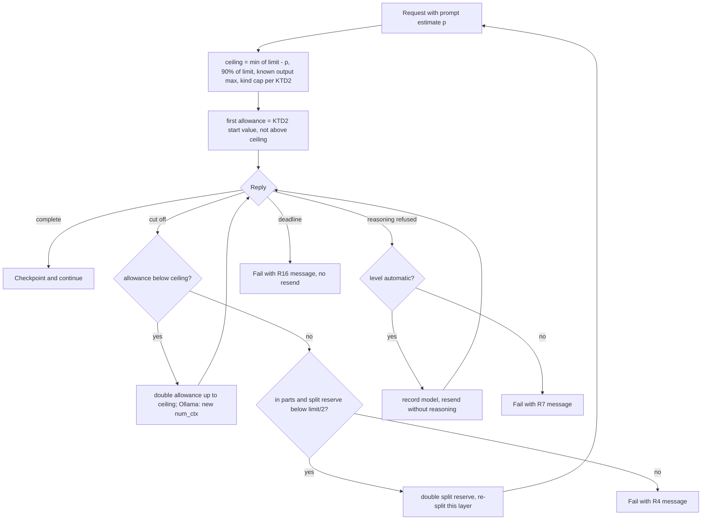

# Summary Speed with Local Models - Plan

## Goal Capsule

- **Objective:** A summary with a local reasoning model finishes at the first try, as fast as the user's server allows, and the user can control how much the model thinks and how many requests go at the same time.
- **Means:** a per-request reply allowance separate from the split reserve (KTD1), a Thinking level sent through Rig's own reasoning option (KTD5), Rig-built request bodies with the llama.cpp dialect for LM Studio and Custom (KTD4), and summary parts driven concurrently inside one summary job (KTD9).
- **Product authority:** This Product Contract. The user confirmed the scope on 2026-10-29: reply allowance, thinking control, requests built by Rig, and parallel summary parts, as one feature. R wins on product behaviour; a KTD wins on mechanism.
- **Execution profile:** one branch and one PR (`feat`), units committed one at a time, in a worktree from `origin/main`.
- **Stop conditions:** stop and ask when a live check shows that a settled decision cannot work (for example, LM Studio or LiteLLM refuses Rig's request body), or when `main` adds a settings schema version that conflicts with this work.
- **Who finishes:** `ce-work` implements and verifies; the user runs the manual test on a signed build; the PR follows the repo's Before a PR steps and is babysat to merge-ready.
- **Open blockers:** None.

---

## Product Contract

### Summary

Longhand gives each summary request a reply allowance from the room that is left in the context, instead of a fixed maximum of 8,192 tokens. Each AI provider gets two advanced settings: Thinking, and Requests at the same time. Rig builds the request body for every provider, so that Rig handles the differences between providers.

### Problem Frame

On 2026-10-29 the user summarized an 18-minute one-on-one with `qwen3.8-flash-next` on LM Studio, with a 131,072-token context. The prompt was 6,571 tokens, so the note went in one request. The model used all 8,192 reply tokens on hidden reasoning and wrote no summary text (`finish_reason: length`, `reasoning_tokens: 8192`). Longhand sent the whole request again with 16,384 tokens, and the model started its reasoning again from zero. The second try finished after 10,869 reasoning tokens. The first try cost about 160 seconds and gave nothing.

The 8,192 maximum comes from the first summary code (2026-09-22), when the default context limit was also 8,192. The default context limit became 128,000 in PR #17, but the reply maximum did not change. No document records a reason for it.

Longhand sends no reasoning control, so each model reasons as much as its default allows. A test on the same LM Studio server showed that `reasoning_effort: "none"` gave 0 reasoning tokens and `"low"` about half of the default. LM Studio ignored `chat_template_kwargs.enable_thinking`.

A long transcript that does not fit one request goes in summary parts. Longhand sends the summary parts and the merge groups one at a time, although LM Studio loaded the model with 4 slots.

The Rig migration (`docs/plans/2026-10-18-0955-feat-rig-engine-and-provider-presets-plan.md`, R2 and KTD3) kept the OpenAI-compatible request body byte-for-byte the same as before Rig. Longhand therefore writes `messages` and `"stream": false` itself through Rig's additional parameters. LM Studio and Custom use a Longhand gateway dialect, and Rig refuses every generation option on an unknown gateway, reasoning included. So Rig cannot send a reasoning level to LM Studio today.

### Key Decisions

- **One feature, four parts.** The reply allowance, Thinking, requests built by Rig and parallel summary parts ship in one PR, because together they make local summaries fast. Governs R1–R17. (session-settled: user-directed — chosen over the reply allowance, Thinking and Rig requests without parallel summary parts: the user wants all four now)
- **The reply allowance comes from the room left, with limits.** The rule replaces a fixed maximum that did not follow the context limit. Governs R1, R2, R3. (session-settled: user-directed — chosen over a larger fixed fraction with a higher ceiling and over a user setting for the maximum reply: the user wants the allowance to follow the context, with a buffer of at most 90% of the context)
- **Thinking is a per-provider setting with a default per provider kind.** LM Studio and Ollama start at Low because a summary gains little from long reasoning; every other provider starts at Model default so that its requests do not change. Governs R5, R6, R8. (session-settled: user-approved — chosen over Model default everywhere, over no setting with Low for local providers, and over Off for local providers: the user accepted Low as the local default)
- **Requests at the same time is a per-provider setting.** Longhand does not know a server's slot count, and a request beyond the server's capacity waits in the server's queue. Governs R12, R13. (session-settled: user-approved — chosen over fixed numbers with no setting, over a count reported by the server, and over a default of 1 everywhere)
- **Rig builds the requests.** Rig owns the differences between provider APIs; Longhand keeps its prompts, chunking and merge. The byte-parity rule of the Rig migration (R2 and KTD3 of that plan) ends here. Governs R9, R10, R11. (session-settled: user-directed — chosen over keeping hand-built request bodies: the user said that the purpose of Rig was to let Rig handle the complexity of the LLM APIs)
- **The new settings are advanced.** Most users never change them, because the defaults suit each provider kind. Governs R15.
- **A refused level that the user chose is shown, not replaced; a refused automatic Low is dropped.** If Longhand silently went back to Model default, it would ignore the user's choice. The automatic Low is Longhand's choice, so its refusal is a problem that Longhand corrects without a message. Governs R7, R17. (session-settled: user-directed — chosen over sending Low only to models that report thinking support, and over Model default for Ollama: it works on every server and keeps Low for Ollama reasoning models)
- **Local servers send one request at a time by default.** LM Studio shares one context cache across its slots, and Ollama needs a full context in memory for each parallel request, so two full-size summary parts at the same time do not fit. Governs R12. (session-settled: user-directed — chosen over smaller parts when requests run in parallel, and over a default of 2 with a note in the help text: the split stays unchanged and a user with more room can raise the setting)

### Requirements

**Reply allowance**

- R1. The reply allowance of a summary request is the context that is left after the prompt estimate with its safety margin, but not more than 90% of the context limit, and not more than the model's output maximum when Longhand knows it. Where a provider needs a smaller first allowance (KTD2), the first request uses it, and a cut-off retries with a larger one up to this limit.
- R2. For every provider other than LM Studio and Ollama whose output maximum Longhand does not know, the reply allowance stays at or below a fixed safe value of 16,384 tokens, so that the provider does not refuse the request.
- R3. Whether a note goes in one request or in summary parts does not change: the split decision uses the same minimum reply room as today, and only the allowance of each request grows.
- R4. When a reply is cut off at its allowance, Longhand retries only when R1 and R2 permit a larger allowance. Otherwise the summary fails at once with a message that names the model's context and the Thinking setting.
- R16. When a summary request reaches the reply deadline, the summary fails with a message that names the Thinking setting, and Longhand does not send that request again.

**Thinking**

- R5. Each AI provider has a Thinking setting with the values Model default, Off, Low, Medium and High. Model default sends no reasoning control.
- R6. Thinking starts at Low for LM Studio and Ollama, also for entries that exist before the update, and at Model default for every other provider. A new install and an update give the same defaults.
- R7. When the model or the provider refuses a Thinking level that the user chose, the summary fails with a message that names the Thinking setting and asks the user to choose another level.
- R17. When the model or the provider refuses the automatic Low of R6, Longhand sends the request again without a reasoning control and shows no message. It keeps that result for this model, so later requests to the same model send no reasoning control.
- R8. The Thinking setting applies to every request of a summary, including the summary parts, the merges and the title request.

**Requests built by Rig**

- R9. Rig builds the request body for every provider. Longhand no longer writes the messages or the stream field itself.
- R10. Rig sends the Thinking level in each provider's own field. For Custom, whose server Rig cannot know, a level other than Model default goes as the standard OpenAI `reasoning_effort` field.
- R11. The token-cap behaviour stays: LM Studio and Custom send `max_tokens` for every model id, and a request that a server refuses because of `max_tokens` is sent once more with `max_completion_tokens`.

**Parallel summary parts**

- R12. Each AI provider has a Requests at the same time setting. Its default is 4 for OpenAI, Anthropic, Gemini and OpenRouter, and 1 for LM Studio, Ollama and Custom.
- R13. A summary in parts sends up to that number of summary parts at the same time, and also up to that number of merge groups in each merge layer.
- R14. The summary progress counts finished summary parts and never goes back while the requests run.

**Settings**

- R15. Context limit, Thinking and Requests at the same time are in the Advanced group of the AI Provider pane, and that group is closed by default.

### Acceptance Examples

- AE1. **Covers R1, R3.** Given LM Studio with a 131,072-token context and a note whose prompt is 6,571 tokens, the note goes in one request with a reply allowance of about 118,000 tokens (90% of the context), and the reasoning model finishes at the first try.
- AE2. **Covers R1, R2.** Given an Anthropic model whose output maximum Longhand does not know, the request's `max_tokens` is the fixed safe value, and the provider accepts the request.
- AE3. **Covers R3.** Given a transcript that went in 3 summary parts before this change at the same context limit, it still goes in 3 summary parts.
- AE4. **Covers R6.** Given an LM Studio entry saved before the update, after the update its Thinking setting shows Low, and its next summary request asks for low reasoning. An OpenRouter entry shows Model default, and its request has no reasoning field.
- AE5. **Covers R7.** Given Thinking: Off and a hosted model that cannot turn reasoning off, the summary fails with a message that names the Thinking setting. Longhand does not send the request again without the level.
- AE6. **Covers R10.** Given Custom with Thinking: Low, the request contains `"reasoning_effort": "low"`. Given Custom with Model default, the request contains no reasoning field.
- AE7. **Covers R12, R13, R14.** Given OpenRouter with the default Requests at the same time of 4 and a transcript in 5 summary parts, at most 4 requests run at any moment, and the progress goes from 0 to 5 parts without going back. Given LM Studio with its default of 1, the summary parts go one at a time, as today.
- AE9. **Covers R6, R17.** Given an Ollama entry saved before the update with a model that cannot think, the first summary after the update has its automatic Low refused, is sent again without a reasoning control, and succeeds with no message. The next summary with that model sends no reasoning control.
- AE10. **Covers R4.** Given a note in one request whose reply is cut off at an allowance of 90% of the context, the summary fails at once with a message that names the context and the Thinking setting, and the request is not sent again.
- AE8. **Covers R15.** Given the AI Provider pane with LM Studio active, the Advanced group is closed. When the user opens it, it shows Context limit, Thinking and Requests at the same time.

### Success Criteria

- On the user's LM Studio setup, the 2026-10-29 one-on-one gets a summary with one summary request and no cut-off retry.
- With Thinking at Low, the same note takes clearly less time than with Model default on the same model.
- Summaries from OpenAI, Anthropic, Gemini, OpenRouter, LiteLLM (Custom) and LM Studio still succeed after the change to requests built by Rig.

### Scope Boundaries

- Keeping finished summary parts after a cut-off reply stays a separate idea (`docs/ideas/`, keep-finished-parts-on-cut-off-reply).
- The summary queue still runs one note at a time. Summarizing several notes at the same time is not in scope.
- Streaming replies is not in scope.
- Longhand does not ask the server how many slots it has.
- A thinking token budget (a number of tokens) is not offered; Thinking has levels only.

### Dependencies / Assumptions

- LM Studio accepts `reasoning_effort` values none, low, medium and high on `/v1/chat/completions`. The 2026-10-29 test confirmed none and low on LM Studio with `qwen3.8-flash-next`.
- Current OpenAI-compatible servers (LM Studio, LiteLLM, vLLM, OpenRouter) accept a system message whose content is an array of text parts, as Rig sends it. This is not tested yet.
- Ollama runs a second request at the same time only when its server allows more than 1 parallel request. Otherwise the second request waits; the 30-minute reply deadline limits that wait.
- Existing users have saved settings at schema version 7. The new settings need no schema change, and older builds keep working (KTD7).
- The Anthropic API refuses a request without streaming whose `max_tokens` is above about 21,333 tokens. Research found this in Anthropic's documentation; one live request during U4 confirms it.

### Outstanding Questions

**Deferred to Implementation**

- The exact UI wording of the two settings and their help text (R12, R15), set with the `apple-design` skill in U7.

### Sources / Research

- LM Studio log `~/.lmstudio/server-logs/2026-10/2026-10-29.1.log` and Longhand log `~/Library/Logs/net.ewal.longhand/Longhand.log`, 2026-10-29 22:22–22:33 UTC: the cut-off and the retry.
- `crates/summarize/src/tokens.rs:43`: the current reply allowance, `(limit / 4).clamp(512, 8_192)`.
- `crates/pipeline/src/summarize.rs:724`: the cut-off retry; `:929`: the one-request decision; `:956` and `:1009`: the sequential loops for summary parts and merge groups; `:1060`: the title request uses the same reserve.
- `crates/summarize/src/client.rs:366`: the Longhand gateway dialect; `:1019`: the request built through additional parameters; `:92`: the request deadlines.
- `crates/summarize/src/context.rs:76`: the LiteLLM probe ignores the model's output maximum.
- Rig 0.44 `src/completion/options.rs:212` (`Reasoning`, `Effort`) and `src/providers/openai/options.rs:518` (unknown gateway refuses options), `:1097` (llama.cpp mapping).
- `docs/plans/2026-10-18-0955-feat-rig-engine-and-provider-presets-plan.md`: R2, KTD2, KTD3 (byte parity) and KTD7 (Ollama context size).
- `src/settings/ProviderForm.tsx:470`: the Advanced group; `src/settings/RecognitionOptions.tsx:456`: a closed Advanced options group.
- LM Studio 0.4.8 changelog (adds `reasoning_effort`): https://lmstudio.ai/changelog/lmstudio-v0.4.8

**Product Contract preservation:** changed: R1 (first allowance per KTD2), R2 (the safe value is 16,384), Dependencies (no schema migration; the Anthropic limit) and Outstanding Questions (the planning questions are answered by KTD2–KTD9). The user confirmed these at the plan scoping step on 2026-10-29.

---

## Planning Contract

### Key Technical Decisions

- KTD1. **The reply allowance is a second number beside the split reserve.** `Room.reserve` stays the split reserve that `tokens::reply_reserve` gives, so the one-request decision, the chunk sizes and the saved `Plan` checkpoint do not change (R3). Each request computes its own allowance from its prompt estimate at send time. Saved plans stay valid, because the split does not change. Governs R1, R3.
- KTD2. **The first allowance depends on the provider kind.** LM Studio gets the full R1 allowance. Ollama starts at `min(R1, 32,768)`, because its `num_ctx` (prompt estimate plus allowance) decides the memory that Ollama reserves. OpenAI, Anthropic, Gemini, OpenRouter and Custom start at `min(R1, known output maximum, 16,384)`, because Longhand does not stream, and Anthropic refuses a request without streaming above about 21,333 tokens. Anthropic never goes above 21,333 tokens. (session-settled: user-approved — chosen over the full R1 allowance for every provider: Anthropic refuses large requests without streaming, and a large Ollama `num_ctx` uses much more memory and reloads the model)
- KTD3. **The output maximum comes from Rig's built-in catalog and from LiteLLM.** Rig's `Catalog::builtin()` gives `max_output_tokens` for known hosted models. The LiteLLM probe also reads `model_info.max_output_tokens` beside `max_input_tokens`. It does not use `model_info.max_tokens`, because LiteLLM can fill that legacy field with the input limit; when `max_output_tokens` is absent, the output maximum is unknown and R2 applies. The value travels in `Budget` as a new `#[serde(default)]` field, so older saved plans still read. Gemini and OpenRouter model listings stay out of scope: the catalog covers their common models. Governs R1, R2.
- KTD4. **LM Studio and Custom use Rig's `LLAMACPP` dialect.** It keeps `max_tokens` for every model id, sends no key header when none is saved, and maps a reasoning level to `reasoning_effort` (Off becomes `"none"`). The Longhand `GATEWAY` dialect and the `messages`/`stream` overrides in `additional_params` go away. The `max_completion_tokens` resend stays: it renames the cap field once after a 400 that names it. Governs R9, R10, R11.
- KTD5. **Thinking goes through Rig's `CompletionRequest::reasoning`.** Model default sets nothing. Off becomes `Reasoning::Off`, and Low, Medium and High become `Reasoning::Effort`. When Rig refuses an effort level as unsupported before it sends (budget-only Claude and Gemini models), Longhand converts the level into `Reasoning::Budget` with 1,024, 4,096 or 16,384 tokens, limited to half the allowance, and builds the request again. The UI shows levels only (Scope Boundaries). Governs R5, R8, R10.
- KTD6. **A refused reasoning control is a new typed error.** `SummarizeError::ReasoningRefused` covers Rig's own `UnsupportedOption` refusal and a server 400 whose excerpt names the reasoning field (`reasoning_effort`, `think`, "does not support thinking"). For an automatic Low, the pipeline sends the request again with no reasoning and records `(provider, address, model)` in a process-wide set, so later automatic-Low requests in this launch send none (R17). Only an automatic level consults the set; a level that the user chose is always sent. The set is lost at quit, so each launch can cost one fast refused request per model. For a level that the user chose, the summary fails (R7). Governs R7, R17. (session-settled: user-approved — chosen over a record in local settings: the pipeline has no path to write settings, and one fast refused request per launch is cheap)
- KTD7. **The new fields are `Option` values with no schema change.** `ProviderEntry` gains `thinking: Option<ThinkingLevel>` and `requests_at_once: Option<u32>`. `None` means the default for the provider kind, which Longhand resolves where the value is used and never saves back. A value that the user picks is stored as `Some`, also when it equals the default; that `Some` is what makes a refusal show the R7 message. Older builds ignore the fields, and a write from an older build drops them, so only explicit choices are lost on a downgrade. Provider settings are local, not shared. Governs R6, R12. (session-settled: user-approved — chosen over a schema version 8 migration that writes the defaults: no stored value must change, and older builds keep working)
- KTD8. **The cut-off retry first grows the allowance and then shrinks the parts.** The allowance growth runs inside the one request (in `call_as`), not through the `produce` loop: on a cut-off below the ceiling (R1, R2, KTD2), `call_as` sends the same request again with the doubled allowance, and for Ollama with a new `num_ctx`. Only a cut-off at the ceiling returns `Outcome::CutOff` to `produce`. There the old path runs: a summary in parts doubles the split reserve up to `limit / 2`, which makes smaller prompts, so R1 permits a larger allowance for each part (R4). A one-request note, or a split that gives no larger allowance, fails at once with the R4 message. `MAX_SHRINKS` still bounds the loop. Governs R4.
- KTD9. **Parallel requests run inside the one `block_on` of the summary stage.** A `FuturesUnordered` from `futures-util` drives up to *n* `client.complete` futures. `n` is the provider's Requests at the same time value. The driving loop writes each checkpoint under its index key and reports progress after each completion, so resume works with any completion order. `Control::proceed()` runs before each launch. The first `Pressure`, `CutOff` or `Stop` drops the futures still running. Their `EndGuard` logs "cancelled", and the completed siblings keep their checkpoints unless the cut-off path forgets that layer. Cancel of the note drops the whole set, as it drops one future today. `futures-util` is already a direct dependency of other workspace crates, so the licence list does not change. Governs R13, R14.
- KTD10. **Deadline failures keep today's no-resend rule.** `call_with_retries` already returns `Deadline` without a resend, and the pipeline stops on it. Only the message changes: it names the Thinking setting (R16).
- KTD11. **The title request uses the same allowance rule.** The title cap is `min(context left after the title prompt, KTD2 ceiling)` instead of `room.reserve`. The title request also carries the Thinking level and the automatic-Low rule (R8, R17).

### High-Level Technical Design

The reply allowance of one request and the cut-off path:



One summary layer with Requests at the same time = n:

```mermaid
flowchart TB
  S[Layer with k requests, some already checkpointed] --> T[Skip checkpointed indices, report them as done]
  T --> U[Launch up to n futures; proceed() before each]
  U --> V{Next completion}
  V -->|ok| W[Write checkpoint for that index; done += 1; report done of k] --> X{more to launch?}
  X -->|yes| U
  X -->|no, all done| Y[Next layer or final]
  V -->|error| Z[Drop running futures; handle per first diagram]
```

### Assumptions

- Rig's catalog check runs before any bytes go out, so the budget conversion of KTD5 costs no request.
- Ollama reduces reasoning for `"think": "low"` on thinking models other than gpt-oss. Ollama documents level strings only for gpt-oss, so the manual test compares reasoning tokens with Low and with Model default on an Ollama qwen3 model. If Low gives no reduction, stop and ask before the PR.
- Ollama answers `think` on a model without thinking with an HTTP 400 that contains "does not support thinking" (seen in Ollama issue reports, not tested here). U3 tests the mapping with a mock; the manual test confirms it on a real Ollama model.

---

## Implementation Units

### U1. Provider settings for Thinking and Requests at the same time

- **Goal:** Store, edit and resolve the two new per-provider settings, and give their effective values to the summary stage and the title job.
- **Requirements:** R5, R6, R12; KTD7.
- **Dependencies:** none.
- **Files:** `src-tauri/src/managers/settings.rs`, `src-tauri/src/commands/settings.rs`, `src-tauri/src/lib.rs`, `src-tauri/src/managers/processing.rs`, `crates/pipeline/src/summarize.rs` (`SummaryEndpoint`), `crates/summarize/src/provider.rs` (defaults for each kind), `src/bindings.ts` (generated), `crates/pipeline/tests/runner.rs` and `crates/pipeline/tests/end_to_end.rs` (endpoint literals), TS fixtures in `src/App.test.tsx` and `src/settings/*.test.tsx`.
- **Approach:**
  1. Add `ThinkingLevel` (ModelDefault, Off, Low, Medium, High) and the two `Option` fields on `ProviderEntry`, with `serde(default)` and `specta::Type`.
  2. Add `Provider::default_thinking()` and `Provider::default_requests_at_once()` beside `route()`, per R6 and R12.
  3. Add the setters `set_provider_thinking` and `set_provider_requests_at_once` (range 1–8), with commands registered beside `set_provider_context_limit`.
  4. `endpoint_from_settings` resolves the effective values and records whether Thinking is automatic (`None`) or chosen. `SummaryEndpoint` carries both values.
  5. Regenerate `src/bindings.ts`.
- **Patterns to follow:** `set_provider_context_limit` and its test `each_provider_keeps_its_own_entered_context_limit`; `migrate_endpoint` literal (`..Default::default()`).
- **Test scenarios:**
  - Covers AE4. A v7 settings JSON with an `lm_studio` entry and no new fields loads, and its effective Thinking is Low (automatic). An `open_router` entry resolves to Model default.
  - A v7 JSON loads without a write: `load_at_launch` reports no migration.
  - Setting Thinking to Low on LM Studio stores `Some(Low)`, and the endpoint marks it as chosen.
  - Requests at the same time accepts 1 and 8, refuses 0 and 9 with an error, and keeps the previous value.
  - Each provider keeps its own values when the user switches the active provider.
  - JSON with an unknown extra field next to the new fields still loads (older-build data).
- **Verification:** settings tests pass; `src/bindings.ts` matches the generated output; the TS typecheck passes with the updated fixtures.

### U2. Request bodies built by Rig

- **Goal:** Rig encodes every request body; LM Studio and Custom move to the `LLAMACPP` dialect.
- **Requirements:** R9, R11; KTD4.
- **Dependencies:** none.
- **Files:** `crates/summarize/src/client.rs`, `crates/summarize/tests/providers.rs`, `crates/summarize/tests/client.rs`, `crates/summarize/tests/models.rs`, `crates/summarize/tests/common/mod.rs`.
- **Approach:**
  1. In `RigClient::new`, select Rig's `LLAMACPP` dialect for LM Studio and Custom, and remove `GATEWAY`.
  2. In `rig_request`, set the cap with `request.max_tokens` on every route. Keep `additional_params` only for Ollama (`truncate`, `num_ctx`) and for the `max_completion_tokens` resend.
  3. Keep `check_chat`, the 400 resend, the connect-only retry and the request log lines unchanged.
- **Execution note:** First rewrite the byte-parity tests as body-content tests that fail against the old builder. Then change the builder.
- **Patterns to follow:** the per-route tests in `crates/summarize/tests/providers.rs`; `Reply::With` for body checks.
- **Test scenarios:**
  - Custom sends `POST /v1/chat/completions` with the model, the messages (system content may be an array of text parts), `max_tokens` and the bearer key, and no `max_completion_tokens`.
  - LM Studio with no saved key sends no `Authorization` header.
  - A Custom model id that looks like a reasoning model (`gpt-5-mini`) still sends `max_tokens`.
  - A 400 that names `max_completion_tokens` is sent once more with that field, and not a third time.
  - The OpenAI preset still sends Chat Completions, not `/responses`.
  - Ollama still sends `/api/chat` with `options.num_ctx` and `truncate: false`.
  - A cut-off and a context error still map to `ReplyCutOff` and `ContextExceeded` on every route.
- **Verification:** the `summarize` crate tests pass with no test that asserts the old byte-for-byte body.

### U3. Thinking in every request

- **Goal:** Send the Thinking level on every summary and title request, convert levels for budget-only models, and handle refusals per R7 and R17.
- **Requirements:** R5, R7, R8, R10, R17; KTD5, KTD6, KTD11.
- **Dependencies:** U1, U2.
- **Files:** `crates/summarize/src/client.rs`, `crates/summarize/src/lib.rs` (the remembered-refusal set), `crates/pipeline/src/summarize.rs` (`call_as`, `send_title_request`, messages), `crates/summarize/tests/providers.rs`, `crates/pipeline/tests/runner.rs`.
- **Approach:**
  1. `complete` takes a reasoning choice. `rig_request` calls `request.reasoning(...)` when the level is not Model default.
  2. On Rig's `UnsupportedOption` for an effort level, build the request again with the KTD5 budget. If Rig refuses that too, return `ReasoningRefused`.
  3. `http_error` maps a 400 that names the reasoning field to `ReasoningRefused`.
  4. In the pipeline, an automatic level that gets `ReasoningRefused` records the model and sends again with no reasoning. A chosen level stops with the R7 message.
  5. Requests with an automatic level check the remembered set before they send; a chosen level skips the check.
- **Patterns to follow:** `names_context` and `CONTEXT_SIGNS` for excerpt matching; the `max_completion_tokens` resend for a one-time resend.
- **Test scenarios:**
  - Covers AE6. Custom with Low sends `"reasoning_effort": "low"`; Custom with Model default sends no reasoning field.
  - LM Studio with Off sends `"reasoning_effort": "none"`.
  - Ollama with Low sends `"think": "low"`; with Off, `"think": false`.
  - An Anthropic budget-only model with Medium sends a thinking budget of 4,096 tokens and no effort field.
  - Covers AE9. An Ollama mock answers the first request with 400 "does not support thinking". With automatic Low, the summary finishes with the reply text and no message. The second request has no `think`, and a second note's first request also has no `think`.
  - Covers AE5. With Thinking Off chosen by the user and a refusal, the summary stops with a message that names the Thinking setting. The mock sees exactly one request.
  - The title request carries the same reasoning field as the summary request.
  - After an automatic Low refusal for a model, a user who then chooses Low for that model gets `"think": "low"` sent, and a refusal stops with the R7 message.
- **Verification:** the reasoning field of every route matches the table in KTD5; the refusal tests assert request counts and summary text, not only the outcome.

### U4. Reply allowance from the context room

- **Goal:** Each request gets its allowance from the room left (R1, R2, KTD2), with the output maximum from Rig's catalog and LiteLLM.
- **Requirements:** R1, R2, R3; KTD1, KTD2, KTD3, KTD11.
- **Dependencies:** U2.
- **Files:** `crates/summarize/src/tokens.rs`, `crates/summarize/src/context.rs`, `crates/summarize/src/provider.rs`, `crates/pipeline/src/summarize.rs`, `crates/summarize/tests/context.rs`, `crates/summarize/tests/chunk.rs`, `crates/pipeline/tests/runner.rs`, `CONCEPTS.md`.
- **Approach:**
  1. Add a `tokens` function for the ceiling and the start allowance from the limit, the prompt estimate with its margin, the output maximum and the provider kind.
  2. Add `output_max` to `Budget` (`serde(default)`); fill it from LiteLLM `model_info.max_output_tokens` and from Rig's catalog for the endpoint's provider and model (KTD3).
  3. `call_as` and the title turn send the computed allowance instead of `room.reserve`. For Ollama, `num_ctx` follows the prompt estimate plus the allowance (single request) or stays the room limit (parts).
  4. Keep `Room.reserve` and every split decision unchanged.
  5. In `CONCEPTS.md`, change "In code it is the reply reserve" to name the split reserve as a different number.
  6. Confirm the Anthropic limit with one live request to a Claude model with `max_tokens` 21,334 and no streaming, and record the result in the PR.
- **Test scenarios:**
  - Covers AE1. LM Studio, limit 131,072, prompt estimate 6,571: one request with `max_tokens` about 117,964.
  - Covers AE2. Anthropic with an unknown model id: `max_tokens` 16,384.
  - A known Claude model with a 64,000 output maximum: `max_tokens` 16,384 at the first try.
  - Ollama, limit 131,072, short prompt: `max_tokens` 32,768 and `num_ctx` that covers the prompt plus 32,768, rounded to 2,048.
  - Covers AE3. A long transcript that made 3 parts before the change makes 3 parts after it.
  - A LiteLLM `model_info` with `max_output_tokens: 8000` caps the allowance at 8,000.
  - A LiteLLM `model_info` with `max_tokens` equal to `max_input_tokens` and no `max_output_tokens` gives an unknown output maximum, so the allowance is 16,384.
  - A saved plan JSON without `output_max` still loads, and a Regenerate Summary uses it.
  - The title request's cap follows the same rule.
- **Verification:** `a_reply_cut_off_gets_more_room` and the Ollama `num_ctx` tests are updated to the new numbers, and the new allowance tests pass.

### U5. Cut-off and deadline rules

- **Goal:** A cut-off retries only when a larger allowance is possible, and cut-off and deadline failures show messages that name the Thinking setting.
- **Requirements:** R4, R16; KTD8, KTD10.
- **Dependencies:** U4.
- **Files:** `crates/pipeline/src/summarize.rs` (`produce` retry loop, `describe`), `crates/pipeline/tests/runner.rs`.
- **Approach:**
  1. In `call_as`, a cut-off below the ceiling sends the same request again with the doubled allowance (KTD8); no outcome goes to `produce`.
  2. A cut-off at the ceiling returns `Outcome::CutOff`. `produce` uses today's re-split for parts, and fails with the R4 message for a single request or when the re-split gives no larger allowance.
  4. Replace the two old failure texts with the R4 text, and give `Deadline` failures the R16 text. Both point to Settings > AI Provider > Advanced.
- **Test scenarios:**
  - Covers AE10. A single-request note on LM Studio cut off at its ceiling fails with the R4 text after one request.
  - An Ollama single request cut off at 32,768 is sent again with 65,536 and a larger `num_ctx`, and then finishes.
  - An Anthropic request cut off at 16,384 with a known output maximum of 64,000 is sent again with 21,333.
  - An OpenAI request cut off at 16,384 with a known output maximum of 64,000 is sent again with 32,768.
  - A summary part cut off at its ceiling makes the layer split again with smaller parts, and the finished summary contains every part.
  - A deadline on a summary request stops with the R16 text after one request.
- **Verification:** the old "kept cutting off" and "do not fit" assertions are replaced by the new texts, and the request counts match.

### U6. Summary parts and merge groups at the same time

- **Goal:** A summary in parts sends up to the provider's Requests at the same time value of summary parts and merge groups at once, with progress that never goes back.
- **Requirements:** R13, R14; KTD9.
- **Dependencies:** U1, U5.
- **Files:** `crates/pipeline/Cargo.toml` (`futures-util`), `crates/pipeline/src/summarize.rs` (`Calls`, parts loop, merge loop, progress), `crates/pipeline/tests/runner.rs`, `crates/summarize/tests/common/mod.rs` (gate helper if needed), `src/processing/describe.ts` and its test if the label must change.
- **Approach:**
  1. Split `call_as` into a launch part (checkpoint check, `proceed()`, future) and a finish part (checkpoint write, progress).
  2. Drive the parts of a layer and the groups of a merge layer through one bounded `FuturesUnordered`.
  3. Report `(Parts, done, total)` from a finished-count, and keep the groups counter.
  4. On the first error, drop the remaining futures and return the error to the `produce` loop.
- **Execution note:** Write the concurrency tests first, on a gated mock server: gate on *n* arrivals to prove that *n* run together, and count the requests in flight to prove the limit. Never use a sleep or a time window.
- **Test scenarios:**
  - Covers AE7. OpenRouter with 4 and a transcript in 5 parts: the mock sees 4 requests open at the same time before any reply, never more than 4, and the summary contains every part.
  - LM Studio with the default 1: the mock never sees two open requests.
  - Progress events for 5 parts at 4 at once never decrease and end at 5 of 5.
  - A merge layer with 3 groups at 4 at once sends the 3 merge requests together.
  - A resumed run with parts 1 and 3 checkpointed sends only the missing parts.
  - When part 2 of 4 gets a context error, the other open requests are dropped, and the run stops with the context message.
  - Cancel during 4 open requests drops all 4, and the mock sees the connections close.
- **Verification:** concurrency tests pass in repeated local runs with no timing assumption, and each test fails when the limit is changed (mutation check).

### U7. The Advanced group in the AI Provider pane

- **Goal:** The Advanced group is closed by default and holds Context limit, Thinking and Requests at the same time.
- **Requirements:** R15, R5, R12; AE8.
- **Dependencies:** U1.
- **Files:** `src/settings/ProviderForm.tsx`, `src/settings/ProviderForm.test.tsx`, `src/settings/ui.tsx` (only if a shared disclosure is needed).
- **Approach:**
  1. Invoke `apple-design` before the UI work.
  2. Render the group as a closed `<details>` like `RecognitionOptions.tsx`. Call `focus()` on the summary element on click (WKWebView).
  3. Thinking is a select. Its first option, "Automatic", stores `None` and shows the resolved default in its label, for example "Automatic (Low)" on LM Studio. The other options (Model default, Off, Low, Medium, High) store `Some` (KTD7).
  4. The closed `<details>` summary is labelled "Advanced". Inside the open group, each of the three settings has a one-line help text: the Thinking line names the default for the provider kind, the Requests at the same time line says that the server must be able to run that many requests, and the Context limit sentence stays.
  5. Requests at the same time is a `CommitField` with the provider-kind default as its placeholder. An empty value resets it to the default. Values outside 1–8 show the inline error in the style of Context limit.
  6. Keep the field draft across a collapse, as the single-line-setting solution describes.
- **Test scenarios:**
  - Covers AE8. With LM Studio active, the pane does not show Context limit until the user opens Advanced; then it shows all three settings.
  - Choosing Medium calls `set_provider_thinking` with Medium for the active provider.
  - Choosing Automatic after Medium calls `set_provider_thinking` with no value, and the select shows "Automatic (Low)" on LM Studio.
  - Typing 3 and leaving the field calls `set_provider_requests_at_once` with 3; typing 0 shows the inline error and calls nothing.
  - Typing a value and closing the group saves it.
  - The existing Context limit tests open the group first and still pass.
  - With provider None, the Advanced group is not shown.
- **Verification:** `npm run typecheck` and `npm test` pass; a manual check in the signed build confirms the disclosure takes focus and the values save.

---

## Verification Contract

| Check | When |
|---|---|
| New tests red, then the change, then new and related crate tests (`cargo test -p summarize`, `cargo test -p pipeline`, `cargo test -p longhand` for settings) | per unit |
| `cargo test -p longhand export_bindings` and no diff in `src/bindings.ts` | U1, and at the end |
| `npm run typecheck` and `npm test` | U1, U6 (if `describe.ts` changes), U7 |
| `scripts/check-licences.sh` (expect no change; commit `licences/generated/*` if it changes) | U6 |
| `cargo fmt --all --check`, clippy, one full workspace test run | before each push |
| The other checks in `docs/development-workflow.md#checks-and-ci` | before the PR |
| Manual test on a signed, non-notarized build: the 2026-10-29 note on LM Studio with Low and with Model default; an Ollama qwen3 model with Low and with Model default (compare reasoning tokens); an Ollama model without thinking; Custom (LiteLLM) and OpenRouter summaries | after U7, before the PR |

---

## Definition of Done

- Every R in the Product Contract has a test or a manual check that shows it.
- The success criteria hold on the user's setup, including one summary request with no cut-off retry for the 2026-10-29 note.
- The live Anthropic check of KTD2 is recorded in the PR description.
- No test asserts the old byte-for-byte request body, and no code writes `messages` or `stream` into `additional_params`.
- The concurrency tests wait on events only.
- No experimental or abandoned code from tried approaches stays in the diff.
- The PR title is a `feat` title with the release size that the user chose (patch or minor).
