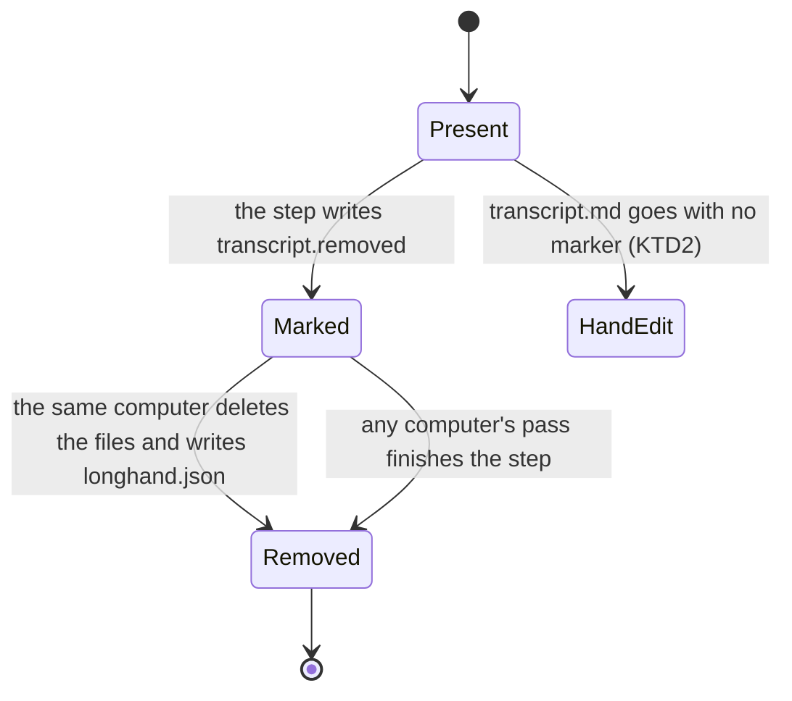
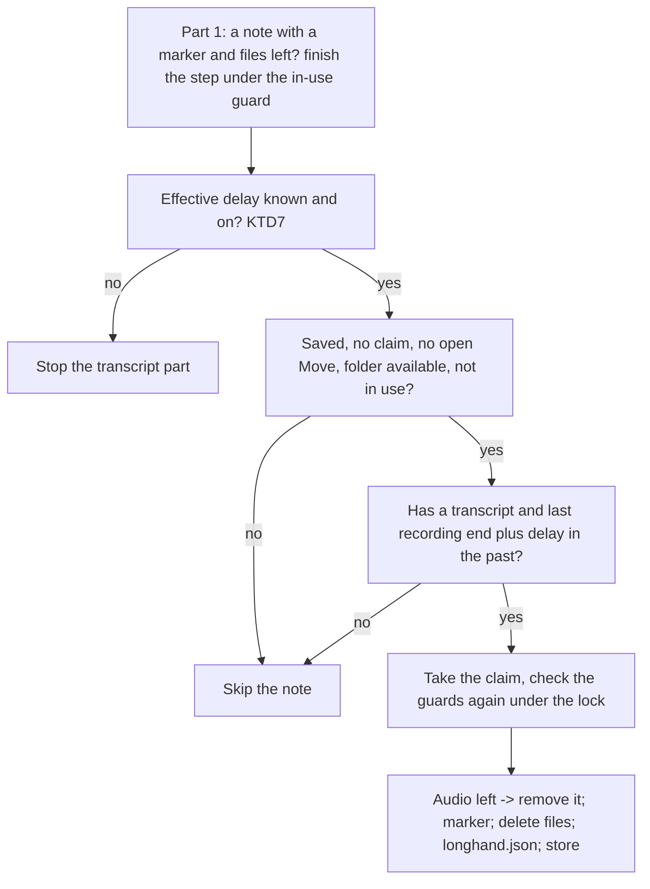

# Remove the Transcripts of Old Notes - Plan

## Goal Capsule

- **Objective:** A user can choose that old notes keep only their summary, manual notes, title and tags. The full transcript of a note does not stay on disk longer than the user wants, and Longhand's database keeps no copy of a note's transcript or summary text after processing is done.
- **Means:** A `transcript.removed` marker beside the transcript, a removal step that reuses the audio removal step, and a transcript part in the existing removal pass (KTD1, KTD3, KTD6). The database clears recognition data at save and the summary cache after the title (KTD12), and Resume reads old timed text from `recognition.jsonl` (KTD14).
- **Product authority:** The Product Contract wins on behavior; the KTDs win on mechanism within it. Audio removal behavior does not change, except where R4 links the two settings. Source idea: `docs/ideas/next/remove-old-transcripts.md`.
- **Stop conditions:** Stop and ask when a change would remove a transcript while the shared settings cannot be read, would delete a file other than the names in KTD4, would let any computer write `transcript.md` into a note with a marker, or would make a note with a removed transcript show as waiting for sync after the sync is complete.
- **Execution profile:** Implement with `ce-work` in a worktree from `origin/main`, one commit per unit, then one PR (`feat`; ask patch or minor before the PR). Settings, removal and the note page are testable in `tauri dev`; give a signed build for the manual test of two computers on one synced folder.
- **Open blockers:** None.

---

## Product Contract

### Summary

A second shared setting in Settings > Storage, off by default, permanently deletes the transcript of each saved note a set number of days after the note last recorded. Its delay is never shorter than the audio delay, so a note never keeps audio after its transcript is gone. A Remove Transcript action removes the transcript of one note, and any audio that is left, at once. Any computer that uses the storage folder can remove old transcripts.

Longhand's database becomes an index only. When processing of a note is done, the database keeps no recognition data or summary cache for it; the files in the note folder are the only copy. Transcribe Again always transcribes from the audio, and Resume reads the old timed text from the note folder.

### Problem Frame

Audio removal deletes the most private part of a note after 30 days by default. The transcript stays forever. A transcript holds every word that each person said, including words that the summary leaves out, so it is almost as private as the audio. Some users want old meetings to keep only what they need later: the summary and their own notes. Today the only way to remove a transcript is to edit `transcript.md` by hand or delete the whole note.

The transcript also has a second home. After a save, Longhand's local database keeps the timed recognition text of every note (window rows, live parts, speaker data, `recognition_output`) and the cached model calls of its summary. Nothing reads them while the note is saved; they serve only a later Resume on the same computer and reuse in Transcribe Again and Regenerate Summary. So every transcript is on disk twice, and a file-level removal would leave the database copy. The files are the source of truth; the database exists to make bulk reads, such as the note list, fast.

### Key Decisions

- **The transcript delay is never shorter than the audio delay.** A note with audio and no transcript can make the transcript again with Transcribe Again, so the transcript would not really be gone. Governs R4, R5. (session-settled: user-directed — chosen over "removing the transcript also removes the audio" and over two independent settings: the rule keeps the two settings in a fixed order.)
- **Off by default.** Current users keep every transcript after the update. The transcript stays the record until the user chooses otherwise. Governs R2. (session-settled: user-approved — chosen over on by default at a long delay and over on for new installs only: no surprise loss for current users.)
- **Remove Transcript also removes audio that is left.** One action takes a note down to its summary, manual notes, title and tags, and it keeps the order of R4 for one note. Governs R17. (session-settled: user-approved — chosen over an action that is available only after Remove Audio, and over no per-note action.)
- **Copy audio removal for everything else.** Permanent delete, the delay from the last recording, any computer removes, the in-use guard, no removal while the shared settings cannot be read, and a confirmation when a change removes data at once. Users learn one model, and the plan reuses tested mechanisms. Governs R6–R13, R19, R20.
- **The database is an index, not a second copy.** Note content lives in files. The database keeps only what makes bulk reads fast, and state of unfinished work while that work runs. Governs R22, R23, R26, R27. (session-settled: user-directed — chosen over keeping recognition data in the database after the save for reuse: files are the source of truth.)
- **Transcribe Again transcribes again.** It reuses no earlier timed text; that is the point of the action. Governs R24. (session-settled: user-directed — chosen over reuse of compatible timed text.)
- **Resume reads the old timed text from the note folder.** `recognition.jsonl` is the source; a run on any computer can use it while the audio is there. Governs R25. (session-settled: user-approved — chosen over transcribing every segment again on Resume.)
- **Regenerate Summary calls the model for every part.** The summary cache goes when the title is done. Governs R23. (session-settled: user-approved — chosen over keeping the summary cache.)
- **Old database backups are cleaned once.** Governs R27. (session-settled: user-directed — chosen over accepting the backups as an exception.)
- **A note shows no mark that its transcript is gone.** The audio decision applies here too: most old notes will have no transcript, so a mark is noise. The fact shows only where it explains an unavailable action. Governs R15.

### Requirements

**The setting**

- R1. The transcript removal setting is a shared setting. It holds a delay in whole days, or off.
- R2. The default of the setting is off. It follows the same copy rules as every other shared setting. While the shared settings cannot be read, no transcript is removed automatically.
- R3. The user sets the delay or turns the setting off in Settings > Storage, next to the audio removal setting.
- R4. The transcript delay is never shorter than the audio delay. The transcript setting cannot be on while audio removal is off.
- R5. Changes to the audio setting keep R4 true without a confirmation. When audio removal is turned off, transcript removal turns off. When the audio delay becomes longer than the transcript delay, the transcript delay becomes equal to the audio delay. The settings page shows the new transcript value.

**Which transcripts go, and when**

- R6. The delay of a note starts when its last recording ended, as for audio removal.
- R7. When the delay of a saved note has passed, Longhand removes the note's transcript: the transcript text and every other copy of the transcript text or timed recognition data that Longhand keeps for the note. The summary, manual notes, title and tags stay.
- R8. Removal deletes the transcript permanently. It does not move it to the Trash or the Recycle Bin.
- R9. A transcript that a person or an agent edited by hand is removed like any other.
- R10. Longhand removes transcripts only from a saved note, by the same rule as audio removal.
- R11. Any computer that uses the storage folder removes old transcripts, including those of notes that another computer recorded. The in-use guard of audio removal applies.
- R12. Longhand checks for old transcripts when it checks for old audio.
- R13. Removal never makes the transcript come back on another computer, and it never makes the note show as waiting for sync when the sync is complete.

**A note with no transcript**

- R14. A note whose transcript was removed cannot use Regenerate Summary, Transcribe Again or Resume.
- R15. A note whose transcript was removed shows no mark or badge for that, and no empty Transcript tab. Only where an action of R14 is unavailable does the note say that its transcript was removed.
- R16. A note whose transcript was removed is complete on every computer.

**Remove Transcript on one note**

- R17. A saved note that has a transcript has a Remove Transcript action. It asks for one confirmation, then removes the transcript at once (R7, R8). It is available whether the setting is on or off.
- R18. When the note still has audio, Remove Transcript also removes the audio, and the confirmation says so.

**Changes that remove transcripts now**

- R19. When a change of the transcript setting would remove transcripts at once, a confirmation comes first. The changes are a shorter delay and turning the setting on. The confirmation says that the removal is permanent and that those notes cannot use Regenerate Summary, Transcribe Again or Resume.
- R20. A change that R5 makes never removes a transcript, because it only makes the delay longer or turns the setting off.

**Agent access**

- R21. The Longhand notes agent skill knows that a saved note can have no `transcript.md`, and it does not treat that as an error or create the file.

**The database keeps no note content**

- R22. When a note is saved, Longhand's database keeps no timed recognition text, live transcript part or speaker data of the note. Index data stays: the state, the recognition settings snapshot, the found speaker count and the file fingerprints.
- R23. When the title of a saved note is done, or at the save when no title runs, the database keeps no cached summary or title call of the note. Regenerate Summary sends every part to the model again.
- R24. Transcribe Again transcribes all audio of the note again. It reuses no earlier timed text.
- R25. Resume of a saved note reuses the old segments' timed text from `recognition.jsonl` in the note folder when the file matches the audio and the transcript, on any computer. Otherwise Resume transcribes all segments again.
- R26. The first launch after the update clears the data of R22 and R23 for every saved note in the database, and leaves no free pages that hold it.
- R27. The first launch after the update also clears that data from each database backup that Longhand keeps on this computer.

### Acceptance Examples

- AE1. **Covers R6, R7.** Given audio removal at 30 days and transcript removal at 90 days, and a note that stopped on 1 June, then on 1 August the note has its transcript and no audio, and on 1 September it has only its summary, manual notes, title and tags.
- AE2. **Covers R4, R5.** Given audio at 30 days and transcripts at 60 days, when the user sets audio to 90 days, the transcript delay becomes 90 days and no confirmation appears.
- AE3. **Covers R4, R5.** Given audio at 30 days and transcripts at 60 days, when the user turns audio removal off, transcript removal is off too.
- AE4. **Covers R4.** Given audio removal is off, the transcript setting cannot be turned on until audio removal is on.
- AE5. **Covers R19.** Given transcripts at 365 days and notes that are 100 days old, when the user sets the transcript delay to 90 days, a confirmation appears before any transcript goes. If the user cancels, the delay stays at 365 days.
- AE6. **Covers R17, R18.** Given the setting is off and a note that is 2 days old with audio, when the user chooses Remove Transcript and confirms, the transcript and the audio are gone at once, and the summary, manual notes, title and tags stay.
- AE7. **Covers R14, R15.** Given a note whose transcript was removed, the note page shows the summary and manual notes with no Transcript tab and no mark. When the user opens the note's menu, Regenerate Summary says that the note's transcript was removed.
- AE8. **Covers R11, R13, R16.** Given computers A and B share a storage folder, when B removes the transcript of a note that A recorded, A shows the note as complete, without a transcript, and does not write the transcript again.
- AE9. **Covers R2.** Given a storage folder from before this feature, after the update every transcript stays until the user turns the setting on.
- AE10. **Covers R22, R23.** Given a note that was just recorded, when its processing is done and its title is set, the database holds no timed text and no summary cache for it, and the note list and note page show it as before.
- AE11. **Covers R24.** Given a saved note with audio, when the user runs Transcribe Again with no change in Settings, every segment is transcribed again.
- AE12. **Covers R25.** Given a note that computer A recorded, when the user resumes it on computer B, only the new recording is transcribed and the old text is the same as before.
- AE13. **Covers R26, R27.** Given a database and one rebuild backup from before the update, after the first launch neither holds timed text or summary cache of a saved note.

### Scope Boundaries

- No "keep transcript" exemption for one note.
- No display of the disk space that the setting would free.
- No change to the summary: a summary that quotes the transcript keeps its quotes.
- No change to audio removal, except R5.
- Copies that the sync service keeps, such as its recycle bin or version history, are out of Longhand's control.
- Delete Note does not change.
- Recognition data of a note that records or processes stays in the database while that work runs. Moving it to files in the Working location is a separate idea (`docs/ideas/someday/processing-checkpoints-as-files.md`).
- Regenerate Summary no longer adds the "Recognition limitation" note that it read from the database; its input becomes the same on every computer.

### Dependencies / Assumptions

- Audio removal (`docs/ideas/done/remove-old-audio.md`) shipped, with its in-use guard, removal markers and removal pass. This work extends them.
- A partial sync can show a note on another computer with its transcript gone before that computer learns that the removal was intentional. A short waiting time is acceptable; R13 and R16 must hold when the sync is complete.
- Today a missing `transcript.md` in a saved note makes the note wait for sync for about 60 seconds, then counts as a hand edit (`crates/library/src/scan.rs`, `crates/library/src/reconcile.rs` `HAND_EDIT_WAIT`). Regenerate Summary then fails with "The transcript is missing." (`crates/pipeline/src/save.rs` `summarize_again`). R14, R15 and R16 replace that path for a removed transcript.
- No feature searches transcript text today, so removal breaks no search.

### Outstanding Questions

**Deferred to Implementation**

- The controls for the two linked delays in Settings > Storage (R3–R5). Use the `apple-design` skill.
- The UI text of the confirmations (R17, R18, R19) and of the explanation on the unavailable actions (R15).

The other questions that the brainstorm deferred are resolved in KTD1 (the removal signal), KTD4 (the copies that go) and KTD2 (a hand delete stays a hand edit).

### Sources / Research

- `docs/plans/2026-09-30-0357-feat-remove-old-audio-plan.md` — the pattern: removal markers, the in-use marker, one pass on any computer, the confirmation of its R17.
- `crates/pipeline/src/remove_audio.rs`, `src-tauri/src/managers/audio_removal.rs` — the audio removal step and pass to extend.
- `crates/shared-settings/src/file.rs` — `KEY_AUDIO_REMOVAL`, `DEFAULT_AUDIO_REMOVAL_DAYS` (1 to 3650 days, or off).
- `src/settings/AudioRemoval.tsx`, rendered in the Storage pane of `src/settings/DestinationPicker.tsx`; `src/session/RemoveAudio.tsx` — the audio setting, the Remove Audio action and its confirmation.
- `crates/session-core/src/note_record.rs` — the fields of `longhand.json`.
- `CONCEPTS.md` — Remove Audio, Note record file, the waiting state for a fingerprint mismatch, Regenerate Summary, Transcribe Again.
- `plugins/longhand/skills/longhand-notes/SKILL.md`, `references/files.md` — list `transcript.md` as an editable file and do not say that it can be missing.

**Product Contract preservation:** changed: R22–R27 and AE10–AE13 added, with their Key Decisions — the user widened the scope after the plan review to remove note content from the database and to make Transcribe Again transcribe again. R7 now also covers the database rows that R22 and R23 clear. The deferred planning questions are resolved in KTD1, KTD2 and KTD4. Other R-IDs and AEs unchanged.

---

## Planning Contract

### Key Technical Decisions

- KTD1. **A marker file `transcript.removed` in the home folder records the removal.** It has fixed content, no leading dot (the watcher skips dot names, `src-tauri/src/managers/library.rs` `should_skip_path`), and a name that `crates/library/src/conflict.rs` `document_copy` does not match. A marker present means the transcript is removed, whether `transcript.md` is still on disk or not. A field in `longhand.json` was rejected for the reason in KTD1 of the audio plan: other writers rebuild the record from their own store, and older builds drop unknown fields. A higher `layout` was rejected because older builds then show a problem notice on each such note (session-settled: user-approved — chosen over a `longhand.json` field and over a higher `layout`: the marker survives every writer, and only the sync service moves it). Governs R11, R13, R16.
- KTD2. **Only the marker makes a removal.** A `transcript.md` that a person deletes by hand, with no marker, stays a hand edit as today (`crates/library/src/reconcile.rs` `HAND_EDIT_WAIT`). Governs R13.
- KTD3. **The transcript step reuses the audio step and keeps its order.** Under one Delete Note claim and the same guards as `crates/pipeline/src/remove_audio.rs` `run_step`: (1) remove each segment's audio that is left, with the existing per-segment marker-then-delete; (2) only when (1) left every segment with its removal marker and no audio file (`Removal::complete()`, or the note has no segments), write `transcript.removed` — otherwise stop with the audio reason and keep the transcript; (3) delete the files of KTD4; (4) write `longhand.json` last, under the store lock, with the fields of KTD4 cleared; (5) clear the store rows of KTD4 and set the store flag. A crash after (2) leaves a marker, and any computer's next pass finishes (3) to (5), as `finish_removal` does for audio. A note needs finishing when it has the marker and a file of KTD4 is still present, or this computer's store flag is not set, or its record still has a field of KTD4. Each effect is detected from disk alone, so a repeat run changes nothing (`docs/solutions/logic-errors/save-state-machine-crash-window-recovery.md`). Governs R7, R8, R18.
- KTD4. **The copies that go, by fixed name only.** In the canonical home folder: `transcript.md`, `recognition.jsonl`, the sync conflict copies of both (`conflict::document_copy`, for `recognition.jsonl` with the same name rule), and the `.longhand-results/` copies (`crates/pipeline/src/remove_copies.rs` deletes them when the marker is present, not only when `transcript.md` and `summary.md` both exist). In `longhand.json`: `transcript_fingerprint`, `recognition_snapshot`, `recognition_artifact` and `recognition_audio`; `found_speakers` stays, because it is a count with no text. In the store, after KTD12 only index data is left: the transcript fingerprint and `recognition_snapshot` are cleared, and the clear call of KTD12 runs again in case a crash left rows. Deletes use `remove_regular_file` (metadata only, `symlink_metadata`, refuses links and folders) and a canonical-equality folder check (`docs/solutions/security-issues/audio-removal-trusted-synced-file-names-before-delete.md`). No name is read from a synced file. Governs R7, R9.
- KTD5. **The store overwrites deleted text.** `Store::open` sets `secure_delete` with the other pragmas (`crates/session-core/src/jobs.rs`). `secure_delete` clears only pages freed while it is on, so the first open after the new migration runs one `VACUUM` outside a transaction to remove the free pages of earlier builds. The store uses WAL, so a step, a pass or a refresh that cleared rows of KTD4 ends with a `wal_checkpoint(TRUNCATE)` outside the transaction. After that, neither the database file nor the WAL holds the removed text. Governs R7.
- KTD6. **One pass removes audio and transcripts.** The transcript part joins `src-tauri/src/managers/audio_removal.rs` `run_pass`: part 1 also finishes each note that needs finishing (KTD3) whatever the setting, and a scan that finds such a note wakes the pass, so a `transcript.md` that a late publication wrote does not wait for the timer; a new part 3 writes new transcript markers only while the effective delay (KTD7) is known and on. The same timer, launch run, settings-change run, in-use guard (`own_runs`), open-Move stop and per-note re-check under the lock apply. An unfinished local publication of the note counts as in use. Governs R10, R11, R12.
- KTD7. **The effective delay enforces R4 where it is read.** The shared file keeps the user's two values (rule 8 of `docs/solutions/integration-issues/shared-settings-in-a-synced-folder-rules.md`). The pass, the count and Remove Transcript's guards use one function: unknown if either value is unknown or the shared settings are not available; off if the transcript value is off or absent, or audio removal is off; otherwise the larger of the two delays. A pair that two computers saved out of order gives the longer delay, never a shorter one. `set_audio_removal` writes both fields in one save when R5 changes the transcript value. `set_transcript_removal` refuses a value that breaks R4. Governs R2, R4, R5, R20.
- KTD8. **The new shared field follows the audio field.** `KEY_TRANSCRIPT_REMOVAL = "transcript_removal"` in `crates/shared-settings/src/file.rs`, with the same off-or-days encoding and range (1 to 3650), a `SharedValue` variant and `Field::Unknown` for a value this build cannot read. Unlike audio, `Absent` means off. `default_settings()` writes `"off"`. Governs R1, R2.
- KTD9. **Every reader treats the marker as a finished removal.** The scan (`crates/library/src/scan.rs` `read_folder`) reads the marker with metadata only, carries it on `NoteFolder`, and adds no `Waiting::Transcript` for a note with a marker. The refresh and adopt (`crates/library/src/refresh.rs`, `reconcile.rs`) set the store flag from the folder and clear this computer's own store rows of KTD4. A receiving computer writes nothing into the home folder for this, except the pass of KTD6. A new migration (next free number on `main` at merge; `0024` today) adds the flag. A rebuild derives it from the marker, so no state lives only in the store. Governs R13, R16, R18.
- KTD10. **No writer puts a transcript back.** The publication (`crates/session-save/src/publication.rs` `publish_with` and its roll-forward) is the only writer into the home folder. It checks for `transcript.removed` together with its existing `fields()? != before` check before each file write, and again under the lock before `longhand.json`, for both `WriteSet::Result` and `WriteSet::Summary`, and returns `Outcome::Conflict` when the marker is there. `crates/pipeline/src/join.rs` and `crates/pipeline/src/recognition/stages.rs` write only the working folder and need no guard. Regenerate Summary, Transcribe Again and Resume refuse up front with the transcript reason (R14). Governs R13, R14.
- KTD11. **The note page reads the transcript as optional.** `session_document` (`src-tauri/src/commands/session.rs` `read_document`) returns the summary when `transcript.md` is missing; today a missing transcript fails the whole call. `SessionDetail` gets a transcript state (`present` or `removed`) beside `audio`, from the store flag. Governs R15, R16.
- KTD12. **Processing ends with no note content in the store.** In `crates/pipeline/src/save.rs`, on both paths to Saved (the first save and `update_home`), under the same lock and before `apply(Event::Saved)`, one store call clears the note's Transcribe rows (window rows, live parts, `live-source-*`, `live-snapshot-*`), Diarize, Assemble and `previous_*` checkpoints, and its `recognition_output` and `recognition_epochs` rows. `recognition_snapshot`, `found_speakers` and the fingerprints stay: they are index data, and Resume and the model-deletion guard read the snapshot. The Summarize checkpoints stay until the title job ends (`crates/pipeline/src/runner.rs` title job; `src-tauri/src/managers/processing.rs` `summary_made`), and are cleared then, or at Saved when no title job is queued. Both end with the WAL checkpoint of KTD5. Governs R22, R23.
- KTD13. **Transcribe Again has no reuse path.** Delete the reuse branch in `crates/pipeline/src/recognition/stages.rs` (the `pending-snapshot` branch that calls `reprocess::read_reusable`), `read_reusable` in `crates/pipeline/src/reprocess.rs`, and the dead `durable::reusable_artifact`. The run still writes `recognition.jsonl` for Resume (KTD14). `begin_reprocess` and the `previous_*` restore on failure stay as they are; with KTD12 they move empty sets. Governs R24.
- KTD14. **Resume takes its saved prefix from `recognition.jsonl`.** `crates/pipeline/src/recognition/saved_prefix.rs` drops the check that the store's Transcribe generation equals the file header's generation, and keeps every file-side check: the note record's `recognition_artifact` and `recognition_audio`, the per-file audio digests, the transcript digest, the fingerprints and the coverage. A matching prefix seeds the run's Transcribe rows from the file blocks, so the later stages and the live view read them as today. A missing or mismatched file gives a full run. `seed_from_transcript` for legacy notes does not change. Governs R25.
- KTD15. **The update cleans the store and its backups once.** A new migration deletes the rows of KTD12, and the Summarize checkpoints, of every note whose state is Saved; KTD5's one `VACUUM` then removes the free pages. At the first launch after the update, a step opens each kept rebuild backup (`crates/session-core/src/backup.rs`) with its own connection and never with `Store::open`, as `crates/session-core/src/inspect.rs` does. It checks that each table exists before a delete, sets `secure_delete`, deletes the same rows of the notes that the backup holds as Saved, and runs `VACUUM`. A backup that cannot be opened or changed is skipped and logged; the launch never waits on it or fails. Each backup is cleaned once, and a record of that stops a second run. Governs R26, R27.

### High-Level Technical Design

The transcript of one note, as each computer sees it:

Present shows the Transcript tab and offers its actions. Marked and Removed both count as removed for every reader (KTD9): no tab, no wait, the reasons of R15. HandEdit is today's path.

The transcript part of one pass, for each candidate note:

### Assumptions

- Every shipped build fails to open the note page of a note with no `transcript.md` (`read_document`) and fails Regenerate Summary with "The transcript is missing." A user who runs an older build on the same storage folder sees this for removed notes until they update. An older build cannot write the transcript again: Transcribe Again and Resume need audio, which R4 removed first.
- The sync service delivers a new file (the marker) and a delete in either order; KTD1 and KTD9 cover both orders.

### Risks

- **A backup with a schema this build does not know.** KTD15 checks each table before a delete and skips a backup it cannot read. A skipped backup keeps its rows until a newer backup replaces it.
- **Resume after another computer's Transcribe Again.** The file then has a new generation and transcript digest; KTD14's checks fail and Resume transcribes everything again. Correct, only slower.
- **The live view of a saved note that is still loading** reads the store and is empty for a moment after KTD12. Accepted.
- **A partial pair of settings from two computers.** KTD7 makes the result the longer delay, so a wrong pair keeps data longer, never shorter.
- **The agent skill check sees Longhand's own removal during an agent session.** U9 teaches `check.py` the marker and the deletes that go with it (`docs/solutions/integration-issues/note-check-must-follow-what-longhand-and-a-sync-do.md`).

### Sequencing

U1 and U2 first. U3 needs U2. U4 needs U2 and U3. U5 needs U1 and U4. U6 needs U2. U7 needs U5. U8 needs U5 and U6. U9 needs U1 and U2. U12 and U13 come before U11, so that Resume has its new source before the store rows go. U11 needs U2, U12 and U13. U14 needs U2 and U11. U10 last.

---

## Implementation Units

| U-ID | Title | Key files | Depends on |
|---|---|---|---|
| U1 | Shared setting and effective delay | `crates/shared-settings/src/file.rs`, `view.rs`, `src-tauri/src/managers/settings.rs`, `shared.rs` | — |
| U2 | Marker, folder state and store flag | `crates/session-core/src/folder.rs`, `migrations/0024_*`, `jobs.rs` | — |
| U3 | Readers and writer guards | `crates/library/src/scan.rs`, `refresh.rs`, `reconcile.rs`, `status.rs`, `crates/session-save/src/publication.rs` | U2 |
| U4 | The removal step | `crates/pipeline/src/remove_transcript.rs`, `remove_audio.rs`, `remove_copies.rs` | U2, U3 |
| U5 | Pass, count and commands | `src-tauri/src/managers/audio_removal.rs`, `commands/session.rs`, `commands/settings.rs`, `lib.rs` | U1, U4 |
| U6 | Note read paths and refusals | `src-tauri/src/commands/session.rs`, `managers/processing.rs`, `crates/pipeline/src/reprocess.rs` | U2 |
| U7 | Settings UI | `src/settings/TranscriptRemoval.tsx`, `AudioRemoval.tsx`, `DestinationPicker.tsx` | U5 |
| U8 | Note page UI | `src/session/RemoveTranscript.tsx`, `SessionPage.tsx` | U5, U6 |
| U9 | Agent skill and drift test | `plugins/longhand/skills/longhand-notes/**`, `crates/library/tests/skill_drift.rs`, `testdata/storage-folder/` | U1, U2 |
| U10 | Docs | `CONCEPTS.md`, `docs/solutions/integration-issues/shared-settings-in-a-synced-folder-rules.md` | all |
| U11 | Clear note content at save | `crates/session-core/src/jobs.rs`, `crates/pipeline/src/save.rs`, `crates/pipeline/src/runner.rs` | U2, U12, U13 |
| U12 | Transcribe Again transcribes again | `crates/pipeline/src/recognition/stages.rs`, `reprocess.rs`, `durable.rs` | — |
| U13 | Resume prefix from the file | `crates/pipeline/src/recognition/saved_prefix.rs`, `stages.rs` | — |
| U14 | One-time cleanup of store and backups | `crates/session-core/migrations/`, `backup.rs`, `src-tauri/src/startup.rs` | U2, U11 |

### U1. Shared setting and effective delay

**Goal:** The transcript removal value is a shared setting with an effective delay that enforces R4 wherever it is read.

**Requirements:** R1, R2, R4, R5; KTD7, KTD8.

**Dependencies:** None.

**Files:** `crates/shared-settings/src/file.rs`, `crates/shared-settings/src/view.rs`, `crates/shared-settings/tests/file.rs`, `crates/shared-settings/tests/two_computers.rs`, `src-tauri/src/managers/settings.rs`, `src-tauri/src/managers/shared.rs`.

**Approach:**
1. Add the field per KTD8; share the off-or-days encoding with `AudioRemoval` where that keeps the code smaller.
2. Add the view reader (`Absent` = off, `Unknown` = unknown, not `Available` = unknown) and the effective-delay function of KTD7 beside `audio_removal_days()`.
3. Add `TranscriptRemovalSetting` to the app `Settings`, its patch in the diff, apply from `SharedValue`, and `SharedSnapshot::transcript_removal_days` returning the effective value.

**Patterns to follow:** `AudioRemoval`, `audio_removal_days`, `AudioRemovalSetting` and their tests.

**Test scenarios:**
- Covers AE9. A settings file with no `transcript_removal` key reads as off.
- `"off"`, `1`, `3650` parse; `0`, `3651` and `"soon"` read as `Unknown`, and a save of another field keeps the unknown value.
- Effective delay: transcript 60, audio 30 gives 60; transcript 20, audio 30 gives 30; audio off gives off; either unknown gives unknown; shared settings not available gives unknown.
- A save of the audio field from another computer keeps the transcript field.
- `default_settings()` writes `"off"`.

**Verification:** The shared-settings and settings tests pass, and the drift test of U9 lists the new `SharedValue`.

### U2. Marker, folder state and store flag

**Goal:** The marker exists as a named concept, the store can hold the flag, and the store overwrites deleted rows.

**Requirements:** R7, R16; KTD1, KTD5, KTD9.

**Dependencies:** None.

**Files:** `crates/session-core/src/folder.rs`, `crates/session-core/migrations/0024_transcript_removed.sql` (next free number at merge), `crates/session-core/src/schema.rs`, `crates/session-core/src/jobs.rs`, `crates/session-core/tests/folder.rs`, `crates/session-core/tests/jobs.rs`, `crates/session-core/tests/migrations.rs`.

**Approach:**
1. Add the marker name and fixed text beside `REMOVAL_MARKER_SUFFIX`, and a metadata-only `transcript_removed(home)` check.
2. Add the flag column and `Store::transcript_removed` / `set_transcript_removed`, plus one store call that clears the rows of KTD4 for a note.
3. Set `secure_delete` in `Store::open`.

**Patterns to follow:** `audio_removed`, migration `0014_segment_audio_removed.sql`, `Store::set_removed_audio`, `clear_recognition_results`.

**Test scenarios:**
- The marker name has no leading dot, and `conflict::document_copy` does not match it.
- A marker with any content counts.
- The migration runs on a database of the previous schema with rows in it, and every existing note reads as not removed.
- The clear call removes the recognition rows, fingerprint, snapshot, result state and Summarize checkpoints of one note and leaves another note's rows.
- `secure_delete` is on for a store that `Store::open` opened.
- A store with rows deleted before the migration has no free pages after the first open.

**Verification:** session-core tests pass, including the migration test from the old schema.

### U3. Readers and writer guards

**Goal:** Every computer reads a marker as a finished removal, and no writer puts a transcript back.

**Requirements:** R13, R16; AE8; KTD2, KTD9, KTD10.

**Dependencies:** U2.

**Files:** `crates/library/src/scan.rs`, `crates/library/src/refresh.rs`, `crates/library/src/reconcile.rs`, `crates/library/src/status.rs`, `crates/session-save/src/publication.rs`, `crates/library/tests/scan.rs`, `crates/library/tests/two_computers.rs`, `crates/session-save/tests/publication.rs`.

**Approach:**
1. `read_folder` reads the marker and adds no `Waiting::Transcript` when it is present (KTD9).
2. Refresh and adopt set the store flag and clear this computer's rows (U2) when the folder has the marker.
3. The publication checks for the marker before each write, for both write sets (KTD10).

**Execution note:** Write the two-computer tests red first, with the whole change delivered and with each partial order.

**Patterns to follow:** `removed_audio` in `scan.rs`; `a_missing_transcript_expires_after_the_wait` and `a_new_transcript_from_b_clears_as_recognition_results_for_that_note` in `crates/library/tests/two_computers.rs`.

**Test scenarios:**
- Covers AE8. B's whole removal reaches A: A shows the note complete, with no wait, the flag set and A's recognition rows cleared.
- The marker arrives before the delete of `transcript.md`: no wait, and the receiving scan writes nothing into the home folder.
- The delete arrives before the marker: the note waits as today until the marker arrives, then is complete.
- `transcript.md` deleted with no marker still waits, then counts as a hand edit after the wait.
- A publication (result or summary) on a note whose folder has the marker writes no `recognition.jsonl`, `transcript.md` or `longhand.json` and ends as a conflict.
- A roll-forward of an unfinished publication after the marker arrived writes nothing.
- An open note page gets a `LibraryChanged` for the note when the marker arrives.

**Verification:** library and session-save tests pass; each new test fails when its guard is removed for a moment.

### U4. The removal step

**Goal:** One step removes a note's transcript and any audio left, in the order of KTD3.

**Requirements:** R6, R7, R8, R9, R10, R17, R18; KTD3, KTD4.

**Dependencies:** U2, U3.

**Files:** `crates/pipeline/src/remove_transcript.rs` (new), `crates/pipeline/src/remove_audio.rs`, `crates/pipeline/src/remove_copies.rs`, `crates/pipeline/src/lib.rs`, `crates/pipeline/tests/remove_transcript.rs` (new), `crates/pipeline/tests/remove_copies.rs`.

**Approach:**
1. Expose from `remove_audio.rs` the claim, guard, canonical home and per-segment removal so the transcript step reuses them inside one claim.
2. Add `remove_transcript`, `finish_transcript_removal` (the finishing condition of KTD3) and a transcript eligibility shared by pass and count: Saved, no claim, not in use, has a transcript, last `wall_end` plus the effective delay in the past; store only, opens no file.
3. Change `remove_copies` so a marker lets it delete the `.longhand-results/` copies.
4. Write `longhand.json` with the existing record writer, which handles both layouts, holding the store lock from read to write (`docs/solutions/logic-errors/note-record-writers-undid-each-other.md`).

**Patterns to follow:** `remove_audio.rs` (`run_step`, `finish_removal`, `eligibility`) and its tests.

**Test scenarios:**
- Covers AE1. A note 100 days old with transcript delay 90 loses `transcript.md`, `recognition.jsonl` and the record fields; summary, notes, title and tags are unchanged.
- Covers AE6. A note with audio loses audio and transcript in one call.
- A crash after the marker leaves files; `finish_transcript_removal` deletes them and writes the record.
- A crash after the file deletes and before the `longhand.json` write; the next pass clears the record fields and the store rows.
- An unsafe audio name or a failed audio marker write on one segment leaves `transcript.md` and writes no `transcript.removed`.
- The marker is written before the first delete (an injected delete that fails leaves the marker).
- A second run changes nothing.
- A conflict copy `transcript (1).md` goes; `Transcript.MD`, a symlink named `transcript.md` and a folder named `transcript.md` are refused or skipped as `remove_audio` does.
- A hand-edited `transcript.md` goes (R9).
- A note that is not Saved, is claimed, or has a fresh in-use marker of another run is not touched.
- Eligibility: no recording, already removed, and not yet due are not eligible; the check opens no file.
- `.longhand-results/` copies go when the marker is present.

**Verification:** pipeline tests pass; each new test fails under a mutation of the code it guards.

### U5. Pass, count and commands

**Goal:** The pass removes old transcripts, and the commands give Remove Transcript, the setting and its confirmation count.

**Requirements:** R3, R4, R5, R10, R11, R12, R17, R19, R20; AE2, AE3, AE5; KTD6, KTD7.

**Dependencies:** U1, U4.

**Files:** `src-tauri/src/managers/audio_removal.rs`, `src-tauri/src/commands/session.rs`, `src-tauri/src/commands/settings.rs`, `src-tauri/src/lib.rs`, `src/bindings.ts` (generated).

**Approach:**
1. Add the transcript work to `run_pass` per KTD6, with the effective delay re-read per note, and a `count_eligible` for transcripts.
2. Add the `remove_transcript` command beside `remove_audio`, with the same refusals and `own_runs` in-use check.
3. Add `set_transcript_removal` and `transcript_removal_count` beside the audio pair; the count is 0 unless the change removes more.
4. In `set_audio_removal`, write the transcript field in the same save when R5 moves it; that save never asks and never removes.

**Patterns to follow:** the audio parts of the same files and their tests (`Library::saved_note`, `Pass::new`).

**Test scenarios:**
- A pass with the effective delay on removes a due transcript and leaves a note that is not due.
- A pass with the shared settings not available removes nothing new and still finishes a marked note.
- A setting that turns off during a pass stops the next new removal.
- A fresh in-use marker and an open Move keep the transcript.
- Covers AE2. Audio 30 to 90 with transcripts at 60 sets transcripts to 90 in the same save and removes nothing.
- Covers AE3. Turning audio off turns transcripts off.
- `set_transcript_removal` refuses a value below the audio delay and refuses on while audio is off.
- Covers AE5. The count for 365 to 90 counts the 100-day notes; the count for 90 to 365 is 0.
- `remove_transcript` refuses an unavailable folder, a busy note and an open Move with plain-word reasons.

**Verification:** src-tauri tests pass and the bindings are regenerated.

### U6. Note read paths and refusals

**Goal:** A note with a removed transcript opens with its summary and gives the transcript reason on each unavailable action.

**Requirements:** R14, R15, R16; AE7; KTD10, KTD11.

**Dependencies:** U2.

**Files:** `src-tauri/src/commands/session.rs`, `src-tauri/src/managers/processing.rs`, `crates/pipeline/src/reprocess.rs`, `crates/pipeline/src/save.rs`.

**Approach:**
1. `read_document` returns no transcript and no lines when `transcript.md` is missing (KTD11).
2. Add the transcript state to `SessionDetail`.
3. Regenerate Summary refuses before the claim; Transcribe Again gets a `Cause` for a removed transcript that wins over the audio cause; the Resume refusal gives the transcript reason ahead of `AUDIO_REMOVED`.

**Patterns to follow:** `AudioView`, `Cause::RemovedAudio`, `record_refusal`.

**Test scenarios:**
- `session_document` of a note with no `transcript.md` returns its summary.
- `SessionDetail` of a note with the flag says `removed`.
- Covers AE7. Regenerate Summary, Transcribe Again and Resume each refuse with the transcript reason and start no job.
- A note with only removed audio still gives the audio reason.

**Verification:** src-tauri and pipeline tests pass.

### U7. Settings UI

**Goal:** Settings > Storage shows the transcript control below audio removal with R4 and R5 visible.

**Requirements:** R3, R4, R5, R19, R20; AE2, AE3, AE4, AE5.

**Dependencies:** U5.

**Files:** `src/settings/TranscriptRemoval.tsx` (new), `src/settings/TranscriptRemoval.test.tsx` (new), `src/settings/AudioRemoval.tsx`, `src/settings/AudioRemoval.test.tsx`, `src/settings/DestinationPicker.tsx`.

**Approach:** Invoke `apple-design` first. Mirror `AudioRemoval.tsx`: `CommitField` and `Switch`, a confirmation only when the count is above 0, no question and no removal on an unattended commit, the latest state from a ref at unmount (`docs/solutions/ui-bugs/single-line-setting-lost-at-close-or-pane-change.md`). The control is unavailable while audio removal is off and does not accept fewer days than the audio delay. After an R5 change, show the saved transcript value without waiting for the props (`docs/solutions/ui-bugs/own-save-taken-for-a-change-on-another-computer.md`).

**Test scenarios:**
- Covers AE4. With audio off, the transcript control is unavailable.
- Covers AE5. A shorter delay with a count above 0 asks; Cancel keeps 365.
- Covers AE2. Raising audio above the transcript delay shows the new transcript value and asks nothing.
- An unattended commit (pane change) of a shorter transcript delay saves nothing.
- A value below the audio delay is not accepted.

**Verification:** `npm test` and `npm run typecheck` pass.

### U8. Note page UI

**Goal:** Remove Transcript is on the note menu, and a removed transcript shows no tab and no mark.

**Requirements:** R14, R15, R17, R18; AE6, AE7.

**Dependencies:** U5, U6.

**Files:** `src/session/RemoveTranscript.tsx` (new), `src/session/SessionPage.tsx`, `src/session/SessionPage.test.tsx`.

**Approach:** Invoke `apple-design` first. Mirror `RemoveAudio.tsx`: one destructive confirmation that names the audio when the note still has it (R18). Filter the Transcript tab out and fall back to Notes when the transcript is removed. Give Regenerate Summary (menu and Summary tab button), Transcribe Again and Copy of the transcript the reason or hide them, as the audio pattern does. When the note has no summary or only the stub summary, the confirmation also says that the note has no summary and that none can be made after the removal. Show no notice for an automatic removal.

**Test scenarios:**
- Covers AE6. Confirm removes; the tab goes and the summary stays.
- Cancel and Escape remove nothing.
- The confirmation names the audio only when the note has audio.
- The confirmation says that no summary exists when the note has only the stub summary.
- Covers AE7. A removed note shows no Transcript tab and no mark, and the menu gives the transcript reason.
- A refused removal shows its reason.

**Verification:** `npm test` passes.

### U9. Agent skill and drift test

**Goal:** The Longhand notes skill accepts a missing `transcript.md`, knows the marker and the setting, and its check does not report Longhand's own removal.

**Requirements:** R21.

**Dependencies:** U1, U2.

**Files:** `plugins/longhand/skills/longhand-notes/SKILL.md`, `references/files.md`, `references/layout.md`, `references/answering.md`, `references/settings.md`, `scripts/_longhand.py`, `scripts/check.py`, `scripts/tests/test_check.py`, `crates/library/tests/skill_drift.rs`, `testdata/storage-folder/`.

**Approach:**
1. Add `transcript.removed` to the never-edit list; say that a note can have no `transcript.md` and that the agent must not create one.
2. In `check.py`, a deleted `transcript.md` or `recognition.jsonl` and a new marker are not problems when the folder has the marker.
3. Add the `transcript_removal` settings row and its value check, and say that Longhand uses the longer of the two delays (KTD7).
4. Update `skill_drift.rs` and write the test storage folder again.

**Test scenarios:**
- A check across a Longhand removal (marker added, files deleted) passes.
- A deleted `transcript.md` with no marker is still a problem.
- An agent edit that creates `transcript.md` in a folder with the marker is a problem.
- `skill_drift.rs` lists the new setting.

**Verification:** the skill script tests and `skill_drift.rs` pass.

### U10. Docs

**Goal:** The glossary and the rules describe the shipped behavior.

**Requirements:** All.

**Dependencies:** U1–U9, U11–U14.

**Files:** `CONCEPTS.md`, `docs/solutions/integration-issues/shared-settings-in-a-synced-folder-rules.md`.

**Approach:** State the database rule in `CONCEPTS.md` (files are the source of truth; the database is an index for bulk reads and holds unfinished work only while it runs). Change Transcribe Again (no reuse) and Resume (prefix from `recognition.jsonl`). Add a Transcript removal entry beside Audio removal; change "Audio removal is the one exception" in the Library entry; add the marker to Waiting for a sync; name the new setting in rule 8 of the shared-settings rules.

**Test expectation:** none -- docs only.

**Verification:** The docs use the terms of the code and say nothing that the code does not do.

### U11. Clear note content at save

**Goal:** A saved note has no recognition data or summary cache in the store.

**Requirements:** R22, R23; AE10; KTD12.

**Dependencies:** U2, U12, U13.

**Files:** `crates/session-core/src/jobs.rs`, `crates/pipeline/src/save.rs`, `crates/pipeline/src/runner.rs`, `src-tauri/src/managers/processing.rs`, `crates/session-core/tests/jobs.rs`, `crates/pipeline/tests/runner.rs`, `src-tauri/src/managers/live.rs` (tests).

**Approach:**
1. Widen the U2 clear call to the rows of KTD12, with `found_speakers`, the snapshot and the fingerprints kept.
2. Call it on both paths to Saved, under the lock, before `apply(Event::Saved)`; keep `delete_finished_live_blocks` only if it still has a job.
3. Clear the Summarize checkpoints when the title job ends, or at Saved when none is queued; `summary_made` must not depend on them after that.
4. Run the WAL checkpoint after each clear.

**Patterns to follow:** `clear_recognition_results`, `delete_finished_live_blocks`, `promote_result_snapshot`.

**Test scenarios:**
- Covers AE10. After the first save and the title, the note has no Transcribe, Diarize, Assemble or Summarize rows and no `recognition_output` rows; the note list and `session_detail` are unchanged.
- The same after a Resume save and after a Transcribe Again save.
- A note whose title is set by the user clears the summary cache at Saved.
- `recognition_snapshot` and `found_speakers` stay.
- A crash between the clear and `apply(Saved)` leaves the note in its earlier state, and the next run clears again.
- The tests of live catchup and `summary_made` that read rows after a save change to read them before it.

**Verification:** session-core, pipeline and src-tauri tests pass.

### U12. Transcribe Again transcribes again

**Goal:** Transcribe Again always transcribes from the audio.

**Requirements:** R24; AE11; KTD13.

**Dependencies:** None.

**Files:** `crates/pipeline/src/recognition/stages.rs`, `crates/pipeline/src/reprocess.rs`, `crates/pipeline/src/recognition/durable.rs`, `crates/pipeline/tests/runner.rs`, `crates/pipeline/tests/recognition_stages.rs`.

**Approach:** Delete the reuse branch, `read_reusable` and `reusable_artifact` (KTD13). Delete or change the tests that assert reuse (`reprocess.rs` unit tests; `runner.rs` "timed text reuse does not run ASR again"; `recognition_stages.rs` reuse cases).

**Test scenarios:**
- Covers AE11. Transcribe Again with unchanged settings runs ASR on every segment.
- Transcribe Again with only a speaker change runs ASR on every segment.
- A failed Transcribe Again keeps the previous transcript and summary.

**Verification:** pipeline tests pass, and a search finds no caller of the deleted functions.

### U13. Resume prefix from the file

**Goal:** Resume reuses the old segments' timed text from `recognition.jsonl` on any computer.

**Requirements:** R25; AE12; KTD14.

**Dependencies:** None.

**Files:** `crates/pipeline/src/recognition/saved_prefix.rs`, `crates/pipeline/src/recognition/stages.rs`, `crates/pipeline/tests/recognition_stages.rs`, `crates/library/tests/two_computers.rs`.

**Approach:** Remove the generation equality check; keep the file checks; seed the run's Transcribe rows from the matching blocks (KTD14). Update the `saved_prefix.rs` unit tests that build a store generation.

**Test scenarios:**
- Covers AE12. A note recorded on A and resumed on B, with no store rows on B, transcribes only the new segment, and the old text is unchanged.
- Resume with no store rows on the recording computer (after U11) reuses the prefix.
- A changed audio digest, a changed `transcript.md` or a changed fingerprint gives a full run.
- A missing `recognition.jsonl` gives a full run.
- A failed Resume that is retried reuses the prefix again.
- A legacy note with no snapshot still seeds from `transcript.md`.

**Verification:** pipeline and library tests pass.

### U14. One-time cleanup of store and backups

**Goal:** Data that earlier builds kept is gone from the store and its backups after the first launch.

**Requirements:** R26, R27; AE13; KTD5, KTD15.

**Dependencies:** U2, U11.

**Files:** `crates/session-core/migrations/0025_clear_saved_note_content.sql` (next free number at merge), `crates/session-core/src/schema.rs`, `crates/session-core/src/backup.rs`, `src-tauri/src/startup.rs`, `crates/session-core/tests/migrations.rs`, `crates/session-core/tests/backup.rs`.

**Approach:**
1. The migration deletes the KTD12 rows and the Summarize checkpoints of Saved notes; the KTD5 `VACUUM` follows on the first open.
2. A backup cleaning step in `backup.rs`, called once from startup after the store opens, per KTD15.

**Execution note:** Build the migration and backup tests from real old schemas with rows, as `docs/solutions/workflow-issues/edited-applied-migration-breaks-older-databases.md` requires.

**Test scenarios:**
- Covers AE13. A database from the previous schema with a Saved note and an unfinished note: after the migration, the Saved note has no recognition rows, and the unfinished note keeps all of its rows.
- A backup with Saved-note rows is cleaned, and a second launch does not open it again.
- A backup from an older schema that lacks `recognition_output` is cleaned without error.
- A backup that cannot be opened is skipped, and the launch completes.
- After the cleanup, neither file contains a known transcript string.

**Verification:** session-core tests pass, including the migration from the old schema.

---

## Verification Contract

- `cargo fmt --all --check` before each push.
- Per unit: the new tests red first, then `cargo test -p <crate>` for the touched crates (`shared-settings`, `session-core`, `library`, `session-save`, `pipeline`, and `longhand` for `src-tauri`). Give each cargo test run a time limit.
- At the end: one full `cargo test --workspace` and `cargo clippy --workspace --all-targets -- -D warnings`.
- `npm run typecheck` and `npm test`.
- The skill script tests: `uv run --no-project python -m unittest discover -s plugins/longhand/skills/longhand-notes/scripts/tests -t plugins/longhand/skills/longhand-notes/scripts`.
- `scripts/check-windows.sh`.
- Manual test in a signed build: two computers on one synced folder, the setting on with a short delay, removal on one and the open note page on the other.

## Definition of Done

- Every R1–R27 and AE1–AE13 is covered by a passing test or by the manual test.
- Each new test was shown to fail under a mutation of the code it guards.
- The Verification Contract passes, and CI is green with CodeQL.
- `CONCEPTS.md` and the skill describe the shipped behavior.
- No dead code from abandoned attempts is in the diff.
- After merge, `docs/ideas/next/remove-old-transcripts.md` moves to `done/` with `node scripts/ideas.ts move`.
