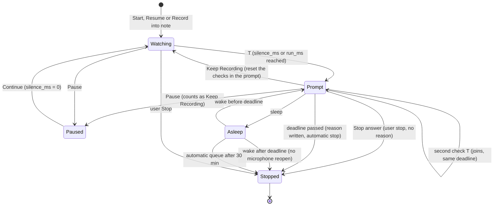
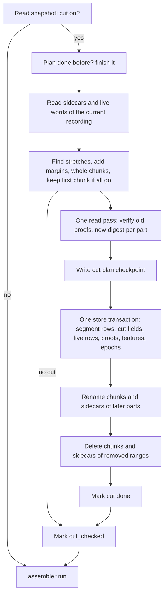

# Forgotten Recording - Plan

## Goal Capsule

- **Objective:** A recording that nobody attends ends by itself soon after the last speech, and a note with long silence keeps, prepares and syncs only the audio around the speech.
- **Means:** A speech and level timeline that capture writes beside the recovery chunks (KTD1, KTD2) drives a "Keep recording?" prompt with a countdown (KTD5), and at each Stop a cut that splits segments at whole-chunk boundaries before Preparing the audio (KTD15, KTD16).
- **Authority:** The Product Contract wins on product behaviour. The KTDs win on mechanism within their cited R-IDs. A unit overrides neither.
- **Stop conditions:** Stop and ask the user when evidence shows that R14 cannot hold on a recognition route (live results must be computed again for more than the windows next to a cut edge), when a cut can remove a chunk with a live word or a speech cell, or when the notification cannot be removed on one platform with native code.
- **Execution profile:** One feature, one PR (`feat`), units committed in order on one branch in a worktree from `origin/main`. Ask "patch or minor?" before the PR opens. The skill change in `plugins/` goes in the same PR.
- **Who finishes:** `ce-work` implements and checks locally, then a signed build goes to the user for the manual tests, then `ce-babysit-pr` until the PR is ready to merge.

---

## Product Contract

### Summary

Longhand watches each recording for 30 minutes with no speech and for 6 hours of total recording time. Either one shows "Keep recording?" with a 2-minute countdown, and if nobody answers, Longhand stops the note. At every Stop, unless the user turned the cut off, Longhand removes long stretches with no speech and a low sound level before it prepares the audio, so the saved note holds the meeting and not the empty room.

### Problem Frame

On Friday 2026-11-13 at 15:01, the user started a note on the work Mac and did not stop it after the meeting. The note recorded for 43.5 hours over the weekend. The user saw it only because another computer showed the note as in use on another computer, and then stopped it remotely. The user has left notes running after a meeting several times before (`docs/ideas/done/recording-state-widget.md`). The recording widget did not help, because nobody was at the computer.

The cost has four parts, and the user rates all four as critical:

- **Privacy.** The microphone recorded an office for two days without the user's knowledge.
- **Processing time.** After Stop, processing took 17 minutes. Preparing the audio took 13 min 17 s of that time, because it converts every second of the recording, silence too. The live transcript and live speaker recognition had already done most of the other work during the 43 hours.
- **Disk and sync.** The full 43.5 hours of audio is saved in the home folder and syncs to the user's other computers.
- **The note itself.** The useful meeting is a short part at the start of a very long note.

A warning alone does not solve this, because the user is not there to see it.

### Key Decisions

- **Two checks, each with a prompt before the stop.** A silence check reacts fast after a meeting ends. The time limit is the backstop for an empty room where a TV or a cleaner talks. The user can set the time of each check and turn each off. Governs R2, R3, R5, R10. (session-settled: user-directed — chosen over a silence check only, a time limit only, and both checks with no prompt: both triggers are needed, and the prompt protects a quiet meeting where the user is present)
- **No answer stops the note and cuts the silent end.** The user finds a finished note of normal length, not an open note. Governs R7, R12. (session-settled: user-directed — chosen over a stop that keeps all audio, and over a Pause that leaves the note open and not processed)
- **Defaults are 30 minutes, 6 hours and 2 minutes.** A quiet stretch of 30 minutes in a real meeting is rare, and 6 hours covers a workshop day. Governs R2, R3, R5, R10. (session-settled: user-directed — chosen over 15 min / 4 h / 2 min and 60 min / 8 h / 5 min)
- **A countdown always ends in a stop, also when people talk.** A time limit is the user's own setting, so the user wants the note to stop at that time. Governs R7. (session-settled: user-directed — chosen over speech that holds the stop until 2 minutes with no speech: the user set the limit and wants it kept)
- **Cut long silence only when both channels are quiet and have no speech.** When the two signals disagree, the audio stays. Quiet speech that the speech check also misses can still be removed, and the quiet-speech test in Success Criteria checks for this. A noisy room is not cut. Governs R12, R13. (session-settled: user-directed — chosen over a cut on no speech alone with a 30-day backup of the removed audio, and over keeping all audio and making Preparing faster: the user wants the cut to be reliable nearly every time)
- **The cut applies at every Stop, not only after an automatic stop.** The silent end of an automatic stop is removed by this cut, not by a separate rule. A note that the user stopped late, or that ran with both checks off, gets the same benefit. Governs R12, R14. (session-settled: user-approved — proposed in the scoping synthesis with the effect on noisy notes shown, and confirmed)
- **The prompt plays no sound.** The recording surface must not draw a meeting's attention to the screen (the attention budget in U7 of `docs/plans/2026-09-21-2052-feat-longhand-walking-skeleton-plan.md`). Governs R5. (session-settled: user-approved — proposed in the scoping synthesis and confirmed)
- **A notice on an automatic stop, no notice for a cut.** An automatic stop is not normal and is important to the user. A cut is normal behaviour, and the silence line in the transcript shows it. Governs R8, R16. (session-settled: user-approved — proposed in the scoping synthesis and confirmed)
- **The settings are shared settings.** One user with several computers wants one behaviour, the same as the recording widget setting. Governs R11. (session-settled: user-approved — proposed in the scoping synthesis and confirmed)
- **A settings change applies to the next note.** This follows the existing rule for recording settings. Keep Recording is the way to extend the current note. Governs R11.
- **The system notification has no buttons.** A click opens Longhand, where the user answers. The answer surfaces are the recording widget and the main window. Governs R5, R9. (session-settled: user-directed — chosen over Keep Recording and Stop buttons in the notification: macOS shows two actions as one "Options" menu, and a Windows toast reports a click only while it is on screen)
- **The kept margin is 1 to 2 minutes.** The cut removes whole minutes of audio only. Governs R13. (session-settled: user-directed — chosen over an exact 1-minute margin: whole minutes keep the cut simple and keep the live results valid)
- **The stop notice shows on all the user's computers.** Governs R8. (session-settled: user-directed — chosen over a notice on the recording computer only: the user found the forgotten note from another computer)
- **A hidden recording widget stays hidden during a prompt.** The prompt then shows in the main window and as a system notification. Governs R5. (session-settled: user-directed — chosen over a prompt that shows the hidden widget: the user hid it on purpose)
- **A silent recording keeps its first minute, a Pause answers the prompt, and a countdown that ends in sleep stops the note at wake.** These rules close gaps that the flow analysis found. Governs R4, R12, R17. (session-settled: user-approved — proposed in the scoping synthesis and confirmed)

### Requirements

**Speech and silence during recording**

- R1. During every recording, Longhand detects speech on the microphone channel and on the app audio channel, also when the live transcript is off.
- R2. The silence check triggers after 30 minutes of recording in which no speech was detected on either channel. Sound that is not speech, such as a fan, air conditioning or traffic, counts as silence. Only speech on either channel that is longer than a short minimum (KTD3) starts the 30 minutes again.
- R3. The time limit triggers after 6 hours of recording time in the current recording. The current recording starts at Start, at Resume, or at Record into a saved note. Audio that the note recorded before that does not count.
- R4. Paused time does not count for either check. After Continue, the silence check starts again from zero, and the time limit continues from the recording time before the pause. Pause during a prompt closes the prompt, and counts as Keep Recording for each check in the prompt.

**The prompt and the automatic stop**

- R5. When a check triggers, the computer that records shows "Keep recording?" with a 2-minute countdown and two choices, Keep Recording and Stop. The prompt shows on the recording widget when the widget shows, in the main window, and as a system notification. The notification has no buttons, and a click on it opens Longhand. The prompt plays no sound, and in the main window it takes no keyboard focus and has no default button.
- R6. Keep Recording closes the prompt and starts each check in the prompt again. The silence check counts again from zero, and the time limit asks again after a further 6 hours of recording time.
- R7. Stop, or the end of the countdown with no answer, stops the note the same way as the user's Stop, and processing starts. Speech during the countdown does not hold the stop.
- R8. A note that Longhand stopped shows a short notice on the note that names each check in the prompt. The notice shows on every computer that uses the storage folder.
- R9. There is only one prompt at a time. A check that triggers while a prompt is open joins that prompt and keeps its countdown, and an answer on any surface, or the end of the countdown, closes the prompt on every surface and removes the system notification.
- R17. When the countdown ends while the computer sleeps, Longhand stops the note when the computer wakes, before the microphone opens again, and the note shows the notice of R8.

**Settings**

- R10. Settings > Recording has an on/off switch and a time for the silence check, the time limit and the long-silence cut, and a time for the countdown. The defaults are on for all three, with 30 minutes, 6 hours, 10 minutes and a 2-minute countdown. The silence check allows 5 to 240 minutes, the time limit 1 to 24 hours, the long-silence cut 5 to 240 minutes, and the countdown 1 to 10 minutes.
- R11. These settings are shared settings, so they apply on every computer that uses the storage folder. A change applies to the next note.

**Long-silence cut**

- R12. When the long-silence cut is on, at every Stop, by the user or by Longhand, Longhand removes each stretch at least as long as the cut time (10 minutes by default) in which every recorded channel has no speech and a low sound level. Only a Pause or a Resume ends a stretch. When the cut would remove all audio of the current recording, its first minute stays. When the cut is off, the note keeps all its audio.
- R13. Between 1 and 2 minutes of audio stays between a removed stretch and the speech on each side of it. The cut removes whole minutes of audio.
- R14. Longhand finds and removes the stretches before Preparing the audio, so Preparing and all later stages process only the audio that stays. The live transcript and live speaker results of the kept audio stay valid after the cut, so a cut never causes a second recognition pass.
- R15. The transcript shows each removed stretch as one silence line with the duration that was removed. Transcript times keep the original recording time.
- R16. Removed audio is deleted permanently. The saved audio holds only the audio that stays, and the note shows no notice for a cut.

### Acceptance Examples

- AE1. Forgotten after a meeting
  - **Covers:** R2, R5, R7, R8, R12, R13
  - **Given:** A meeting ends at 15:45, and the note keeps recording in a quiet, empty office.
  - **When:** No speech is detected until 16:15, and nobody answers the prompt.
  - **Then:** The note stops at 16:17. The audio from 1 to 2 minutes after 15:45 to the Stop is removed, the transcript ends with one silence line, and the note shows that Longhand stopped it after 30 minutes with no speech.
- AE2. Noisy empty room
  - **Covers:** R2, R7, R12
  - **Given:** The meeting ends, and a loud air conditioner runs in the empty room.
  - **When:** No speech is detected for 30 minutes, and nobody answers the prompt.
  - **Then:** The note stops 32 minutes after the meeting. The noisy end is not removed, because its sound level is not low.
- AE3. Quiet stretch in a real meeting
  - **Covers:** R2, R6, R12, R13, R15
  - **Given:** A workshop has a 35-minute quiet writing exercise.
  - **When:** The prompt shows at 30 minutes, and the user selects Keep Recording.
  - **Then:** The note records on. At Stop, 31 to 33 whole minutes of the quiet stretch are removed, and the transcript shows one silence line with that duration.
- AE4. All-day workshop
  - **Covers:** R3, R7
  - **Given:** A workshop is still running after 6 hours of recording.
  - **When:** The time limit prompt shows, and nobody answers within 2 minutes, while people talk.
  - **Then:** The note stops and processing starts.
- AE5. Call through an app
  - **Covers:** R1, R2, R12
  - **Given:** A note records the microphone and a Teams call. The room is silent, and the far side of the call talks.
  - **When:** 40 minutes pass.
  - **Then:** The silence check does not trigger, and no part of those 40 minutes is removed.
- AE6. Checks turned off
  - **Covers:** R10, R12, R14
  - **Given:** The silence check and the time limit are off, and a note records for 43 hours, most of it in a quiet room.
  - **When:** The user stops it.
  - **Then:** The quiet stretches are removed before Preparing the audio, so Preparing takes about as long as for a note of the kept length.
- AE7. Lunch pause
  - **Covers:** R4
  - **Given:** A note records for 20 minutes with no speech, and then the user pauses it for one hour.
  - **When:** The user selects Continue.
  - **Then:** No prompt shows at Continue, and the silence check counts from zero.
- AE8. Asleep during the countdown
  - **Covers:** R17, R8
  - **Given:** The prompt shows, and the laptop lid closes 30 seconds later.
  - **When:** The laptop wakes 10 minutes later.
  - **Then:** The microphone does not open again, the note stops, and the note shows the notice.
- AE9. Nobody spoke
  - **Covers:** R12
  - **Given:** A note started by mistake, with the silence check and the time limit off, records 3 hours in an empty, quiet room.
  - **When:** The note stops.
  - **Then:** The note keeps its first minute, and the transcript shows one silence line for the rest.

### Success Criteria

- A note left recording in a quiet room after a meeting ends as a finished note that is at most a few minutes longer than the meeting.
- For a long recording with little kept audio, the full time from Stop to the finished note, including the search for silence and the cut, is much shorter than the 17 minutes of the forgotten note in the Problem Frame.
- In test recordings with quiet or far speech on either channel, the cut removes no stretch that has speech in it.
- In test recordings of empty rooms with a fan, air conditioning or traffic, the silence check triggers within 30 minutes of the last real speech.

### Scope Boundaries

**Deferred for later**

- Stopping a note from another computer. The user's laptop showed the note as in use on another computer, but could not stop it.
- A faster Preparing the audio for audio that stays, for example a long noisy note that is not cut.
- Less live transcript and live speaker recognition work during long silence.

**Not in this work**

- Notes that exist before this change, such as the 43-hour note. A note that an older build started and this build stops has no settings snapshot, so it gets no checks and no cut.
- A forgotten Pause. The user rejected a speech-listening reminder for a paused note in the pause-recording brainstorm (`docs/ideas/done/recording-state-widget.md`).
- A backup of removed audio.
- Imported audio. An import is not a recording and has no Stop.
- Transcribe Again and reprocessing. They read the saved audio, which the cut already made short.
- A prompt after a crash or a quit during the countdown. The note is interrupted, and the existing automatic queue after 30 minutes ends it.

### Outstanding Questions

**Deferred to Implementation**

- The final values of the speech minimum and the quiet level (KTD3, KTD4). U13 sets them from the private test recordings in `fixtures/` before the PR opens.

### Sources

- `crates/pipeline/src/assemble.rs`: Preparing the audio reads, resamples and encodes every second of each segment. Nothing skips silence.
- `crates/asr/src/windows.rs` and `crates/vad/src/lib.rs`: recognition after Stop uses Earshot VAD and transcribes only voiced windows.
- `src-tauri/src/managers/live.rs` and `crates/asr/src/stream.rs`: speech is detected during recording only when the live transcript is on (`live_transcript` setting).
- `src-tauri/src/managers/capture.rs`: live peak levels for the microphone and the app channel; the app channel starts at the first app sound.
- `src/recording/inputStatus.ts`: the existing "quiet" status, after 20 s below -60 dBFS.
- `src-tauri/src/managers/alerts.rs`: the existing system notification and alert cue for a failed capture.
- `src/widget/RecordingWidget.tsx`: the recording widget with Pause, Continue and Stop.
- `src-tauri/src/managers/settings.rs`: local and shared settings; `show_recording_widget` is a shared setting that applies to the next note.
- `crates/pipeline/src/transcribe.rs` and `crates/pipeline/src/join.rs`: the silence, pause and gap lines in the transcript.
- `docs/ideas/done/recording-state-widget.md` and `docs/plans/2026-10-09-1504-feat-pause-recording-plan.md`: the earlier decisions about a recording left running and a forgotten Pause.

---

## Planning Contract

### Key Technical Decisions

**Speech and level during recording**

- KTD1. **One speech detector per channel in the segment thread.** The existing `on_frame` closure (`src-tauri/src/managers/capture.rs:4160-4164`) gets both channels at the native rate for every 20-ms frame (`crates/recorder/src/lib.rs:77-87, 256-260`). Each channel gets one `pipeline::resample::StreamResampler` to 16 kHz and one bare `vad::EarshotVad` (256 samples, threshold 0.5), new for each segment because the device rate can change. The cost is about 0.06% of one core. Inline work cannot drop frames, and a channel that drops frames would make holes in the timeline. The live worker's VAD cannot serve R1: it runs only with live features on, sees only the mix, and can fall behind (`crates/pipeline/src/live.rs:560-582, 1086-1090`).
- KTD2. **A speech timeline in sidecar files beside the chunks.** For each closed chunk, the segment thread writes `{segment}-{capture_started_at}-{start_ms}.speech` in `audio-recovery/` through a temporary file and a rename. The file has one cell for each 250 ms of new audio (not the 2-s lookback). Each cell holds, for each recorded channel, the voiced fraction of its Earshot frames and the RMS level in dBFS, each as one byte, after a small header with a format version and the channel count. Sidecars exist from the first frame, before the session row exists, so they avoid the `DeferredLive` problem (`crates/pipeline/src/live.rs:26-63`). They never sync. A cell with no data, for example the open chunk after a crash or a chunk that an older build wrote, counts as speech. Storing fractions and levels instead of flags lets U13 change the thresholds without a format change.
- KTD3. **Speech means 1 s of voiced cells within 2 s.** A cell is voiced on a channel when at least half of its Earshot frames are voiced. Speech is at least 4 voiced cells within 8 cells in a row on one channel. One short sound, such as a door or a cough, is not speech (`docs/solutions/logic-errors/verify-stopped-on-detected-sound-without-words.md`). The silence check (R2) and the cut (R12) use this definition, and the cut adds a stricter rule for short sounds (KTD17). U13 confirms the values on the test recordings.
- KTD4. **A chunk is quiet when its 95th-percentile cell level is at or below -50 dBFS on every recorded channel.** The percentile lets a door slam stay inside a quiet chunk. `QUIET_PEAK` (-60 dBFS peak, `src/recording/inputStatus.ts:11-14`) is a peak test for a dead microphone and is too strict for room tone. U13 sets the final value from the empty-room recordings. A mono segment has no app channel. A stereo segment's app channel is part of the test, also while it is silent.

**The prompt**

- KTD5. **A pure prompt flow with injected UTC time, run by one guard thread.** `GuardFlow` in a new module `src-tauri/src/managers/guard.rs` takes inputs `{tick(now, silence_ms, run_ms), pause, continue, sleep, wake(now), interrupted, answer(generation, keep|stop), stopped}` and returns actions `{show_prompt, join_prompt, close_prompt, auto_stop(checks)}`. The prompt has a generation, a set of checks and a UTC deadline, after the `AlertsManager` model (`src-tauri/src/managers/alerts.rs:42-50, 99-187`). One thread, `longhand-guard`, ticks once a second and reads the counters. Tokio timers do not advance in sleep, so the deadline is UTC wall clock (`docs/solutions/logic-errors/update-checks-stopped-on-a-mac-that-sleeps-often.md`). The flow has no I/O, so tests drive it with no waits.
- KTD6. **The counters live per note, outside the segment.** An `Arc<GuardMeter>` with two atomics, `silence_ms` and `run_ms`, goes into each segment thread. The segment thread adds 250 ms per cell and sets `silence_ms` to zero at speech. It never takes `inner` (`capture.rs:4165-4167`). Only Continue and Keep Recording set `silence_ms` to zero, so a microphone change, the first app sound or a restart does not reset the silence check. `run_ms` starts at zero at Start, Resume and Record into a note, so the time limit does not use `recorded_before` (`capture.rs:4067, 4146`).
- KTD7. **An automatic stop uses the user's Stop path on its own thread.** `stop_session` takes `inner` itself (`capture.rs:2441-2447`), so a check before the call leaves a window in which Keep Recording or a new note can arrive. The guard thread therefore calls a new `CaptureManager::stop_session_if(note_id, generation, reason)`: it takes `inner`, checks that the note and the prompt generation are still current, writes the stop reason (KTD8), and then continues on the same stop path as `stop_session`. When the check fails, it returns with no stop. Then the guard calls `ProcessingManager::wake()`, as `commands::capture::stop_recording` does (`src-tauri/src/commands/capture.rs:113-128`). A Stop from the prompt is a user stop with no reason. The answer commands are async with `blocking`. Lock order stays capture lock, then store lock.
- KTD8. **The stop reason is in `longhand.json`.** `NoteRecord` gets `auto_stop: Option<AutoStop>` with `skip_serializing_if = "Option::is_none"`; `AutoStop` holds the silence-check minutes and the time-limit hours that were in the prompt, each optional (`crates/session-core/src/note_record.rs:27-80`). It syncs (R8). An older build drops the field at its next write of the record, which is acceptable. The read-modify-write holds the store lock from read to write (`docs/solutions/logic-errors/note-record-writers-undid-each-other.md`). `SessionDetail` gets the field, and the note page shows one quiet status line.
- KTD9. **Sleep during a prompt.** `did_wake` asks the guard before it opens the microphone (`capture.rs:3692-3747`). When the deadline passed, the guard writes the reason and stops the note from `Interrupted{Sleep}`; the microphone does not open (R17). When the sleep passes `AUTO_QUEUE_AFTER` (30 min, `crates/session-core/src/state.rs:13, 190-198`) first, `Store::tick` queues the note; the guard then writes the reason only when the deadline passed before the queue. The prompt and its countdown stay open while the note is interrupted. A countdown that ends while the input is lost stops the note, and the stop clears the failed-capture alert as a user Stop does.
- KTD10. **The notification is native code on both platforms.** `tauri-plugin-notification` 2.7.0 cannot remove a shown notification on macOS or Windows. On macOS, the prompt shows through the plugin with no action type, and the guard removes it by a scan of `NSUserNotificationCenter.defaultUserNotificationCenter.deliveredNotifications` for the prompt title, through `objc2` (`src-tauri/Cargo.toml:98-104`). On Windows, Longhand shows and removes its own toast with tag `keep-recording` and group `longhand` through `windows::UI::Notifications` (`ToastNotificationManager`, `History().Remove`), with no audio element. Longhand registers no `on_action` handler, because one handler makes every notification tracked, with one waiting thread each (`tauri-plugin-notification-2.7.0/src/desktop.rs:62-67, 146`). At launch, Longhand removes any prompt notification that a crash left.
- KTD11. **The widget grows only while the prompt shows.** The window stays 288×64 (`src-tauri/src/widget.rs:16-18`) and grows to show the prompt row, with the placement and the macOS tracking area computed again (`docs/solutions/ui-bugs/hover-lagged-in-a-panel-that-is-never-key.md`). It stays a non-key panel. A hidden widget stays hidden. The countdown is text that changes once a second, like the elapsed time, with no motion.
- KTD12. **The main-window prompt is app level.** It renders in `src/App.tsx` above Home and the note page, because `RecordingBar` shows only on the open note's page (`src/session/SessionPage.tsx:1107-1114`). It uses the `Warning` plus action row shape of `RecordingBar` (`src/session/RecordingBar.tsx:109-152, 270-305`), with no `prominent` button, no `autoFocus`, no `focus()` call, and no show or front of the window.

**Settings**

- KTD13. **Four shared keys in the `AudioRemoval` form.** `silence_check_minutes` (`"off"` or 5–240), `recording_time_limit_hours` (`"off"` or 1–24), `long_silence_cut_minutes` (`"off"` or 5–240) and `stop_countdown_minutes` (1–10, no off). The file layer follows `AudioRemoval` (`crates/shared-settings/src/file.rs:94-140`), and the settings form follows `AudioRemovalSetting` (`src-tauri/src/managers/settings.rs:118-169`). Saves are patch-only through `shared_patch`. No rule links two of these settings in the file (`docs/solutions/integration-issues/shared-settings-in-a-synced-folder-rules.md`, rule 8). The link is applied where the cut reads the snapshot (KTD17), so the silent end of an automatic stop is cut also when the silence check plus the countdown is shorter than the cut time.
- KTD14. **A settings snapshot for each recording, stored with the session row.** Start, a Resume of a saved note and Record into a note each begin a new recording, so each reads the four settings once and store them as `RecordingGuards` in a new session-row column. The guard thread and the cut read only the snapshot. A Resume of an interrupted note keeps its snapshot. The cut reads the snapshot after a relaunch, so it cannot be in memory only. A note with no snapshot gets no checks and no cut.

**The cut**

- KTD15. **The cut runs at the start of the Assemble execution.** It runs in `runner.rs` before `assemble::run` (`crates/pipeline/src/runner.rs:1807-1813`), and therefore before `check_space` (`crates/pipeline/src/assemble.rs:56-82`). `run_stage` reads the segment rows once before the stage (`runner.rs:1712`), so after the cut the Assemble branch reads the rows from the store again and gives that new list to `assemble::run`. A 43-h note would otherwise need about 12 GB of free space before its cut. The progress UI shows the cut as "Preparing the audio", with no new stage. Every stop path reaches this point: the user's Stop, the automatic stop, and the automatic queue of an interrupted note.
- KTD16. **The cut splits segments at whole-chunk boundaries.** Each removed stretch becomes a gap between two parts, and each part keeps its original note-timeline offset. So transcript times, `recognition-epoch-*` keys and every `offset_ms + position` calculation stay correct with no time map (`crates/session-core/src/timeline.rs:1-43`). Part A keeps index k and ends at a chunk end. Each later part starts at a chunk start, and its chunks are renamed, not rewritten. The cut then gives the segments of the current recording new indices in time order, from the lowest index of the current recording up, so the segment that is last by offset has the highest index. An older build that reads the synced records computes the next index as the last segment by offset plus one, so it cannot give a used index (KTD22). `ArchiveReader` skips the samples before the segment offset instead of rejecting the chunk (`crates/pipeline/src/live/archive.rs:126-131`). A skip list in Assemble was rejected: it breaks the position rule in more than 10 places.
- KTD17. **Detection is per recording, on whole chunks.** The cut reads the sidecars of the segments of the current recording only, never the saved prefix (`crates/pipeline/src/recognition/saved_prefix.rs:28-98`). A stretch runs across segment boundaries and ends only at a Pause or a Resume boundary. A chunk can be removed when it is quiet (KTD4), has no speech cell on any channel (KTD3), has no cell that is both voiced and above the quiet level on any channel, has no cell with missing data, and holds no live word. The voiced-and-loud rule is for the cut only: a 1-s remark is too short to be speech for the silence check, but the cut must not delete it. After the stretches are found, each side next to speech keeps whole chunks until the kept margin is at least 60 s, which gives 1 to 2 minutes (R13). A side at a Pause, a Resume, the Stop or the recording start keeps no margin. A stretch qualifies when its length before the margins is at least the cut time; then its whole chunks outside the margins are removed. For the trailing stretch of an automatic stop by the silence check, the limit is the smaller of the cut time and the silence-check time, so that the silent end is cut (Key Decision: no answer stops the note and cuts the silent end). When every chunk of the recording would go, whole chunks from the start stay until they hold at least 60 s of audio, also when the first segment ends early (R12). Segments that a stretch covers completely are removed as a whole. The result is deterministic, and each checked segment gets a `cut_checked` mark, so a second run finds nothing.
- KTD18. **The cut keeps live results valid by one read pass before any file change.** For each segment that the cut splits, one pass over its chunks verifies the old `live-source` proof (`crates/pipeline/src/live/archive.rs:24-58, 181-221`) and computes a new running digest for each part. When the old proof does not verify, the cut writes no new proofs, and `bind_live` does what it does today. When the live worker was behind, each part gets a proof only for the audio that the old proof covered. Live rows split at the cut edges: each piece keeps only the words inside its part, part B pieces move by `B.offset_ms - original.offset_ms`, and they get new keys under the new index (`crates/pipeline/src/live.rs:76-119`). Epoch records clip to the kept ranges. Live speaker feature windows keep the original grid: a window that lies fully inside a part is kept with a grid phase, and a window that crosses a cut edge is deleted, so `features::complete` computes only those windows again (at most two 10-s windows for each edge).
- KTD19. **Crash-safe cut order.** (1) Write the cut plan as an Assemble checkpoint. (2) In one store transaction: write the segment rows (part A shortened, new rows, the cut fields, `cut_checked`) and the re-keyed live rows, proofs, snapshots and feature keys. (3) Rename the chunks and sidecars of the new parts. (4) Delete the chunks and sidecars of the removed ranges, after a check of each name and entry kind (`docs/solutions/security-issues/audio-removal-trusted-synced-file-names-before-delete.md`). (5) Mark the cut done. Segment rows come before renames, because `register_chunks` makes a row for each chunk index with no row (`crates/pipeline/src/recover.rs:197-276`). At restart, an unfinished plan finishes first; each file step can run again. `start_over` deletes the Assemble checkpoints, so the result lives in the segment rows, not only in checkpoints.
- KTD20. **NeMo reuses live epochs on the original grid.** `run_file` walks its epoch grid from the original capture origin of the segment, reuses a saved epoch whose range contains the requested range, and clips its rows, turns and coverage to the kept range (`crates/pipeline/src/recognition/nemo.rs:19, 38-50, 241-258, 1083, 1110-1163`). Without this, every epoch of a later part is computed again, because its offset is not on the 20-min grid. Native speaker labels stay scoped to one epoch.
- KTD21. **Two cut fields on each segment drive the silence lines.** `Segment` gets `cut_after_ms` (the removed audio after the segment end) and `cut_before_ms` (the removed audio before the segment start, for a leading stretch). Both are in the store, in `SegmentRecord` with `serde(default, skip_serializing_if)`, and outside `same_segments` and the saved-prefix comparison (`docs/solutions/logic-errors/pause-marker-missing-on-recognition-transcript-route.md`). One shared function in `crates/pipeline/src/join.rs` makes the lines for both transcript routes: a `Silence` line for the cut, then the normal Pause or Gap line for any rest of the distance to the next segment when the rest is longer than 1 s. An older build reads the note as a Gap line, which is acceptable.
- KTD22. **`Timeline::next_index` uses the maximum index plus one.** The cut gives later parts indices that are not in time order, so the current rule (last segment by offset, `crates/session-core/src/timeline.rs:146-151`) could give a used index at the next Resume. KTD16's renumbering in time order also keeps older builds safe; this rule is the second guard.

### High-Level Technical Design

The prompt flow, for one note. `T` is the trigger of a check, and the deadline is UTC wall clock.

The cut, inside the Assemble execution, before `check_space`:

### Assumptions

- Earshot's cost on two channels is negligible next to the resampler, as its README states. U3 measures it in a release build.
- Whole-minute chunk boundaries are multiples of the 20-ms live read step, so a new proof can end exactly at a part end.
- A click on an untracked notification brings Longhand to the front on macOS and Windows. The manual tests prove this; if it fails, the click handler is a follow-up, not a reason to add buttons.

### Sequencing

U1 and U2 come first, because every other unit reads the settings snapshot or the new fields. U3 then gives the timeline that U4 (the prompt) and U9 (the cut) read. The prompt path (U4–U8) and the cut path (U9–U12) are independent after U3. U13 runs last, because the calibration and the real-audio checks need all code.

### System-Wide Impact

- **Stored data:** one SQLite migration (session-row snapshot, segment cut fields, `cut_checked`), two optional fields in `longhand.json` records, new files in `audio-recovery/`. Real users run older builds; each new field is optional, and an older build degrades to a Gap line and no notice. Because the cut numbers segments in time order (KTD16), an older build's Record into a cut note gets a free index.
- **Agent skill:** the four shared keys and the `auto_stop` record field reach `plugins/longhand/skills/longhand-notes/` and its drift tests.
- **Privacy:** the cut deletes audio before Preparing, so removed audio never reaches the home folder or sync.
- **Attention budget:** the prompt is the only new exception-tier surface, and it has no sound, no motion and no focus.

### Risks and Dependencies

| Risk | Mitigation |
|---|---|
| The cut removes quiet speech. | KTD3 and KTD4 use both signals, missing data counts as speech, live words block a cut, and U13 tests the private quiet-speech set before the PR. |
| A cut causes a second recognition pass on one route. | KTD18 and KTD20; U10 and U11 assert the checkpoints after a cut on each route, not only the transcript. |
| The pyannote window grid cannot take a phase. | U10 tests it first. If it cannot, stop and ask the user (Goal Capsule stop condition). |
| Native notification removal fails on one platform. | Manual test in a signed build on macOS, and on Windows on nebula. Stop and ask when removal cannot work. |
| A crash during the cut loses audio or leaves orphan chunks. | KTD19 order, with a lost-record test after each step. |

---

## Implementation Units

| U-ID | Title | Files touched | Depends on |
|---|---|---|---|
| U1 | Shared settings and snapshot type | `crates/shared-settings/src/file.rs`, `src-tauri/src/managers/settings.rs`, `src-tauri/src/commands/settings.rs`, `plugins/longhand/skills/longhand-notes/` | — |
| U2 | Stored fields and next index | `crates/session-core/`, `crates/session-core/migrations/0026_*.sql` | U1 |
| U3 | Speech timeline during capture | `src-tauri/src/managers/capture.rs`, `crates/recorder/src/chunks.rs`, new `crates/recorder/src/speech.rs` | U2 |
| U4 | Prompt flow and automatic stop | new `src-tauri/src/managers/guard.rs`, `src-tauri/src/managers/capture.rs`, `src-tauri/src/commands/capture.rs` | U3 |
| U5 | Native prompt notification | new `src-tauri/src/notify_prompt.rs`, `src-tauri/Cargo.toml` | U4 |
| U6 | Prompt in the widget and main window | `src-tauri/src/widget.rs`, `src/widget/RecordingWidget.tsx`, `src/App.tsx`, new `src/recording/StillRecording.tsx` | U4 |
| U7 | Stop notice on the note | `crates/session-core/src/note_record.rs`, `src-tauri/src/commands/session.rs`, `src/session/SessionPage.tsx` | U4 |
| U8 | Settings > Recording controls | `src/settings/Recording.tsx`, new `src/settings/RecordingGuards.tsx` | U1 |
| U9 | Cut detection | new `crates/pipeline/src/cut/detect.rs` | U2, U3 |
| U10 | Cut execution and live re-binding | new `crates/pipeline/src/cut/apply.rs`, `crates/pipeline/src/runner.rs`, `crates/pipeline/src/live/archive.rs`, `crates/pipeline/src/live/features.rs` | U9 |
| U11 | NeMo epoch reuse after a cut | `crates/pipeline/src/recognition/nemo.rs` | U10 |
| U12 | Silence lines for cuts | `crates/pipeline/src/join.rs`, `crates/pipeline/src/recognition.rs`, `crates/session-core/src/folder.rs`, `src-tauri/src/commands/session.rs`, `crates/pipeline/src/transcribe.rs` | U2 |
| U13 | Calibration, docs and real-audio checks | `crates/recorder/src/speech.rs` constants, `CONCEPTS.md`, `docs/solutions/` | all |

### U1. Shared settings and snapshot type

- **Goal:** The four settings exist as shared settings with defaults, ranges and patch-only saves, and a `RecordingGuards` snapshot type exists.
- **Requirements:** R10, R11; KTD13, KTD14.
- **Files:** `crates/shared-settings/src/file.rs` (keys, `Field`s, `SharedValue` variants, `default_settings()`); `src-tauri/src/managers/settings.rs` (fields, `from_parts`, `shared_patch`, `apply_shared`, setting forms with `validate()`); `src-tauri/src/commands/settings.rs` and `src-tauri/src/lib.rs` (one command per setting); `src/bindings.ts` (generated); `src/settings/shared.ts` (`damagedFileText`); the six test files with a full `Settings` literal; `plugins/longhand/skills/longhand-notes/scripts/_longhand.py` (`SETTINGS_KEYS`), `check.py` (`check_setting`), `references/settings.md`, `scripts/tests/test_check.py`; `crates/library/tests/skill_drift.rs`; `testdata/storage-folder/` if the writer output changes.
- **Approach:** Copy the `AudioRemoval` pattern for each key. The countdown is a plain integer with no off state. `RecordingGuards { silence_check_minutes: Option<u32>, time_limit_hours: Option<u32>, cut_minutes: Option<u32>, countdown_minutes: u32 }` with `serde` for the store column in U2.
- **Test scenarios:** absent key reads the default; `"off"` and each range end read correctly; a value outside the range and a wrong type read as `Unknown` and give the default; a save of one key keeps the others and unknown keys; two-computer test shows the same value; the skill check accepts the valid values and rejects the others on Python 3.9 and current.
- **Verification:** `cargo test -p shared-settings`, the settings tests in `src-tauri`, `cargo test -p library --test skill_drift`, the skill script tests, `npm run typecheck`, `npm test`.

### U2. Stored fields and next index

- **Goal:** The store and the note folder can hold the snapshot, the cut fields, the cut mark and the stop reason, and Resume after a cut allocates a free index.
- **Requirements:** R8, R11, R15; KTD8, KTD14, KTD21, KTD22.
- **Files:** `crates/session-core/migrations/0026_recording_guards.sql` (session column `recording_guards`, segment columns `cut_after_ms`, `cut_before_ms`, `cut_checked`); `crates/session-core/src/jobs.rs` (`insert_segment`, `segments()`, session row read and write); `crates/session-core/src/timeline.rs` (`Segment` fields, `next_index`); `crates/session-core/src/folder.rs` (`SegmentRecord` fields); `crates/session-core/src/note_record.rs` (`auto_stop`); `crates/pipeline/src/recognition/saved_prefix.rs` (exclude the cut fields).
- **Approach:** Follow `0020_segment_ends_in_pause.sql` for the columns and `ends_in_pause` for the record fields. Before the migration number is final, check `origin/main` for a parallel 0026 (`docs/solutions/workflow-issues/parallel-branches-bump-same-schema-version.md`).
- **Test scenarios:** an old record with no new fields reads and writes byte-identical; a record with the fields round-trips; `same_segments` is true when only the cut fields differ; `next_index` gives max + 1 when indices are out of time order (segments 0, 2, 1 by offset gives 3); the migration runs on a store from the current release.
- **Verification:** `cargo test -p session-core`, `LONGHAND_UPDATE_TESTDATA=1 cargo test -p library --test test_storage_folder` and a read of the `testdata/` diff.

### U3. Speech timeline during capture

- **Goal:** Every recording writes a speech and level timeline beside its chunks and keeps the per-note counters current, with or without the live transcript.
- **Requirements:** R1, R2, R3, R4; KTD1, KTD2, KTD3, KTD4, KTD6.
- **Files:** new `crates/recorder/src/speech.rs` (cell builder, sidecar format, reader, the KTD3 and KTD4 constants); `crates/recorder/src/chunks.rs` (sidecar name, write at chunk close, `remove_segment` deletes sidecars); `src-tauri/src/managers/capture.rs` (`on_frame` feeds the detector, `GuardMeter` in `Inner`, Start, Resume, Record into a note and Continue reset rules).
- **Approach:** The sidecar writer follows the chunk boundaries (`chunks.rs:205-219`) and writes at chunk close on the existing off-thread rename path, never a 0-byte file. The reader follows the shared end-before-data order (`docs/solutions/logic-errors/live-reader-missed-last-chunk-and-dropped-worker-never-ended.md`). The counter updates are atomics only. A reader for the cut returns `None` for a cell with no data.
- **Test scenarios:** a synthetic tone with speech-like modulation sets voiced cells and resets `silence_ms`; white noise at -40 dBFS gives no speech and a level above the quiet level; one 250-ms burst is not speech, 1 s within 2 s is; a stereo segment with speech only on the right resets the counter; a mic change (new segment) keeps `silence_ms`; Continue sets it to zero; `run_ms` starts at zero at Resume while `recorded_before` is not zero; the sidecar covers new audio only, not the lookback; a crash leaves no sidecar for the open chunk and the reader reports missing cells; `remove_segment` removes the sidecars; a release-build measurement of the detector's CPU time on 10 minutes of 48-kHz stereo.
- **Verification:** `cargo test -p recorder`, capture tests in `src-tauri`.

### U4. Prompt flow and automatic stop

- **Goal:** The checks show one prompt with a countdown, the answers and Pause close it, and the countdown end stops the note with its reason, also across sleep.
- **Requirements:** R2–R9, R17; KTD5, KTD6, KTD7, KTD8, KTD9, KTD14.
- **Files:** new `src-tauri/src/managers/guard.rs` (`GuardFlow`, `GuardManager`, the `longhand-guard` thread, the `RecordingPrompt` event); `src-tauri/src/managers/capture.rs` (snapshot at Start, Resume and Record into a note; calls into the guard at pause, continue, will_sleep, did_wake, stop; `RecordingStatus.prompt`); `src-tauri/src/commands/capture.rs` (`keep_recording(generation)`, `stop_from_prompt(generation)`, async with `blocking`); `crates/session-core/src/note_record.rs` writer for `auto_stop`; `src-tauri/src/lib.rs` (register).
- **Approach:** All decisions are in `GuardFlow`; `GuardManager` only applies actions. The deadline thread checks the generation under the capture lock before the stop (KTD7). On the automatic-queue path, the store tick asks the guard whether the deadline passed before it writes the reason. One owner per message: the automatic stop shows no error and no second notification (`docs/solutions/ui-bugs/one-capture-failure-gave-two-messages.md`).
- **Test scenarios:** each state-machine edge in the High-Level Technical Design with injected UTC `now`; a second check joins with the same deadline; Keep Recording resets only the checks in the prompt and the time limit asks again after a further limit; Pause closes the prompt and AE7 shows no prompt at Continue; a time-limit prompt closed by Pause does not show again at Continue; the deadline and a Keep Recording at the same moment give one result by generation, and `stop_session_if` does not stop a note whose generation changed or a new note; wake after the deadline stops with no microphone reopen (AE8); wake before the deadline keeps the prompt; sleep past 30 minutes with a passed deadline writes the reason; a countdown during `Interrupted` (input lost) stops and clears the alert; checks that are off never trigger; a note with no snapshot gets no checks; an integration test drives the real manager to a stop and waits for the `captureEnded` event, then asserts the `auto_stop` record and the Queued state.
- **Verification:** `cargo test -p longhand guard` (unit) and the capture integration tests.

### U5. Native prompt notification

- **Goal:** The prompt shows as a silent system notification with no buttons, a click opens Longhand, and Longhand removes it when the prompt closes.
- **Requirements:** R5, R9; KTD10.
- **Files:** new `src-tauri/src/notify_prompt.rs` (`show`, `remove`, `remove_leftover` with `#[cfg(target_os)]` parts); `src-tauri/Cargo.toml` (Windows `windows` features `UI_Notifications`, `Data_Xml_Dom`; macOS `objc2` foundation classes if needed); `src-tauri/src/managers/guard.rs` (calls); `src-tauri/src/lib.rs` (leftover removal at launch); `PROVENANCE.md` if code is borrowed.
- **Approach:** Title "Keep recording?", body "Longhand stops this note in N minutes. Open Longhand to keep recording.", where N is the countdown of the snapshot. No `.sound()`. The Windows toast XML sets `<audio silent="true"/>` and the tag and group. A removal failure is logged and not shown.
- **Test scenarios:** unit tests for the toast XML (tag, group, silent audio, no actions) and for the title match used by the macOS scan; manual tests (Verification Contract) for show, click, removal on answer, removal on stop, leftover removal at launch, Focus or Do Not Disturb on.
- **Verification:** `cargo test -p longhand notify_prompt`, `scripts/check-windows.sh`, `scripts/check-licences.sh` if a dependency feature adds a crate.

### U6. Prompt in the widget and main window

- **Goal:** The widget, when shown, and the main window show "Keep recording?" with the countdown, Keep Recording and Stop, and an answer on one surface closes all.
- **Requirements:** R5, R6, R7, R9; KTD11, KTD12.
- **Files:** `src-tauri/src/widget.rs` (prompt size, placement, tracking area, no show when hidden); `src/widget/RecordingWidget.tsx`; new `src/recording/StillRecording.tsx` (shared prompt row and countdown text); `src/App.tsx`; `src/recording/useCapture.ts` (prompt from status and event); `src/bindings.ts`.
- **Approach:** Invoke `apple-design` and `emil-design-eng` before the UI work. Countdown text from the UTC deadline, `m:ss`, updated once a second, no animation. Buttons call the U4 commands with the generation. The main-window row is `role="status"` and holds "Keep recording?" and the countdown length; the `m:ss` text that changes each second is outside the live region (`aria-hidden`), so a screen reader does not read it every second. The buttons are not prominent and nothing takes focus.
- **Test scenarios:** the prompt renders from the status and from the event; each button calls its command with the generation; an older generation from a late event is ignored; the prompt goes on `captureEnded` and on a close event; `document.activeElement` does not change when the prompt shows; the live-region text does not change while the countdown runs; Rust tests that `step` keeps a hidden widget hidden with a prompt and that the placement fits the larger size on the screen edge.
- **Verification:** `npx vitest run src/widget src/recording src/App.test.tsx`, widget unit tests in `src-tauri`; WebKit focus check in the signed build.

### U7. Stop notice on the note

- **Goal:** A note that Longhand stopped shows which check stopped it, on every computer.
- **Requirements:** R8; KTD8.
- **Files:** `src-tauri/src/commands/session.rs` (`SessionDetail.auto_stop`); `src/session/SessionPage.tsx` (status line); `src/bindings.ts`.
- **Approach:** One quiet status line under the title, as `not_saved_yet` renders (`src/session/SessionPage.tsx:1031-1036`). Text: "Longhand stopped this note after 30 minutes with no speech." / "… after 6 hours of recording." / both in one sentence. The minutes and hours come from the record, not from the current settings.
- **Test scenarios:** each of the three texts; no line for a user stop; the record from another computer gives the line.
- **Verification:** `npx vitest run src/session`, `cargo test` for the detail mapping.

### U8. Settings > Recording controls

- **Goal:** The user turns each check and the cut on or off and sets each time.
- **Requirements:** R10, R11; KTD13.
- **Files:** new `src/settings/RecordingGuards.tsx`; `src/settings/Recording.tsx` (a group after the widget group); new `src/settings/RecordingGuards.test.tsx`.
- **Approach:** Follow `src/settings/AudioRemoval.tsx` (`Row`, `Switch`, `CommitField`, range check, `ErrorText`) and `sharedDetail` for the shared note. Minute and hour fields save at blur, at unmount and at window close (`docs/solutions/ui-bugs/single-line-setting-lost-at-close-or-pane-change.md`). A read-only storage folder disables the controls.
- **Test scenarios:** each switch calls its command with off or the last value; a value outside the range shows the error and saves nothing; a value saves on unmount; the controls are disabled for a read-only folder.
- **Verification:** `npx vitest run src/settings`.

### U9. Cut detection

- **Goal:** A pure function returns the cut plan for the current recording from the segment rows, the sidecars, the live words and the snapshot.
- **Requirements:** R12, R13; KTD3, KTD4, KTD17.
- **Files:** new `crates/pipeline/src/cut/detect.rs` and `crates/pipeline/src/cut/mod.rs`.
- **Approach:** Input is plain data, so tests need no files. Output lists, for each segment, the kept chunk ranges, the new index of each later part, the removed chunks, and the `cut_before_ms` and `cut_after_ms` values.
- **Test scenarios:** AE1 trailing stretch keeps 1–2 min after the last speech and has no margin at the Stop; AE3 35-min stretch removes 31–33 whole minutes; AE2 noisy chunks are not removed; AE5 speech on the app channel only blocks the cut; AE9 all-silent recording keeps at least its first 60 s, also when a mic change ends the first segment after 20 s; a stretch across a mic change removes the whole segment between and gives one stretch; a Pause ends a stretch and keeps no margin at the Pause; the saved prefix of a resumed note is never in the plan; a missing cell blocks removal of its chunk; a live word in a quiet chunk blocks its removal; a stretch shorter than the cut time after margins is not cut; a second run on the output finds nothing; a 1-s voiced burst at speech level in a 15-minute quiet stretch blocks removal of its chunk with the live transcript off; an 11-minute stretch between speech is cut with the 10-minute default; the trailing stretch of an automatic stop with a 5-minute silence check and a 10-minute cut is cut; after a cut, the segments of the current recording have indices in time order and the last by offset has the highest index; the snapshot with the cut off gives no plan. Expected values come from the examples, not from the code.
- **Verification:** `cargo test -p pipeline cut::detect`.

### U10. Cut execution and live re-binding

- **Goal:** The cut changes the files and the store in a crash-safe order, and the live results of the kept audio stay valid.
- **Requirements:** R12, R14, R16; KTD15, KTD16, KTD18, KTD19.
- **Files:** new `crates/pipeline/src/cut/apply.rs`; `crates/pipeline/src/runner.rs` (call before `assemble::run`); `crates/pipeline/src/live/archive.rs` (skip samples before the offset; digest per part); `crates/pipeline/src/live/features.rs` (grid phase); `crates/pipeline/src/recognition/durable.rs` (accept clipped epochs); `crates/session-core/src/jobs.rs` (one transaction method for the cut); `crates/pipeline/src/assemble.rs` (use the lookback of a part's first chunk as resampler pre-roll only).
- **Approach:** Test first that the pyannote window grid can take a phase; if it cannot, stop and ask (Goal Capsule). Each file step checks that its source exists, so it can run again. The cut writes no message to the UI.
- **Test scenarios:** after a cut, `bind_live` keeps every live row, proof and snapshot of the kept audio and records no `live-invalidation-reasons` entry (assert the checkpoints); a live row that crosses a cut keeps only its words inside each part; part B rows have the new index and correct times on the note timeline; a proof that does not verify gives no new proofs; a live worker that was behind gives proofs only for covered audio; a crash after each of steps 1–5 (lost-record tests) finishes the cut at the next run with no lost kept audio and no orphan chunk; `check_space` and `assemble::run` get the segment rows after the cut; the removed chunks and sidecars are gone; a symlink or a wrong name in `audio-recovery/` is not deleted; the automatic queue of an interrupted note runs the cut; `start_over` after a cut does not cut again; a note without a snapshot is not cut.
- **Verification:** `cargo test -p pipeline cut`, `cargo test -p pipeline live`, `cargo test -p session-core`.

### U11. NeMo epoch reuse after a cut

- **Goal:** On the NeMo routes, the live epochs of the kept audio are reused after a cut.
- **Requirements:** R14; KTD20.
- **Files:** `crates/pipeline/src/recognition/nemo.rs`; `crates/pipeline/src/recognition.rs` if `validate_result` needs the clipped coverage.
- **Approach:** The grid origin of a cut part is the original capture origin, which the segment rows can give from the original `offset_ms` of part A. Clip rows, turns and coverage to the requested range.
- **Test scenarios:** part A's last epoch, which contains the cut start, is reused and clipped; part B's epochs are reused from the original grid; a range with no saved epoch is computed; native speaker labels stay consistent inside one epoch across the cut; no epoch is computed again for kept audio (assert the run log or counters, not only the transcript).
- **Verification:** `cargo test -p pipeline nemo`.

### U12. Silence lines for cuts

- **Goal:** Both transcript routes show one silence line for each removed stretch, and the readers of transcript lines stay correct.
- **Requirements:** R15; KTD21.
- **Files:** `crates/pipeline/src/join.rs` (one shared function); `crates/pipeline/src/recognition.rs` (exact route, `:196-285`); `crates/session-core/src/folder.rs` (`session.md` "Silence"); `src-tauri/src/commands/session.rs` (`doc_lines` pairs the line by the segment field, `:1591-1629`); `crates/pipeline/src/transcribe.rs` (`seed_from_transcript`, `:608-760`).
- **Approach:** The shared function returns the lines for one boundary, and for a leading and a trailing cut. Both routes call it.
- **Test scenarios:** a cut between two parts gives one Silence line with the removed duration on both routes; a trailing cut gives a final Silence line; a leading cut gives a first Silence line; a trailing cut before a Resume gives Silence then Gap; a cut before a Pause gives Silence then Pause; turn times after a cut keep the original time; `doc_lines` gives each later Gap the correct wall clock; `seed_from_transcript` of a cut transcript keeps valid pieces; the summary input drops the Silence line as it does today.
- **Verification:** `cargo test -p pipeline join recognition transcribe`, `cargo test -p session-core folder`, session command tests.

### U13. Calibration, docs and real-audio checks

- **Goal:** The thresholds are set from real recordings, and the docs name the new terms.
- **Requirements:** Success Criteria; KTD3, KTD4.
- **Files:** `crates/recorder/src/speech.rs` (constants); `CONCEPTS.md` (the Silence check text without "Planned in"); a new `docs/solutions/` entry for the cut and live re-binding if the work found a non-obvious lesson.
- **Approach:** Use only private files in `fixtures/`; never commit, print or upload them. Record the source durations, the levels and the results in the PR text, not the audio. Write the docs with `ce-noslop`.
- **Test scenarios:** quiet and far speech on each channel is never in a removed chunk; empty rooms with a fan, air conditioning and traffic trigger the silence check within 30 minutes of the last speech and are not cut when loud; a long recording (at least 2 h, paced) with a cut keeps all live results on each route; a timed run of a long, mostly quiet recording records the Stop-to-finished, cut and Preparing times, and the total is much shorter than the 17 minutes in the Problem Frame.
- **Verification:** the local recognition checks in `docs/development-workflow.md#local-recognition-checks`.

---

## Verification Contract

| Gate | Command or step | Applies to |
|---|---|---|
| Rust format | `cargo fmt --all --check` | each push |
| Rust lint | `cargo clippy --workspace --all-targets -- -D warnings` | end of work |
| Rust tests | scoped crate tests per unit (each unit's Verification), one full `cargo test --workspace` at the end | all |
| Frontend | `npm run typecheck`, `npm test` | U1, U6, U7, U8 |
| Windows lint | `scripts/check-windows.sh` | U5 and the end |
| Skill scripts | the two `uv run --no-project` unittest commands in `docs/development-workflow.md#skill-script-tests-and-the-test-storage-folder` | U1, U2 |
| Test storage folder | `LONGHAND_UPDATE_TESTDATA=1 cargo test -p library --test test_storage_folder`, then read the `testdata/` diff | U1, U2 |
| Licences | `scripts/check-licences.sh` when a dependency or feature changes | U5 |
| Real audio | local recognition checks on at least 5 minutes of real audio per route, a paced long recording with a cut, the quiet-speech and empty-room sets, a timed Stop-to-finished run of a long, mostly quiet recording | U10, U11, U13 |
| Manual, macOS | signed build (`npm run tauri -- build --bundles app`): prompt in the widget, the main window and the notification; no focus taken; no sound; click opens Longhand; removal on each answer and on stop; hidden widget stays hidden; auto stop after a short test setting (5 min, 1 min countdown); lid closed during the countdown; the note notice on a second computer | U4–U8 |
| Manual, Windows | release build on nebula: toast with no buttons and no sound, click opens Longhand, removal | U5 |

Tests wait for events, never for delays. A test that fails by timing is a defect in the test.

---

## Definition of Done

- Every R-ID and AE-ID has at least one passing test or a recorded manual result.
- Each unit's Test Scenarios pass, and each test fails when its named behaviour breaks.
- A cut on each recognition route records no `live-invalidation-reasons` entry and computes no epoch again for kept audio.
- The thresholds in `crates/recorder/src/speech.rs` come from U13's calibration, and the results are in the PR text.
- The manual tests pass in a signed build on macOS and in a build on Windows.
- `CONCEPTS.md` and the agent skill name the new settings and terms.
- No code from abandoned approaches stays in the diff.
- The PR title is a `feat` Conventional Commit, after the user answered "patch or minor?".
