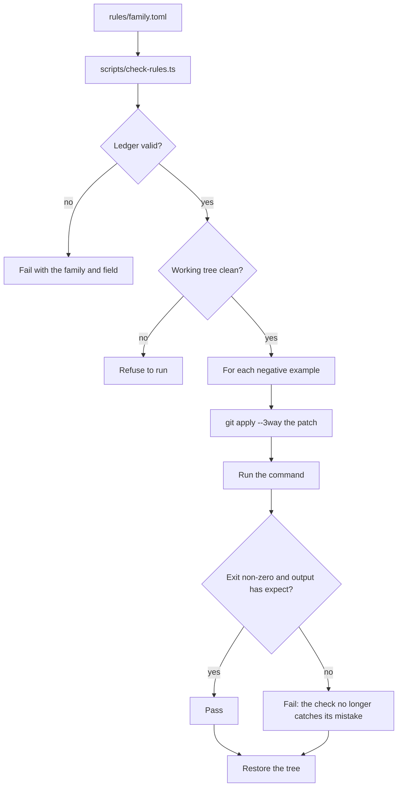

# Lessons become checks pilot - Plan

## Goal Capsule

- **Objective:** When an agent repeats a mistake that Longhand already has a lesson for, a check fails before the change merges, and each check proves that it still catches its mistake. After 4–6 weeks, a count of new mistakes shows whether this works better than prose.
- **Means:** A rule ledger in `rules/`, one check script that runs each rule's negative example, five low-cost mechanisms, and an instruction section that sends each correction to pstack's `/correct` (KTD1–KTD6).
- **Authority:** This plan, then `CLAUDE.md`. The audit in `docs/ideas/done/lessons-become-checks.md` gives the counts. A unit does not change app behaviour (KTD7).
- **Stop conditions:**
  - Stop and ask when a check finds a defect that the plan does not name (KTD7 lists the known ones).
  - Stop and ask when a negative example cannot make its check fail. Do not weaken the negative example.
  - Stop and ask when a change needs a new npm or crate dependency, or a Claude Code plugin source other than the one KTD9 names.
- **Execution profile:** `ce-work` in a worktree from `origin/main`. One commit per unit for U1–U8, one PR titled `chore: turn recorded lessons into checks` (no app release, KTD8). U9 is a review 4–6 weeks after the merge, done by hand.
- **Open blockers:** None.

---

## Product Contract

### Summary

The pilot adds the minimum system that makes lessons enforceable and testable: a ledger of mistake families, a script that proves each family's check still fails on its mistake, fourteen first families plus the agent-rule families on five mechanisms (source scans, a timing scan, clippy bans, existing tests, an agent hook), and an instruction that turns each new correction into a check. After 4–6 weeks, a count by hand shows if the method works.

### Problem Frame

An audit on 2026-11-19 read 115 lessons in `docs/solutions/` and 148 rules in `CLAUDE.md`, `docs/development-workflow.md` and agent memories. About half of the lessons have an enforcer, usually a regression test from the fix. The rest have a partial enforcer or none. Only 6 lessons need prose. The repo has no custom lint layer, and nothing proves that an enforcer still catches its mistake. Prose goes stale with no signal: the audit found old commands, deleted files, moved line numbers and memories that are no longer true.

Compound engineering (CE) records each lesson as prose. pstack's `/correct` turns a mistake into structure, a lint, a test or a gate. CE has no step after a lesson where an extension can attach, so an instruction alone is prose that nothing enforces. The pilot tests the claim that checks prevent repeated mistakes better than prose, in Longhand first, before anything is built for other projects.

### Requirements

**Ledger and check**

- R1. Each mistake family has one file in `rules/` with its rule, its state (`enforced` or `judgment`), the command that holds it, its negative examples and its lesson paths.
- R2. One check fails when a family file is not valid, when a lesson path does not exist, or when a negative example does not make its command fail with the expected output.
- R3. CI runs the check, with all negative examples, on each pull request and each push to `main`.

**First families**

- R4. A frontend source scan holds the IME guard (Enter and Escape) and the four single-owner rules (`markdown-it`, `onCloseRequested`, the clipboard API, `<NoteEditor` placement).
- R5. A timing scan fails on short real-time limits in tests: an `elapsed()` upper bound under 60 s, a `recv_timeout` under 60 s in test code outside a polling loop, a `waitFor` timeout under 60 s, a real `setTimeout` sleep in a test, and a `HANG_LIMIT` other than 60 s.
- R6. Clippy bans `Fs::rename_new` (use `rename_new_waiting`) and `ort::session::Session::builder` (use the `crates/onnx` helper), with messages that name the function to use.
- R7. Existing enforcers become families: the migration hash pin (extended to all migrations), the opener scope (extended to all capability files), the storage-folder byte test, the navigation-guard test and the dependency-age check.
- R8. A count of `map_err(|e| e.to_string())` in `src-tauri/src/commands/` cannot go above its current value (63).
- R9. A Claude Code hook blocks or questions agent commands that break shared repo rules, with a message that names the fix.

**Process**

- R10. The agent instruction file tells each agent to run `/correct` after a `ce-debug` fix, a `ce-compound` lesson, an accepted review finding or a user correction, and to add the family to `rules/`.
- R11. After 4–6 weeks, a review counts new mistakes and records whether their family had a check and whether the check caught them. It compares the pilot period with the 8 weeks before the merge, counted from the same sources in the same way and divided by the number of merged PRs, for covered and not covered families.

### Key Decisions

- **Build in Longhand first; make a standalone tool only after the pilot works.** (session-settled: user-directed — chosen over a separate plugin repository from the start: the method must be proven before it is packaged.) Governs R1–R11.
- **Minimum version, not the full design.** (session-settled: user-directed — chosen over draft 7 of the ce-plus-pstack design, with event log, amendments, signed approvals and loops: those answer problems the project does not have yet.) Governs R1–R3, R10, R11.
- **No newtypes at the boundaries in this pilot.** (session-settled: user-approved — chosen over including `NoteId` and `AudioName` newtypes: they change app code and make a release.) Governs R4–R9.

### Success Criteria

- Each `enforced` family has a negative example that fails its command in CI.
- The check has no false positives on `main` at merge.
- At the review (R11), the result is one of: fewer escaped repeats in covered families, no change, or too few new mistakes to tell. "Too few" extends the pilot and is not a pass.

### Scope Boundaries

- No plugin, set-up skill, event log, amendment files, loops, signed approvals or runtime harness. `hybrid/design-full.md` on the local `hybrid-method` branch keeps that design.
- No change to app behaviour in this PR (KTD7).
- Not built: `[workspace.lints]` and `clippy::significant_drop_in_scrutinee`. They need edits to 26 manifests. Reconsider when a lock-held-in-condition mistake repeats.
- Not built: bans for `reqwest` builders and `serde_json` writers. No shared helper exists for reqwest, and about 30 SQLite uses would trip a `serde_json` ban. The byte tests stay the enforcer.
- Not built: scans for grid `1fr`, widget `hover:` and switch sizes, and bare sleeps in Rust tests (38 sites). Each needs a baseline review first, or gives too many false positives.
- Not built: hook rows that call git or gh inside the hook (branch checks, push checks, `cargo fmt` before push). They are slower, and a failure inside them is harder to see. Reconsider after the pilot.

#### Deferred to Follow-Up Work

- A `fix` PR for the defects that the new checks find (KTD7): the four Escape handlers with no IME guard, the three raw `rename_new` calls in `crates/pipeline/src/type_move.rs`, the `< 1 s` assert in `src-tauri/src/managers/capture.rs`, and the dependency-age check that fails on npm `inBundle` entries and advises an exception (`docs/solutions/workflow-issues/npm-bundled-entries-fail-the-dependency-age-check.md`). Each needs its own idea file.
- `NoteId` and `AudioName` newtypes, as a separate `refactor` PR.
- A typed user error to replace `map_err(|e| e.to_string())`.

---

## Planning Contract

### Key Technical Decisions

- KTD1. **The ledger uses TOML.** `scripts/lib/toml.ts` already reads tables, arrays of tables and string arrays. `scripts/lib/frontmatter.ts` reads only flat keys, and a YAML package would add a dependency with licence and age rules. Each family is `rules/<family>.toml` with `family`, `rule`, `state`, `enforced_by`, `lessons`, `judgment`, and one `[[negative]]` table per known form of the mistake.
- KTD2. **A negative example has `apply`, `run` and `expect`.** `apply` is a patch file in `rules/negatives/`, applied with `git apply --3way`. `run` is the project command that holds the rule. `expect` is a pattern that the failing output must contain. A patch adds a new file where the rule allows it (a new component, command file or test file), and edits an existing file only when the rule is about that file, so that normal changes to busy files do not break it. A negative example that fails to apply is a check failure with its own message ("regenerate the negative example").
- KTD3. **Negative examples run in place, one at a time, and the script restores the tree after each one.** The script refuses to start when the working tree has uncommitted changes. After each run, also a failed run, it restores the changed files and removes the added files. In place keeps `target/` and `node_modules` warm and valid; a temporary worktree would rebuild each workspace crate and would have no `node_modules`. In CI the checkout is disposable, so a stopped job leaves nothing behind. All negative examples run on each pull request (R3); when the step time becomes a problem, add selection then.
- KTD4. **A scan holds its own exception list, and the list can only get shorter.** Each entry names a file, a count or line pattern, and a reason. A scan fails on a hit that has no entry, and on an entry that no longer matches. This is the ratchet. In Rust, an exception is `#[expect(clippy::disallowed_methods, reason = "...")]`, which fails when it is no longer needed.
- KTD5. **Clippy bans go in a root `clippy.toml` only.** `disallowed-methods` warns by default, and CI's `cargo clippy --workspace --all-targets -- -D warnings` (`.github/workflows/ci.yml`) makes the warning an error. Clippy needs the definition path, not a re-export (`session_save::rename::Fs::rename_new`). Whether a trait-method path matches a call on a concrete type is not verified; the negative example proves it before the family is `enforced`.
- KTD6. **The hook is one Node script with a rule table, for regex-only rules.** It runs on `PreToolUse` for Bash, Edit and Write. It returns deny or ask with a message that names the fix. Codex does not read Claude Code hooks, so those rules stay as text in `CLAUDE.md` for Codex.
- KTD7. **A defect that a new check finds stays as a listed exception with the reason "known defect", and a separate `fix` PR removes it.** This keeps the pilot PR free of app behaviour changes and releases. The known defects are listed under Deferred to Follow-Up Work.
- KTD8. **One PR, titled `chore: turn recorded lessons into checks`.** The units are commits on one branch. The PR changes scripts, tests, CI, `clippy.toml`, Rust lint attributes, docs and agent config. None of these change the shipped app, so the PR makes no release.
- KTD9. **The instruction section states the `/correct` order itself, and U8 enables pstack for Claude Code.** pstack is not enabled today. Its source is the `cursor/plugins` repository on GitHub, Claude Code harness `harness/pstack/claude-code` (MIT). U8 adds it to `extraKnownMarketplaces` and `enabledPlugins` in `.claude/settings.json`. Codex has no pstack, so the section gives the order in one sentence and names `/correct` as the tool where it exists.

### High-Level Technical Design

### Assumptions

- `#[expect(..., reason = ...)]` is stable on Rust 1.95 and clippy honours it for `disallowed_methods`.

---

## Implementation Units

### U1. Ledger format and check script

- **Goal:** `node scripts/check-rules.ts` validates `rules/*.toml` and runs every negative example.
- **Requirements:** R1, R2
- **Dependencies:** none
- **Files:**
  - `scripts/check-rules.ts` (new)
  - `scripts/check-rules.test.ts` (new)
  - `rules/README.md` (new: the fields and states, in STE)
- **Approach:**
  1. Read each `rules/*.toml` with `scripts/lib/toml.ts` (KTD1). Check that the family id equals the file name, that `state` is `enforced` or `judgment`, that `enforced` has `enforced_by` and at least one negative example, that `judgment` has `judgment` text, that each `lessons` path and each patch file exists.
  2. Modes: no argument runs validation and all negative examples; `--validate` runs only validation; `--family <id>` runs one family.
  3. Run each negative example as in KTD2 and KTD3. Print one line per family: pass, or fail with the reason.
  4. `rules/README.md` says that the check reads the committed tree, so run it after each commit.
  5. Header comment and usage lines as in `scripts/ideas.ts`.
- **Patterns to follow:** `scripts/ideas.ts` (validator shape, `required` list), `scripts/ideas.test.ts` (temp git repo, `spawnSync` of a copy), `scripts/lib/spawn.ts`.
- **Test scenarios:**
  - A valid `enforced` family whose patch makes its command fail with the expected text passes.
  - A family whose patch applies but whose command passes fails with "no longer catches its mistake" and the family id.
  - A family whose command fails without the expected text fails and prints both.
  - A patch that does not apply fails with "regenerate the negative example".
  - A missing field, an unknown state, a family id that differs from the file name, a missing lesson path and a missing patch file each fail with the file and the field.
  - A patch whose context moved by a few lines still applies.
  - With uncommitted changes in the tree, the script refuses to run and changes nothing.
  - After a run, also a failed run, `git status` shows a clean tree: edited files are restored and added files are removed.
- **Verification:** `node --test scripts/check-rules.test.ts` passes, and the script runs on an empty `rules/` folder with exit 0.

### U2. CI and local check list

- **Goal:** CI runs the check with all negative examples on each pull request and push.
- **Requirements:** R3
- **Dependencies:** U1
- **Files:**
  - `.github/workflows/ci.yml` (two steps in the macOS leg of `checks`)
  - `docs/development-workflow.md` (Checks and CI list)
- **Approach:**
  1. Add `node --test scripts/check-rules.test.ts` to the script-test steps, because CI names script tests one by one.
  2. Add a "Rule ledger" step that runs `node scripts/check-rules.ts` after the workspace Rust tests, so the cache is warm (KTD3).
  3. Add `node scripts/check-rules.ts` to the local check list, after the commit.
- **Patterns to follow:** the "Provenance" step in `ci.yml`; `docs/solutions/workflow-issues/actions-context-not-available-fails-before-jobs.md`.
- **Test expectation:** none -- CI configuration; the pull request's CI run is the proof.
- **Verification:** actionlint passes, and the PR's CI shows the "Rule ledger" step with its time.

### U3. Frontend source scans

- **Goal:** One scan test holds the IME guard and the four single-owner rules, with a ledger family and a negative example for each.
- **Requirements:** R4
- **Dependencies:** U1
- **Files:**
  - `src/lib/keyboard.test.ts` (extend to Escape)
  - `src/lib/owners.test.ts` (new: the single-owner rules)
  - `rules/ime-guard.toml`, `rules/markdown-parser-owner.toml`, `rules/close-listener-owner.toml`, `rules/clipboard-owner.toml`, `rules/note-editor-frame.toml` (new)
  - `rules/negatives/*.patch` (new)
- **Approach:**
  1. Extend the IME scan to Escape checks. The four Escape handlers without a guard (`src/home/ImportSheet.tsx`, `src/lib/ConfirmDialog.tsx`, `src/session/SessionMenu.tsx`, `src/settings/chord.ts`) go into the exception list as known defects (KTD4, KTD7).
  2. The owner scan forbids each pattern outside its owner files. The failure message names the shared function: `parseMarkdown`, `registerCloseSave`, the `src/lib/clipboard.ts` functions, or the allowed `<NoteEditor` files.
  3. Each family's negative example adds one forbidden use in a non-owner file.
- **Patterns to follow:** `src/lib/keyboard.test.ts`; lesson docs `docs/solutions/ui-bugs/webkit-ime-confirm-enter-has-iscomposing-false.md`, `summary-list-nesting-differs-from-commonmark.md`, `tauri-stale-close-listener-blocks-next-window.md`, `webkit-clipboard-html-kept-dark-mode-text-colour.md`, `note-editor-frame-needs-px-3-or-it-shows-a-horizontal-scroll-bar.md`.
- **Test scenarios:**
  - The scans pass on the current tree with the four listed Escape exceptions.
  - An Escape check without `isImeComposing(` in a new file fails, and the message names `file:line` and `isImeComposing`.
  - An `import` from `markdown-it` outside its two owners fails and names `parseMarkdown`.
  - An exception entry whose file no longer has the hit fails with "remove the exception".
- **Verification:** `npm test` passes, and `node scripts/check-rules.ts --family <id>` passes for each of the five families.

### U4. Timing scan

- **Goal:** A script finds short real-time limits in tests, with a ledger family.
- **Requirements:** R5
- **Dependencies:** U1
- **Files:**
  - `scripts/check-timing.ts` (new)
  - `scripts/check-timing.test.ts` (new)
  - `rules/test-timing-limits.toml`, `rules/negatives/test-timing-*.patch` (new)
  - `.github/workflows/ci.yml` (run the script and its test)
- **Approach:**
  1. Scan Rust test code (`crates/*/tests/**`, `src-tauri/tests/**`, and `#[cfg(test)]` modules) and `src/**/*.test.{ts,tsx}` for the five patterns in R5.
  2. A `recv_timeout` inside a loop that has an outer limit is allowed. There is no inline marker that allows a hit; each deliberate hit is an entry in the exception list (KTD4).
  3. Known hits go into the exception list: `src-tauri/src/managers/capture.rs` (`< 1 s`, known defect, KTD7), `crates/summarize/tests/models.rs` (`< 30 s`, documented), and the three frontend `setTimeout` lines with their reasons.
  4. The message cites the rule in `CLAUDE.md` and `docs/solutions/test-failures/tests-with-speed-limits-failed-on-a-loaded-runner.md`: wait for the event; a limit only stops a hang.
- **Patterns to follow:** `scripts/ideas.ts` for script shape; the lesson docs in `docs/solutions/test-failures/` named in the audit.
- **Test scenarios:**
  - `assert!(start.elapsed() < Duration::from_secs(2))` in a test file fails; `< Duration::from_secs(60)` passes.
  - A `recv_timeout(Duration::from_secs(1))` alone in a test fails; the same call inside a loop with a 120 s outer limit passes.
  - `waitFor(..., { timeout: 500 })` fails; no timeout passes.
  - A new `setTimeout` sleep in a test fails; a listed one passes, and a listed one that was removed fails with "remove the exception".
  - `const HANG_LIMIT: Duration = Duration::from_secs(10)` fails.
  - Production code (not test code) with a short `recv_timeout` is not reported.
- **Verification:** the script passes on `main` with its exceptions, and its negative examples fail it.

### U5. Clippy bans

- **Goal:** Clippy blocks the two calls that bypass their shared function.
- **Requirements:** R6
- **Dependencies:** U1
- **Files:**
  - `clippy.toml` (new)
  - `crates/session-save/src/rename.rs`, `crates/pipeline/src/move_notes.rs`, `crates/pipeline/src/type_move.rs`, `crates/onnx/src/lib.rs` (`#[expect]` attributes only)
  - test files in `crates/pipeline/tests/`, `crates/session-save/tests/save.rs` and `crates/session-save/tests/rename_home.rs` that call `rename_new` (file-level `#![expect]`)
  - `rules/rename-waits.toml`, `rules/ort-cpu-builder.toml`, `rules/negatives/*.patch` (new)
- **Approach:**
  1. Ban `session_save::rename::Fs::rename_new` with the reason "Use rename_new_waiting; decide a new name only with is_name_taken." Ban `ort::session::Session::builder` with the reason "Build every ONNX session through crates/onnx session_builder (CPU only)."
  2. Add `#[expect]` with a reason at the helper, at the deliberate cross-volume probe in `move_notes.rs`, at the three `type_move.rs` calls (known defect, KTD7), and at the ort helper.
  3. Prove the trait-method path first with the negative example (KTD5). When clippy does not match calls on `RealFs`, stop and ask.
- **Patterns to follow:** `docs/solutions/logic-errors/folder-in-use-taken-for-a-taken-name.md`, `docs/solutions/integration-issues/ort-adds-core-ml-to-every-session-by-default.md`.
- **Test scenarios:**
  - A new `RealFs.rename_new(..)` call in `crates/pipeline/src/` fails clippy with the reason text.
  - A new `Session::builder()` call in a crate other than `crates/onnx` fails clippy with the reason text.
  - `cargo clippy --workspace --all-targets -- -D warnings` and `scripts/check-windows.sh` pass on the tree.
- **Verification:** clippy passes, and both negative examples fail it with the expected text.

### U6. Existing enforcers and small gaps

- **Goal:** Existing tests become ledger families, two tests cover their full scope, and two known gaps get a check.
- **Requirements:** R7, R8
- **Dependencies:** U1
- **Files:**
  - `crates/session-core/tests/migrations.rs` (pin hashes of all migrations)
  - `src/lib/links.test.ts` (check every file in `src-tauri/capabilities/`)
  - `scripts/check-dependency-age.ts`, `scripts/check-dependency-age.test.ts` (a `--now <date>` option only)
  - `src/lib/command-errors.test.ts` or a Rust test (count ratchet for R8; implementer's choice)
  - `rules/migration-hashes.toml`, `rules/opener-scope.toml`, `rules/storage-folder-bytes.toml`, `rules/navigation-guard.toml`, `rules/dependency-age.toml`, `rules/command-error-text.toml`, `rules/negatives/*.patch` (new)
- **Approach:**
  1. Extend the pinned migration hashes from 1–21 to all migrations, and add a test that the pinned list is a prefix of the current list, so a new migration must be pinned when it is released.
  2. Loop the opener-scope test over all capability files.
  3. Add a `--now <date>` option to `check-dependency-age.ts` (default: the current time), so that its negative example does not expire after 7 days. Its `inBundle` defect stays for the `fix` PR (KTD7).
  4. The command-error count fails above 63 and asks to lower the number when the count goes down (KTD4).
  5. Write each family with a negative example: change an applied migration, add a capability file with a wide opener scope, reorder a writer's keys, remove a navigation guard, add a version that is one day old for a fixed `--now`, add a new command file with a 64th `map_err`.
- **Patterns to follow:** the enforcers listed in the learnings research: `crates/library/tests/test_storage_folder.rs`, `src-tauri/src/window.rs` navigation-guard test.
- **Test scenarios:**
  - Editing `0001_*.sql` fails the migration test with the migration number.
  - A capability file other than `default.json` with an `https://*.example.com/*` opener scope fails the opener test.
  - With `--now` set to two days after a version's publish date, the age check fails on that version; with `--now` set to ten days after, it passes.
  - A 64th `map_err(|e| e.to_string())` in `src-tauri/src/commands/` fails; 63 passes.
- **Verification:** the Rust tests, `npm test` and `node --test scripts/check-dependency-age.test.ts` pass, and all six families pass with `node scripts/check-rules.ts`.

### U7. Agent process hook

- **Goal:** A Claude Code hook stops agent commands that break shared repo rules, with ledger families.
- **Requirements:** R9
- **Dependencies:** U1
- **Files:**
  - `.claude/hooks/rules.mjs` (new)
  - `.claude/hooks/rules.test.mjs` (new)
  - `.claude/settings.json` (add the `PreToolUse` hook)
  - `.gitignore` (add `.claude/hooks/rules.log`)
  - `rules/agent-*.toml` (new, one family for each source rule)
  - `.github/workflows/ci.yml` (run the hook test)
- **Approach:**
  1. The rule table holds regex-only rows (KTD6): ask before `gh pr create|edit` with a `feat` title; deny `!` or `BREAKING CHANGE` in a PR title; deny Compound Engineering branding in a PR body; ask before `gh run rerun`; deny `git mv`/`mv` of `docs/ideas/` paths; deny writes under `reference-source/`; deny `git add -f` of the private paths; deny `pip`, `bun`, `yarn`, `pnpm` and bare `python`; deny `prettier`; deny copies into `/Applications`.
  2. Match tool bans only on the command word of each shell segment (split on `&&`, `||`, `;` and `|`), and match PR-title rules only on the value of `--title`, so that a commit message or PR body that names a tool is not blocked.
  3. Each message names the fix, from the rule's text in `CLAUDE.md` or `docs/development-workflow.md`.
  4. A hook error never blocks a command; it prints a warning.
  5. Each deny or ask appends one line (time, family, deny or ask) to a gitignored log, `.claude/hooks/rules.log`, for the pilot review (U9).
  6. The negative example for each family runs the hook script with a command string and expects the deny or ask output.
  7. The sandbox blocks agent writes to `.claude/settings.json` and `.claude/hooks/` in the main checkout. Write them in the worktree, with the user's approval when asked.
- **Patterns to follow:** user-global Node hook scripts (`"type": "command"`, `timeout`); `scripts/ideas.test.ts` for `node:test`.
- **Test scenarios:**
  - `gh pr create --title "feat: x"` returns ask with the "patch or minor?" message.
  - `gh pr create --title "fix!: x"` returns deny.
  - A `git mv` of an idea file from one status folder to another returns deny and names `node scripts/ideas.ts move`.
  - `uv run python x.py` is allowed; `python3 x.py` is denied.
  - An Edit to `reference-source/handy/README.md` is denied.
  - `git commit -m "no pip or prettier here"` is allowed, and `gh pr create --title "chore: x" --body "no BREAKING CHANGE"` is allowed.
  - A deny adds one line to the log; an allowed command adds none.
  - Malformed hook input prints a warning and allows the command.
- **Verification:** the hook test passes, and a session in the worktree shows the deny message for one sample command.

### U8. Instruction section, pstack and terms

- **Goal:** Each agent sends each correction to `/correct` and the ledger, and the new terms have definitions.
- **Requirements:** R10
- **Dependencies:** U1
- **Files:**
  - `CLAUDE.md` (new section; `AGENTS.md` is a symlink)
  - `.claude/settings.json` (enable pstack for Claude Code)
  - `CONCEPTS.md` (rule family, negative example, exception list)
- **Approach:**
  1. Add a "Lessons become checks" section to `CLAUDE.md`: after a `ce-debug` fix, a `ce-compound` lesson, an accepted review finding or a user correction, run `/correct` where it exists, put the rule at the highest level that works (structure or type, lint whose message names the fix, test, runtime check, gate), use prose only for a real judgment, and add or update the family in `rules/` with a negative example (KTD9). A mistake seen for the first time with no low-cost check needs only the lesson document.
  2. Enable pstack from the source in KTD9 in `.claude/settings.json`. Read the repository's marketplace manifest for the exact plugin id first; when there is no manifest for Claude Code, stop and ask.
  3. Add the terms to `CONCEPTS.md`.
- **Test expectation:** none -- instruction text and agent configuration. U9 measures the effect.
- **Verification:** a new Claude Code session in the worktree lists the pstack `/correct` command.

### U9. Pilot review

- **Goal:** A count by hand shows if the method reduced repeated mistakes.
- **Requirements:** R11
- **Dependencies:** U1–U8 merged, then 4–6 weeks
- **Files:** `docs/ideas/done/lessons-become-checks.md` (results section)
- **Approach:**
  1. At the merge, count the baseline: the new lessons in `docs/solutions/`, the accepted review findings in merged PRs and the user corrections recorded in memories in the 8 weeks before the merge. Give each a family, mark it covered or not covered by the pilot, and record the number of merged PRs. Write it in the idea file.
  2. After 4–6 weeks, count the same sources since the merge, plus two sources that show caught mistakes: PR CI runs in which a family's command failed with its expected text, and the hook log (U7).
  3. For each mistake, record its family, whether the family had a check, and whether the check caught the mistake before merge.
  4. Compare the two periods per merged PR, for covered and not covered families (R11). When there are fewer than 10 new mistakes, extend the pilot by 4 weeks.
  5. Record the result and the next decision: package the method for a second project, change it, or stop.
- **Test expectation:** none -- a review, not code.
- **Verification:** the idea file has the counts and the decision.

---

## Verification Contract

| Gate | Command | When |
|---|---|---|
| Script tests | `node --test scripts/check-rules.test.ts scripts/check-timing.test.ts scripts/check-dependency-age.test.ts` | U1, U4, U6 |
| Hook test | `node --test .claude/hooks/rules.test.mjs` | U7 |
| Frontend tests | `npm test` | U3, U6 |
| Types | `npm run typecheck` | each unit with TypeScript |
| Rust format and lint | `cargo fmt --all --check`, `cargo clippy --workspace --all-targets -- -D warnings`, `scripts/check-windows.sh` | U5, U6 |
| Rust tests | `cargo test -p session-core --test migrations`, then one full workspace run at the end | U6, end |
| Ledger | `node scripts/check-rules.ts` | after the commit of each unit that adds a family, and at the end |
| Workflows | actionlint on `ci.yml` | U2, U4, U7 |

---

## Definition of Done

- All gates in the Verification Contract pass locally and in the PR's CI.
- Each `enforced` family has at least one negative example that fails its command.
- Each exception has a reason, and each known defect is listed in a new idea file for the `fix` PR.
- After `node scripts/check-rules.ts`, `git status` shows a clean tree.
- No abandoned code from approaches that did not work is left in the diff.
- The PR title is `chore: turn recorded lessons into checks`, and the PR is babysat to ready.
- U9 runs 4–6 weeks after the merge.
