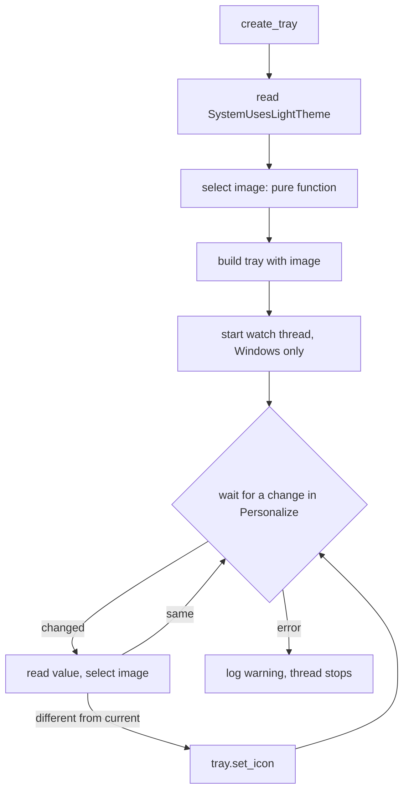

# Windows Tray Icon on a Dark Taskbar - Plan

## Goal Capsule

- **Objective:** On Windows, a user can see the Longhand icon in the notification area on a dark taskbar and on a light taskbar. The icon follows a change of the taskbar colour while the app runs.
- **Means:** select between a black and a white tray image from the Windows taskbar theme, and watch the registry key for changes (KTD1, KTD2).
- **Authority:** the requirements in the Product Contract govern behaviour. The KTDs govern the mechanism. A unit overrides neither.
- **Execution profile:** one `fix` PR. The work is in a worktree from `origin/main`.
- **Stop conditions:** stop and ask when the registry watch cannot work without a window or a new dependency outside the `windows` crate, or when macOS behaviour must change.
- **Finish:** the implementer gives a signed Windows build for a manual test on nebula before the push (`docs/development-workflow.md#manual-tests`), then opens the PR and runs `ce-babysit-pr` on it.

## Product Contract

### Summary

On Windows, the tray icon shows a white glyph when the taskbar is dark and the current black glyph when the taskbar is light. When the user changes the taskbar colour, the icon changes without a restart. macOS keeps its template icon.

### Problem Frame

A user reported that the Longhand tray icon is almost invisible on Windows in dark mode. The tray uses one black image with `icon_as_template(true)`. macOS recolours template images for the menu bar, but Windows has no template images. Thus Windows shows the black glyph on a dark taskbar.

### Requirements

**Icon choice**

- R1. On Windows, the tray icon is the white glyph when the taskbar is dark, and the black glyph when the taskbar is light.
- R2. The taskbar colour comes from the Windows "system" colour mode (the taskbar and Start), not from the app colour mode. Windows lets the two be different.
- R3. When Windows does not give the taskbar colour, the icon is the white glyph.

**Change while running**

- R4. When the user changes the taskbar colour, the icon changes within a few seconds, also when no Longhand window is open.
- R5. When the app cannot watch for changes, the icon from launch stays, the app writes a warning to the log, and it shows no message to the user.

**Other platforms**

- R6. macOS behaviour does not change: the tray keeps the black template image.

### Key Decisions

- **Read the taskbar theme, not the app theme.** Windows can show a dark taskbar with light apps, which is the default of Windows 10. Governs R2. (session-settled: user-approved — chosen over the window theme that Tauri reports: that follows the app colour mode, not the taskbar.)
- **The icon follows a change while the app runs.** The tray app runs for days, and a restart is not an expected step. Governs R4.

### Scope Boundaries

- The icon does not show the recording state or the alert state. The tray tooltip and menu already show the alert.
- High contrast themes are not handled. Windows draws high contrast taskbars in black or white, and both images keep their shape. Revisit when a user reports a problem.
- The image size stays at 44x44. Windows scales it to the tray size.

### Sources

- Handy reads `SystemUsesLightTheme` for its tray: `reference-source/Handy/src-tauri/src/tray.rs` (`windows_taskbar_theme`, `get_icon_path`).
- Longhand reads the registry with `winreg` in `src-tauri/src/widget.rs` (`windows_text_scale_factor`).

---

## Planning Contract

### Key Technical Decisions

- KTD1. **Read `HKCU\Software\Microsoft\Windows\CurrentVersion\Themes\Personalize`, value `SystemUsesLightTheme`, with `winreg`.** `1` means a light taskbar. `0`, a missing value or a missing key means a dark taskbar (R3), because a missing value is the Windows 10 default, which has a dark taskbar. This follows Handy's `windows_taskbar_theme`, without its fallback to the window theme. Governs R1, R2, R3.
- KTD2. **Watch the key with `RegNotifyChangeKeyValue` on a background thread.** The thread opens the key, then waits in a loop for a value change (`REG_NOTIFY_CHANGE_LAST_SET`, synchronous wait, subtree not included). After each change it reads the value again and changes the icon only when the result is different. It needs no window, so it works when the main window is closed (R4). It needs the `Win32_System_Registry` feature on the existing `windows` 0.62 dependency, which adds no crate. Rejected alternatives:
  - The `WindowEvent::ThemeChanged` event (Handy). tao sends it only when the app colour mode changes, and only to an open window.
  - A poll of the value on a timer. It does work while nothing changes, and it adds a delay.
  - A message-only window for `WM_SETTINGCHANGE`. It needs its own message loop, which is more code for the same result.
- KTD3. **`TrayIcon::set_icon` from the watch thread.** Tauri 2.12 sends `set_icon` to the main thread itself (`run_item_main_thread!`), so the thread does not use `run_on_main_thread`.
- KTD4. **The white image is a recoloured copy of `src-tauri/icons/tray.png`.** It keeps the alpha channel and sets every pixel colour to white, so the two images have the same shape. Commit the image as a file; do not recolour at run time.
- KTD5. **One pure function selects the image.** Its input is the registry value, which can be missing, and its result is one of the two images. The launch and the watch thread call it, and unit tests cover it on every platform.
- KTD6. **The watch thread stops on an error.** When the key does not open or the wait fails, the thread writes one `log::warn!` and stops (R5). It does not try again, because the same call fails again. This follows the CLAUDE.md rule against messages for problems that do not need the user.

### High-Level Technical Design

---

## Implementation Units

### U1. White tray image

- **Goal:** add the white glyph for a dark taskbar.
- **Requirements:** R1.
- **Dependencies:** none.
- **Files:** `src-tauri/icons/tray-white.png` (new).
- **Approach:** make the image from `src-tauri/icons/tray.png` per KTD4, for example with a short `uv run` script that uses Pillow and that is not committed. Check that the size is 44x44 and that the alpha channel is the same as the source.
- **Test expectation:** none -- an image asset. U2's tests load it.
- **Verification:** the image shows a white "L." on a transparent background.

### U2. Select the image from the taskbar theme at launch

- **Goal:** on Windows, the tray starts with the image that agrees with the taskbar colour.
- **Requirements:** R1, R2, R3, R6.
- **Dependencies:** U1.
- **Files:** `src-tauri/src/tray.rs`, `src-tauri/PROVENANCE.md`.
- **Approach:**
  1. Add the pure function from KTD5, which maps the registry value to the image bytes: `Some(1)` gives the black image, and every other result gives the white image.
  2. Add a Windows-only read of the value per KTD1, in the shape of `windows_text_scale_factor` in `src-tauri/src/widget.rs`.
  3. In `create_tray`, on Windows, build the tray with the selected image. On other platforms, keep `TRAY_ICON` and `icon_as_template(true)` as they are.
  4. In `src-tauri/PROVENANCE.md`, add the taskbar theme read to the `src/tray.rs` entry, with Handy's `src-tauri/src/tray.rs` (`windows_taskbar_theme`) as the source path, at the revision of `reference-source/Handy`.
- **Patterns to follow:** `windows_text_scale_factor` and `text_scale_of` in `src-tauri/src/widget.rs` (a pure function that tests cover, and a `#[cfg(windows)]` registry read).
- **Test scenarios** (unit tests in `src-tauri/src/tray.rs`, on every platform; they catch a wrong mapping, not a wrong registry path):
  - The value `Some(1)` selects the black image.
  - The value `Some(0)` selects the white image.
  - A missing value (`None`) selects the white image.
  - An unexpected value, for example `Some(2)`, selects the white image.
  - Both images decode as 44x44 RGBA images.
- **Verification:** the tests pass. `scripts/check-windows.sh` passes. `scripts/check-provenance.sh` passes.

### U3. Change the icon when the taskbar colour changes

- **Goal:** the tray icon follows a change of the taskbar colour while the app runs.
- **Requirements:** R4, R5.
- **Dependencies:** U2.
- **Files:** `src-tauri/src/tray.rs`, `src-tauri/Cargo.toml`.
- **Approach:**
  1. Add `Win32_System_Registry` to the features of the Windows `windows` dependency in `src-tauri/Cargo.toml`, with a short comment in the style of the existing comments.
  2. At the end of `create_tray`, on Windows, start a named thread that runs the watch loop per KTD2, KTD3 and KTD6. It keeps the last image that it set, so it changes the icon only when the image changes.
  3. The loop finds the tray with `app.tray_by_id("main")`. When no tray exists, it does nothing for that change.
- **Execution note:** the registry wait can only run on Windows. Keep the logic that decides whether to change the icon in pure code that the U2 tests cover. Prove the loop with the manual test.
- **Test scenarios:**
  - Unit test (every platform): a change from the black image to the white image calls for a new icon, and a change to the same image does not.
  - Manual test on nebula (Windows 11): launch with a dark taskbar, then the white icon shows. Set "Choose your mode" to Custom with a light Windows mode, then the black icon shows within a few seconds.
  - Manual test: close the main window, then change the taskbar mode again. The icon changes.
  - Manual test: set a light taskbar with dark apps (Custom mode). The icon is black.
- **Verification:** the manual tests pass on a signed Windows build. The log has no tray theme warning during normal use.

---

## Verification Contract

| Check | When |
|---|---|
| New unit tests in `src-tauri/src/tray.rs` with `cargo test -p longhand` (scoped to the tray tests) | U2, U3 |
| `scripts/check-windows.sh` (Windows lint from macOS) | U2, U3 |
| `cargo fmt --all --check` and `cargo clippy` for the workspace | before the push |
| `scripts/check-provenance.sh` | U2 |
| `scripts/check-licences.sh` | not needed: no crate is added or removed |
| Manual test on nebula with a release build (`docs/development-workflow.md#manual-tests`, nebula build steps) | after U3, before the push |
| macOS signed build: the menu-bar icon is unchanged in light and dark mode | after U3 |

## Definition of Done

- R1 to R6 are true on a signed Windows build and a signed macOS build.
- The U2 and U3 unit tests pass, and the local checks above pass.
- `src-tauri/PROVENANCE.md` names the code that came from Handy.
- The diff has no unused code, no temporary recolour script, and no change to macOS behaviour.
- One PR with a `fix:` title is open, and `ce-babysit-pr` ran until it is ready to merge.
