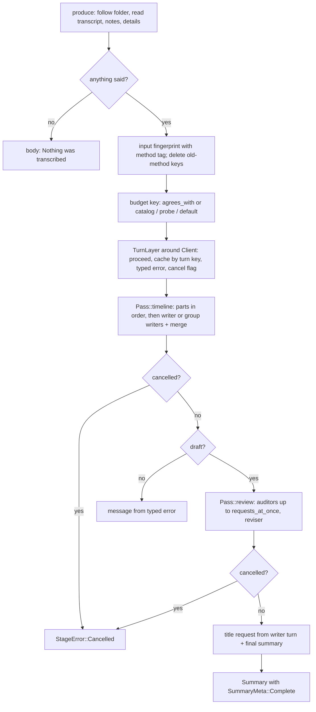

# Summary Pipeline in the App - Plan

## Goal Capsule

- **Objective:** Each summary that the app writes or writes again is more accurate on large models and completes on long notes with small models, and it is as dependable as today: a stopped run continues, the user sees progress, and older builds on the same computer keep working.
- **Means:** The summary step runs the timeline pipeline from `crates/summary-agent` (timeline parts, writer, review) in place of the part, merge and final method (KTD1), with a caching and control layer around each model turn (KTD3, KTD4).
- **Authority:** The Product Contract wins on behaviour. The KTDs win on mechanism within their cited R-IDs. A unit overrides neither.
- **Stop conditions:** Stop and ask the user when the in-memory transcript source cannot give the same line numbers that the lab measured, when the cached turn key cannot be made stable across builds, when a change needs a database migration, or when the parity run (Verification Contract) scores the app's pipeline more than 0.3 below the lab's pipeline on the same notes.
- **Execution profile:** One `feat` PR from a worktree created from `origin/main`. Units are commits in order. Ask the user "patch or minor?" before the PR opens.
- **Who finishes:** `ce-work` implements and checks locally. The user runs the manual test on a signed build. Then `ce-babysit-pr` runs until the PR is ready to merge.

---

## Product Contract

### Summary

The app writes every summary with the timeline pipeline that PR #113 added and the summary lab measured. The pipeline replaces today's method for all models and context sizes, with no setting. Resume, cancel, pause, progress, the failure messages and the title request keep working. Older builds on the same computer read the new stored data without failure.

### Problem Frame

Today the app summarizes a long transcript in parts, merges the part summaries in layers, and writes the summary in a final call. In the lab (`docs/ideas/next/agentic-summary.md`), the timeline pipeline scored higher on 12 held-out notes with two large-context models. At a 32k context it wrote a summary for every note, where today's method failed on the two longest notes with "the reply did not fit in its context". Users get none of this until the app uses the pipeline.

The pipeline was built for the lab. It reads notes from a saved storage folder, saves nothing between model turns, knows nothing of the app's cancel, pause and progress, and maps no failure to a message. The app's summary step has these protections today, and real users depend on them.

### Key Decisions

- **No setting to choose the method.** (session-settled: user-directed — chosen over a setting that offers both methods: Git keeps the old method if it must come back.) Governs R1, R2.
- **Prompt wording does not change.** (session-settled: user-directed — chosen over adding rules such as an attendee section in this work: users already change their prompts.) Governs R16.
- **A speaker label is a weak hint.** (session-settled: user-directed — chosen over trusting the labels: the diarization is reliable only at speaker changes.) The pipeline prompts already carry this rule (`TURN_RULE`). Governs R16.
- **The review pass always runs.** (session-settled: user-approved — proposed with its cost in calls and time: the measured gain includes it.) Governs R3.
- **The writer keeps its read tool, and falls back to no tools.** (session-settled: user-approved — proposed with the no-tools fallback: it is where context tools join later.) Governs R4.
- **A slower summary is acceptable.** (session-settled: user-approved — proposed as 4–10 calls in place of 1–3: accuracy wins over time.) Governs R19.

### Requirements

**Method**

- R1. Every summary that the app writes uses the timeline pipeline: the first summary after a recording, Regenerate Summary, and Retry.
- R2. Today's part, merge and final method is removed from the app.
- R3. The review pass runs after every draft. When the review fails, the app keeps the draft and shows no message.
- R4. The writer can read lines of this note's transcript. When the model or server refuses tools, the writer runs again with no tools and the app shows no message.
- R5. The pipeline sends only this note's transcript, notes and details to the provider. No other note reaches the provider.

**Dependability**

- R6. A run that fails, is cancelled, or stops when the app quits continues from the last completed model turn when it runs again with the same inputs and endpoint.
- R7. Cancel stops the run at once and is never shown as a failure. A cancelled run never publishes a draft.
- R8. Pause (inference suspended) holds the run before its next model turn.
- R9. The processing page shows each step of the pipeline with its count: timeline parts, sections, the summary, and the review.
- R10. Each failure that the user can act on gives today's message: the context limit, a reply that does not fit, no reply in time, and an endpoint that cannot be reached. A failure with no user action gives one plain message, and the log holds the cause.
- R11. The title request after a summary works as today.
- R12. "Requests at the same time" still has an effect, and its Settings text describes what it does now.

**Stored data and older builds**

- R13. The change adds no database migration.
- R14. An older build that reads a note's summary data after this build wrote it does not fail, and does not mix the two methods' saved results.
- R15. A run that an older build started continues in this build with no failure. It starts the summary again.

**Unchanged behaviour**

- R16. The prompts, the Background, the note details and the user's summary prompt reach the model as the lab measured. The user's prompt text goes to the writer and the merge step only.
- R17. A note with nothing transcribed gets today's text and sends no request.
- R18. The store holds no note text after the save and the title, as today.
- R19. No time limit stops a run beyond today's request deadlines.

### Success Criteria

- On the lab's development notes, the app's pipeline scores within 0.3 of the lab's run-25 pipeline with the same models (the noise between two runs of one method was about 0.1–0.3).
- A manual test on a signed build makes a first summary, a regeneration, a cancel and resume, and a run on a local model, and records the time of each.

### Scope Boundaries

- Prompt wording, including an attendee section and the pause rule in timeline parts, stays as it is.
- No new agent tools: earlier notes, library search and calendar stay in their own ideas.
- No setting to choose the method.
- Existing summaries are not written again. Only new runs use the pipeline.
- The summary lab stays a dev tool; it only follows the changed `produce` (U7).

#### Considered and not built

- **OpenRouter `require_parameters`.** The lab required hosts that accept tools. Without it, OpenRouter can route to a host that drops the tools, and the writer works from the timeline alone. The timeline holds the content, so the loss is small; setting it would make a model with no tool host fail. Change this if a real run shows writer quality drops on OpenRouter.
- **A time limit per run.** Today has none beyond the request deadlines; the user chose accuracy over time.

#### Deferred to Follow-Up Work

- The idea `summary-context-document` (a context document across notes).
- A UI note on the processing page when the writer read lines of the transcript.

### Outstanding Questions

None block implementation.

### Sources / Research

- `docs/ideas/next/agentic-summary.md`: lab results.
- `docs/plans/2026-11-20-1211-chore-summary-agent-foundation-plan.md`: KTD7 (blocking runtime), KTD10 (no forced tool choice), KTD14 (catalog limit for agent runs).
- `docs/solutions/logic-errors/summary-in-a-wake-with-no-network-kept-the-default-budget.md`: probe and retry rules that the new budget keeps.
- `docs/solutions/runtime-errors/older-build-panicked-on-newer-database-at-launch.md`: why no migration.
- `docs/solutions/logic-errors/resume-during-processing-deleted-live-text-proofs.md`: name kept and dropped checkpoint keys.
- `docs/solutions/integration-issues/dependency-feature-changed-json-key-order.md`, `docs/solutions/integration-issues/reqwest-tls-backend-with-unified-features.md`: feature checks when `summary-agent` enters the app build.
- `docs/solutions/runtime-errors/lock-in-an-if-let-condition-stays-held-in-its-block.md`: store locks in new checkpoint code.

---

## Planning Contract

### Key Technical Decisions

- KTD1. **`produce` keeps its contract and runs the pipeline inside it.** `crates/pipeline/src/summarize.rs` `produce` keeps its signature, its callers (`run`, `save::summarize_again`) and its result (`Summary` with `SummaryMeta::Complete`). It runs `Pass::timeline` and `Pass::review` inside the one `Runtime::block_on` with the cancel poll, on the blocking pool, in one summary-queue turn. Reason: the runner, Save, Regenerate, the title job and the lab depend on this contract (foundation KTD7). Governs R1, R7.
- KTD2. **The pipeline reads the transcript from the stage, not from the storage folder.** `Pass` takes the transcript text that `produce` already reads (`read_transcript`) and serves line ranges from it, numbered as `shapes::transcript_lines` numbers them (1-based over the raw file lines). The writer's read tool is a tool source for this note only, built from that text, the notes and the details. It never serves the previous summary or another note. Reason: a first summary runs in the working folder before Save, where the storage folder has no transcript (`crates/pipeline/src/early_home.rs`); it also keeps other notes from the provider. Governs R1, R4, R5.
- KTD3. **One layer around each model turn gives cache, control and typed errors.** A type in `crates/pipeline` that implements `summary_agent::Model` wraps the `summarize::Client`. Before each turn it calls `control.proceed()`. It returns a saved reply when the turn key has one, else it sends the turn and saves the reply. A saved reply that does not decode is a cache miss: the layer deletes the row, logs the cause and sends the turn again. It keeps the typed `SummarizeError` of a failed turn, and it records a cancel in a flag that `produce` reads. Progress is not in this layer: `Model` must be `Send + Sync` and cannot know the step counts, so `Pass` reports progress (U2). `produce` checks the flag and `control.is_cancelled()` after each pass and before it uses any outcome, and returns `StageError::Cancelled`. Reason: `Model` is the only call point of the agent (`summary-agent/src/lib.rs`), so `Pass` needs few changes; and a cancel passed to the agent as an ordinary error turns into a failure or a kept draft (`passes.rs` `kept`). Governs R6, R7, R8, R10.
- KTD4. **The turn key hashes a canonical form, not Rig's serde output.** The key is `turn-` plus a hash of: role and text of each message, tool names and arguments, tool results, the preamble, the tool definitions, the reply cap, `num_ctx`, the Thinking level and the `Source` (provider, address, model). Reason: Rig's JSON bytes can change with a joined `serde_json` feature or a Rig upgrade, which would rerun every turn after an update. The prefix `turn-` never matches an older build's layer-key rule (`l` and two digits). Governs R6, R14.
- KTD5. **A new budget key replaces `plan`.** The key `budget` holds the budget, its source, the `Source`, `num_ctx` and the output maximum. It is checked with today's `Plan::agrees_with` rule (context limit setting and `Source`). The probe rules stay: a first probe that cannot connect or gets a server error fails the stage before the key is saved. Reason: resume needs the same part sizes, and the first-probe rule needs to know whether a budget was saved. Governs R6, R15.
- KTD6. **The automatic budget uses Rig's catalog input limit for OpenAI and Anthropic, as the lab measured.** Order: the user's context limit, then `context::catalog_input_limit` for OpenAI and Anthropic, then the probe, then the 128,000 default. OpenRouter, Gemini and local providers keep the probe. Reason: the lab measured the pipeline with this rule (foundation KTD14); without it these models get 128,000. This also does the idea `catalog-context-limit`. Governs R16.
- KTD7. **A method tag joins the input fingerprint, and the new build deletes old-method keys.** The value under `input` adds a method tag, so an older build sees a changed input and forgets its calls. When this build finds `plan`, `whole` or `l##-` keys, it deletes them before the run. The `input` payload stays a fingerprint string; only its value changes. The keys `prompt`, `source-notes`, `title`, `title_request`, `meta`, `done` and the failure record keep their payload shapes. No migration. Reason: an older build reads the same `checkpoints` rows; a new shape under an old key fails its stage. Governs R13, R14, R15.
- KTD8. **Notes are cut and sized as today before the pipeline.** `produce` sends `session_notes` (store notes with the recognition prefix) cut by `prompts::fit_notes` to a share of the budget. `Pass::part_lines` gets a floor so that a part holds a useful number of lines. Reason: notes near the budget would make one request per transcript line. Governs R16.
- KTD9. **Limits come from the app's rules.** `summary_agent::Limits` gets `num_ctx` from the budget (Ollama, one value per run) and the reply kind from `ReplyKind::of(provider, budget.source)`, not the hosted rule. Cut-off halving of a timeline part stops after `MAX_SHRINKS`; with a local reply kind at its ceiling, a cut-off fails at once with `reply_does_not_fit()`. Reason: today's tested rules (`an_lm_studio_note_cut_off_at_its_ceiling_fails_after_one_request`). Governs R10.
- KTD10. **Failure messages come from the typed error of the failed turn.** A provider that rejects a request as too long, and the agent's own check that the next request does not fit, give the Context limit message. The prompt text and Background that do not fit alone give `PROMPT_TOO_LONG`, as today's pre-send check does. A cut-off at the ceiling gives `reply_does_not_fit()`, a deadline gives `no_reply_in_time()`, and an endpoint that cannot be reached gives today's text. `ToolCallLimit`, `MalformedCalls` after the fallback and `NoSummary` give one message: "the model did not write a summary", with the cause in the log. The kept typed error is cleared at the start of each agent run and is used only when it came from the failing step's last turn. `ToolCallLimit` joins the writer's no-tools fallback list. Governs R10.
- KTD11. **Auditors run up to "Requests at the same time".** Timeline parts stay in order, because each part takes the people list of the part before. The auditors are independent, so `Pass::review` runs them with the `requests_at_once` limit. The Settings detail text becomes: "The check of a summary sends its parts to the model at the same time, up to this number. The server must be able to run this many requests at once." Governs R12.
- KTD12. **The title request is built from the writer's prompt and the final summary.** `title_turn` gets the messages of the last writing turn (single writer or merge) and the reviewed summary as the reply, with the run's budget and `num_ctx`. When it does not fit, no title request is saved, as today with `title_reserve`. Governs R11.
- KTD13. **Progress uses four steps.** `SummaryStep` keeps `Parts`, `Groups` and `Final` and adds `Review`. Parts reports the current total, which grows when a part is halved. The labels become "Writing the timeline, part N of M", "Writing section N of M", "Writing the summary" and "Checking the summary, N of M done". The review count is the audit parts completed, because auditors run at the same time; the reviser turn keeps the Review label with no count. A step with one request shows no bar, as today. Governs R9.
- KTD14. **New request kinds in the log.** `RequestKind` gets `Timeline`, `Writer`, `Audit` and `Revise` for the label of each turn, with `queued`. The kinds `Chunk`, `Merge` and `Single` go with the old method. Governs R2.

### High-Level Technical Design

### Assumptions

- The lab's raw-line numbering and transcript text are what the pipeline must keep, because that is what was measured; the old path's pause rule is not added (R16).
- The review runs also for a note that fits one timeline part.

### Sequencing

U1 and U2 change `crates/summary-agent` and can go first. U3 builds the turn layer on them. U4 rewrites `produce`. U5 follows U4 for progress and UI text. U6 removes the old method after U4 passes. U7 and U8 come last.

---

## Implementation Units

### U1. Transcript and note source in memory

**Goal:** `Pass` reads line ranges and the writer's read tool from text that the caller gives, not from the storage folder.

**Requirements:** R1, R4, R5. KTD2.

**Dependencies:** none.

**Files:**
- `crates/summary-agent/src/passes.rs`
- `crates/summary-agent/src/shapes.rs`
- `crates/summary-agent/src/sources.rs`
- `crates/summary-agent/tests/passes.rs`
- `crates/summary-agent/tests/sources.rs` (new)

**Approach:**
1. Add a note source that holds this note's transcript text, notes and details, and answers `get_note` for this note only, with the schema and line numbering of `note-tools` `get_note`.
2. `Pass` takes that source in place of `root`; `transcript_lines` reads from it.
3. Keep the storage-folder source for the lab's other shapes.

**Patterns to follow:** `crates/note-tools/src/get_note.rs` line numbering and budget; `crates/summary-agent/src/sources.rs` `NoteSource`.

**Test scenarios:**
- The in-memory source gives the same lines and numbers as `get_note` on the fixture storage folder for the same transcript.
- A `get_note` call for another note id returns "not found", and `list_notes` is not offered.
- The source never returns a summary, also when the caller has one.
- A timeline run on a source whose note is not in any storage folder writes a draft.

**Verification:** `Pass` runs with no storage folder, and the lab's results for a saved note do not change.

### U2. Pass limits, halving bound, concurrent auditors and progress

**Goal:** `Pass` follows the app's limits and reports progress.

**Requirements:** R9, R10, R12. KTD8, KTD9, KTD11, KTD13.

**Dependencies:** U1.

**Files:**
- `crates/summary-agent/src/lib.rs`
- `crates/summary-agent/src/passes.rs`
- `crates/summary-agent/tests/passes.rs`

**Approach:**
1. `Limits` takes `num_ctx` and a reply kind from the caller.
2. `part_lines` gets a floor; halving stops after the shrink limit, and a cut-off at the ceiling with a local reply kind fails at once.
3. `review` runs auditors up to an `at_once` count and keeps their findings in part order.
4. `Pass` calls a progress hook for each part (with the current total), group writer, writer and auditor.
5. `Pass` sets the label's request kind for each step (timeline part, writer or merge, auditor, reviser) (KTD14).
6. `Pass::timeline` returns the messages of its last writing step for the title request (KTD12).
7. `ToolCallLimit` joins the writer's no-tools fallback list.

**Patterns to follow:** `crates/pipeline/src/summarize.rs` `call_many` (`FuturesUnordered` up to `at_once`).

**Test scenarios:**
- A part cut off seven times fails after the shrink limit, not at one line.
- A local reply kind cut off at its ceiling fails after one request.
- With `at_once` 2 and four audit parts, no more than two auditor requests are open, and findings join in part order.
- Progress reports part 1 of 3, then part 2 of 4 after a halving.
- A writer that reaches the tool-call limit runs again with no tools.
- A notes document near the budget still gives parts of at least the floor.
- Each step's turns carry its own request kind in the label.
- A timeline run returns the writer's messages; with groups, the merge step's messages.

**Verification:** the summary-agent tests pass, and the lab builds.

### U3. Turn layer: cache, control, cancel and typed errors

**Goal:** a `Model` around the app's `Client` that makes each turn resumable, stoppable and mapped to a message.

**Requirements:** R6, R7, R8, R10, R14. KTD3, KTD4, KTD14.

**Dependencies:** U1, U2.

**Files:**
- `crates/pipeline/src/summarize/turns.rs` (new; `summarize.rs` becomes a module folder if needed)
- `crates/summarize/src/client.rs` (`RequestKind`)
- `crates/pipeline/Cargo.toml` (`summary-agent`)
- `crates/summary-agent/Cargo.toml` (comment)
- `crates/pipeline/tests/summary_turns.rs` (new)

**Approach:**
1. Build the canonical form of a turn and its hash (KTD4).
2. Before a turn: `control.proceed()`; on `Cancelled`, set the flag and return an error that ends the agent.
3. Return a saved reply for the key, or send the turn with the label kind and `queued`, then save the reply. A saved reply that does not decode is deleted and the turn is sent again (KTD3).
4. Keep the typed `SummarizeError` of the last failed turn, cleared at the start of each agent run (KTD10).
5. Bind each store-lock guard to a variable before an `if let` or `match` that locks again.

**Patterns to follow:** `call_many` reuse of saved results; `checkpoint::get` and `put`; the lock lesson.

**Test scenarios:**
- A second run with the same inputs sends no request for turns that the first run completed.
- A changed Thinking level, model or `num_ctx` misses every saved turn.
- The key of a turn is the same before and after a change of JSON key order in Rig's message.
- A cancel during `proceed` sets the flag and the agent ends with no request.
- A suspended `proceed` holds the turn until it is resumed.
- A deadline error is kept as typed `SummarizeError`.
- A `turn-` row whose payload does not decode causes one new request and no stage failure.
- No saved key starts with `l` and two digits.

**Verification:** the new tests pass with mock HTTP from `crates/summarize/tests/common/mod.rs`.

### U4. `produce` runs the pipeline

**Goal:** the summary step uses the pipeline with today's input, budget, failure and title rules.

**Requirements:** R1, R3, R5, R6, R7, R10, R11, R13, R14, R15, R16, R17, R18. KTD1, KTD5, KTD6, KTD7, KTD8, KTD10, KTD12.

**Dependencies:** U3.

**Files:**
- `crates/pipeline/src/summarize.rs`
- `crates/summarize/src/context.rs` (catalog budget source)
- `crates/pipeline/tests/runner.rs`
- `crates/pipeline/tests/summary_upgrade.rs` (new)

**Approach:**
1. Keep the start of `produce`: follow folder, transcript, `said`, `source-notes`, details, prompt snapshot, client with retry waits, Thinking and routing, plain-HTTP warning.
2. Add the method tag to the input fingerprint and delete old-method keys.
3. Load or make the `budget` key (KTD5, KTD6).
4. Cut the notes (KTD8), build the note source (U1), the turn layer (U3) and `Pass`.
5. Run timeline and review inside `Runtime::block_on`; check the cancel flag after each.
6. Map the outcome to a message (KTD10); log a review `detail`, show nothing.
7. Save the title request (KTD12) and return `Summary`.

**Execution note:** Start with a failing runner test for a first summary in the working folder before Save; it fails on `main`'s lab wiring for the reason in KTD2.

**Patterns to follow:** existing runner tests and helpers (`endpoint`, `with_summaries`, `summary_steps`, `title_calls`, `hanging_endpoint`), `HANG_LIMIT` waits, `closed_base()`.

**Test scenarios:**
- Covers R1: a new recording gets a summary before Save, and Save publishes it.
- Covers R1: Regenerate with a changed prompt runs the pipeline again; with the same prompt and inputs it reuses saved turns.
- Covers R3: an auditor failure keeps the draft, the note is complete, and no message is shown.
- Covers R5: the requests hold no text of another note in the storage folder.
- Covers R7: cancel during the review publishes nothing and gives `Cancelled`.
- Covers R6: a run that fails at the writer sends only the writer turn and later turns on Retry.
- Covers R10: a "prompt too long" reply stops with the Context limit message; a prompt and Background that do not fit alone give the prompt-too-long message; a deadline gives the no-reply-in-time message; a first probe that cannot connect fails before `budget` is saved.
- Covers R10: a writer cut off, then a no-tools writer with an empty reply, gives "the model did not write a summary", not the cut-off message.
- Covers R11: the title job after the summary sends one title request built from the writer turn.
- Covers R15: a note with an older build's `plan`, `whole` and `l00-00000` keys runs, and those keys are gone.
- Covers R14: after this build's run, an older build's rule reads `input` as changed and its `forget_calls` leaves no mixed state.
- Covers R16: an OpenAI endpoint with automatic detection uses the catalog input limit; a user limit wins over it.
- Covers R17: nothing transcribed sends no request.
- Covers R18: after the save and the title, the store holds no `turn-` rows or note text.
- An Ollama run sends the same `num_ctx` on every turn and in the title request.

**Verification:** the pipeline tests pass, and the runner tests that the old method no longer serves are removed in U6.

### U5. Progress and Settings text

**Goal:** the processing page shows the pipeline steps, and the "Requests at the same time" text is true.

**Requirements:** R9, R12. KTD11, KTD13.

**Dependencies:** U4.

**Files:**
- `crates/pipeline/src/summarize.rs` (`SummaryStep`)
- `src-tauri/src/managers/processing.rs`
- `src/bindings.ts` (generated)
- `src/processing/describe.ts`
- `src/session/ProcessingStatus.tsx`
- `src/settings/ProviderForm.tsx`
- `src/session/ProcessingStatus.test.tsx`
- `src/processing/describe.test.ts`

**Approach:** add `Review`, regenerate bindings with `cargo test -p longhand export_bindings`, and update the labels (KTD13) and the Settings detail text (KTD11). Invoke `apple-design` before the UI change.

**Test scenarios:**
- Each step gives its label with counts.
- A part total that grows during a run shows the new total.
- A one-request step shows no bar.
- With two auditors running at once, the Review label counts completed parts, and the reviser turn shows the label with no count.
- The Settings form shows the new "Requests at the same time" detail text.

**Verification:** `npm run typecheck` and `npm test` pass.

### U6. Remove the old method

**Goal:** the part, merge and final code and its tests are gone.

**Requirements:** R2. KTD14.

**Dependencies:** U4.

**Files:**
- `crates/pipeline/src/summarize.rs` (`Plan` layers, `Calls`, `call_many`, `merge_calls`, `describe`, `WHOLE`, `call_key`, `forget_layers_from`)
- `crates/summarize/src/prompts.rs` (`whole`, `part`, `merge`, `overhead` if unused)
- `crates/summarize/src/client.rs` (`Chunk`, `Merge`, `Single`)
- `crates/pipeline/tests/runner.rs`
- `crates/summarize/tests/*` that cover only removed prompts

**Approach:** remove what the dossier lists as dead; keep `chunk.rs` (the lab and `summary-agent` shapes use it), `fit_notes`, `title_turn`, `title_reserve` and the pipeline prompts. Keep the deletion of old keys (KTD7) as a named list, not the old prefix rule. Rewrite kept behaviour tests (Background, details, title, provider switch, Thinking, keychain, offline endpoint) against the pipeline.

**Test expectation:** the kept behaviour tests pass against the pipeline; removed tests covered only the old method.

**Verification:** `git grep` finds no removed name; the workspace builds and tests pass.

### U7. Summary lab follows the change

**Goal:** the lab builds and says what its baseline is now.

**Requirements:** R2.

**Dependencies:** U4, U6.

**Files:**
- `crates/summary-lab/src/run.rs`
- `crates/summary-lab/README.md`

**Approach:** the baseline calls the new `produce`, so it is now the app's pipeline; the README says so and that older baseline files came from the old method.

**Test expectation:** the existing lab tests pass.

**Verification:** a dry run of the lab works.

### U8. Docs, terms and dependency checks

**Goal:** terms and docs describe the new method, and the app build stays the same apart from the new crates.

**Requirements:** R2, R12.

**Dependencies:** U4, U5, U6.

**Files:**
- `CONCEPTS.md` ("Context limit", "Summary part" replaced by "Timeline part", new "Review")
- `docs/ideas/next/agentic-summary.md`, `docs/ideas/next/catalog-context-limit.md` (move both to `done/` after the merge)
- `licences/generated/*` when the check writes them

**Approach:** update the terms; run `cargo tree -e features -i serde_json` and `-i reqwest` on `main` and on the branch and compare (`preserve_order`, `http3`); run the licence and dependency-age checks.

**Test expectation:** none — docs and dependency checks.

**Verification:** the feature trees match except for the new crates, and the checks pass.

---

## Verification Contract

| Gate | Command or step |
|---|---|
| Rust | `cargo fmt --all --check`, `cargo clippy --workspace --all-targets -- -D warnings`, `cargo test --workspace` (TLS and request-body tests in `summarize` included) |
| Frontend | `npm run typecheck`, `npm test` |
| Repo checks | `scripts/check-windows.sh`, `node scripts/check-timing.ts`, `node scripts/check-rules.ts`, `scripts/check-licences.sh`, `node scripts/check-dependency-age.ts <main lock dir> .` |
| Features | `cargo tree -e features -i serde_json` and `-i reqwest`, compared with `main` |
| Parity | `summary-lab` run of the new baseline on the development notes with Haiku, Luna and Qwen, then `versus` against run 25; held-out notes are not used |
| Small context | the app's pipeline with Qwen at 32k on the longest development notes writes a summary for each, with no context failure; record the calls and time of each |
| Manual | signed build (`docs/development-workflow.md#manual-tests`): first summary, Regenerate, cancel then Retry, a local model run, the title; record the time of each |

## Definition of Done

- Every R has a passing test or a manual-test result.
- The parity run meets the Success Criteria, the small-context run writes a summary for every note, and the results go to the user before the PR.
- No old-method code, test or term is left, and no experimental code from abandoned attempts.
- The manual test passed on a signed build, and the user saw the times.
- The PR title is a `feat` with the user's patch or minor choice.
